# 《计算机体系结构（第2版）》（胡伟武 等编著）课后习题参考答案与深度解析（非星号常考题全集）

> **说明**：
> 1. 本文档严格对照教材《计算机体系结构（第2版）》（胡伟武、陈云霁、肖俊华、章隆兵 编著）各章课后习题及配套课程 PPT（`LEC00` ~ `LEC12`）整理，涵盖全书所有**非带星号（`*`）习题**的完整题目、标准参考答案、**教材原图截图与矢量绘制图（统一存放在 `./img/` 目录下）**及详细解析。
> 2. 针对原题中部分依赖计算机软件或外部手册的子问（如第 2.4 题的电子表格拟合、第 2.7/2.8 题的商用处理器峰值与带宽计算、第 4.9 题的 Load-to-Use 延迟分析、第 7.4(3) 题的 GCC 编译优化选项对比），已结合课堂闭卷考试形式**提炼并改编为可直接手算的公式推导、成本/峰值计算与体系结构机理分析题**，确保没有任何考点遗漏。

---

## 第2章 计算机系统结构基础

### 习题 2.1
**题目**：在 3 台不同指令系统的计算机上运行同一程序 P 时，A 机需要执行 $1.0 \times 10^8$ 条指令，B 机需要执行 $2.0 \times 10^8$ 条指令，C 机需要执行 $4.0 \times 10^8$ 条指令，但实际执行时间都是 $10\text{ s}$。请分别计算这 3 台机器在运行程序 P 时的实际速度，以 MIPS 为单位。这 3 台计算机在运行程序 P 时，哪一台性能最高？为什么？
**解答与解析**：
1. **计算各机器的 MIPS 值**：
   $$\text{MIPS} = \frac{\text{指令条数}}{\text{执行时间} \times 10^6}$$
   - **A 机**：$\text{MIPS}_A = \frac{1.0 \times 10^8}{10 \times 10^6} = 10\text{ MIPS}$
   - **B 机**：$\text{MIPS}_B = \frac{2.0 \times 10^8}{10 \times 10^6} = 20\text{ MIPS}$
   - **C 机**：$\{ \text{MIPS}_C \} = \frac{4.0 \times 10^8}{10 \times 10^6} = 40\text{ MIPS}$
2. **性能比较与原因**：
   - **结论**：这 3 台计算机在运行程序 P 时的**性能一样高（完全相同）**。
   - **原因**：衡量计算机性能唯一可靠、根本的指标是**真正完成指定任务所需的执行时间（Execution Time）**。由于 3 台机器采用不同的指令集体系结构（ISA），每条指令完成的工作量不同（例如 A 机指令功能更复杂，C 机指令更简单），因此单纯比较每秒执行的指令条数（MIPS）没有意义。三者运行同一程序 P 的实际时间均为 $10\text{ s}$，故性能相同。

---

### 习题 2.2
**题目**：如果要给标量处理器增加向量运算部件，并且假定向量模式的运算速度是标量模式的 8 倍，这里把程序中可向量化部分运算量占总运算量的百分比称为向量化百分比。
- **(1)** 画出一张图来表示加速比和向量化百分比的关系，X 轴为向量化百分比，Y 轴为加速比。
- **(2)** 向量化百分比为多少时，加速比能达到 2？当加速比达到 2 时，向量模式运行时间占总运行时间的百分之多少？
- **(3)** 假设程序的向量化百分比为 $70\%$。如果需要继续提升处理器的性能，一种方法是增加硬件成本将向量部件的速度提高一倍，另外一种方法是通过改进编译器来提高程序中向量模式的百分比，那么需要提升多少向量化百分比才能得到与向量部件运算速度提高一倍相同的性能？你推荐哪一种设计方案？
**解答与解析**：
设向量化百分比为 $x \in [0, 1]$，向量模式的加速倍数 $k = 8$。根据 **Amdahl 定律**，系统的总加速比 $y$ 为：
$$y = \frac{1}{(1 - x) + \frac{x}{8}} = \frac{1}{1 - \frac{7}{8}x}$$

**(1) 加速比 $y$ 与向量化百分比 $x$ 的关系曲线**：
- 当 $x = 0\%$ 时，$y = 1.00$；当 $x = 20\%$ 时，$y \approx 1.21$；当 $x = 40\%$ 时，$y \approx 1.54$；当 $x = 57.14\%$ 时，$y = 2.00$；当 $x = 75\%$ 时，$y \approx 2.91$；当 $x = 100\%$ 时，$y = 8.00$。

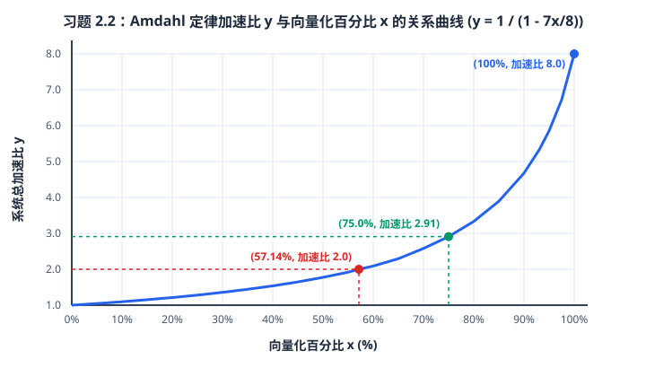

**(2) 加速比达到 2 时的向量化百分比与时间占比**：
- 令 $y = 2$，即：
  $$\frac{1}{1 - \frac{7}{8}x} = 2 \implies 1 - \frac{7}{8}x = \frac{1}{2} \implies x = \frac{4}{7} \approx 57.14\%$$
- 设原标量总运行时间为 $1$，则优化后的总运行时间为 $(1 - x) + \frac{x}{8} = \frac{1}{2}$，其中向量模式运行时间为 $\frac{x}{8} = \frac{4/7}{8} = \frac{1}{14}$。
  因此，向量模式运行时间占总运行时间的百分比为：
  $$\frac{1/14}{1/2} = \frac{1}{7} \approx 14.29\%$$

**(3) 硬件加速一倍 vs. 编译器提升向量化比例**：
- **方法一（硬件向量速度提高一倍，即 $k' = 16$，$x = 70\%$）**：
  $$y_{\text{硬件}} = \frac{1}{(1 - 0.7) + \frac{0.7}{16}} = \frac{1}{0.3 + 0.04375} = \frac{1}{0.34375} = \frac{32}{11} \approx 2.909$$
- **方法二（保持 $k = 8$，将向量化百分比提高到 $x'$）**：
  令 $\frac{1}{(1 - x') + \frac{x'}{8}} = \frac{32}{11}$，即：
  $$1 - \frac{7}{8}x' = \frac{11}{32} \implies \frac{7}{8}x' = \frac{21}{32} \implies x' = \frac{3}{4} = 75\%$$
  因此，只需将向量化百分比从 $70\%$ **提升 $5\%$（达到 $75\%$）**，即可获得与向量部件速度翻倍完全相同的性能！
- **方案推荐**：**推荐第二种方案（改进编译器提高向量化百分比）**。原因：将硬件向量部件速度提高一倍需要显著增加芯片面积、功耗和设计复杂度，而通过改进编译器仅需提升 $5\%$ 的向量化比例，硬件零额外面积/功耗成本，性价比高得多。

---

### 习题 2.3
**题目**：假设有一个代表典型应用的基准测试程序。一款不包含浮点部件的处理器（可以通过整数指令来模拟浮点指令）运行该基准程序的运行速度是 $120\text{ MIPS}$，在该处理器上增加浮点协处理器后运行该基准程序的运行速度是 $80\text{ MIPS}$。下面给出了一些参数：$I$——基准测试中整数指令的数目；$F$——基准测试中浮点指令的数目；$Y$——模拟一条浮点指令需要的整数指令的数目；$W$——无浮点协处理器时基准程序的运行时间；$B$——有浮点协处理器时基准程序的运行时间。
- **(1)** 用上面的参数符号表示出两种配置处理器的 MIPS 值。
- **(2)** 在没有协处理器的配置下，假定 $F = 8 \times 10^6, Y = 50, W = 4\text{ s}$，求 $I$ 的值。
- **(3)** 在上述条件下，求 $B$ 的值。
- **(4)** 在包含协处理器的配置下，系统的 MFLOPS 是多少？
- **(5)** 你的同事想要购买这种协处理器来提高性能，而该配置下 MIPS 降低了，请问他的决策正确吗？解释你的观点。
**解答与解析**：
**(1) 两种配置下的 MIPS 表达式**：
- 无浮点协处理器（软件模拟）时，实际执行的整数指令总数为 $I + F \times Y$，运行时间为 $W$：
  $$\text{MIPS}_{\text{无协处理器}} = \frac{I + F \times Y}{W \times 10^6}$$
- 有浮点协处理器时，实际执行的指令总数为 $I + F$，运行时间为 $B$：
  $$\text{MIPS}_{\text{有协处理器}} = \frac{I + F}{B \times 10^6}$$

**(2) 求整数指令数 $I$**：
已知 $\text{MIPS}_{\text{无协处理器}} = 120, F = 8 \times 10^6, Y = 50, W = 4\text{ s}$，代入公式：
$$120 = \frac{I + 8 \times 10^6 \times 50}{4 \times 10^6} \implies 4.8 \times 10^8 = I + 4.0 \times 10^8 \implies I = 8 \times 10^7 = 80 \times 10^6$$

**(3) 求有协处理器时的运行时间 $B$**：
已知 $\text{MIPS}_{\text{有协处理器}} = 80$，代入 $I = 80 \times 10^6, F = 8 \times 10^6$：
$$80 = \frac{80 \times 10^6 + 8 \times 10^6}{B \times 10^6} = \frac{88}{B} \implies B = 1.1\text{ s}$$

**(4) 求包含协处理器配置下的 MFLOPS**：
> **【计算口径说明】**：MFLOPS（每秒百万次浮点运算）有两种常见计算口径，考试中建议同时写出：
- **口径一（教材标准定义：浮点操作总数除以程序总执行时间 $B$）**：
  $$\text{MFLOPS} = \frac{F}{B \times 10^6} = \frac{8 \times 10^6}{1.1 \times 10^6} \approx 7.27\text{ MFLOPS}$$
- **口径二（按浮点指令单独占用的执行时间 $T_{\text{FP}}$ 计算）**：
  无协处理器时每条整数指令耗时 $\frac{W}{I + F \cdot Y} = \frac{4}{480 \times 10^6}\text{ s}$，因此 $I = 80 \times 10^6$ 条整数指令耗时 $T_{\text{Int}} = 4 \times \frac{80}{480} = \frac{2}{3}\text{ s} \approx 0.667\text{ s}$。
  有协处理器时浮点指令占用时间 $T_{\text{FP}} = B - T_{\text{Int}} = 1.1 - \frac{2}{3} = \frac{13}{30}\text{ s} \approx 0.433\text{ s}$，于是：
  $$\text{MFLOPS}_{\text{仅浮点时段}} = \frac{8 \times 10^6}{(13/30) \times 10^6} = \frac{240}{13} \approx 18.46\text{ MFLOPS}$$

**(5) 决策评价**：
- **结论**：同事购买协处理器的**决策完全正确**。
- **原因**：增加浮点协处理器后，虽然 MIPS 从 $120$ 降到了 $80$，那是因为原来需要 $50$ 条简单整数指令模拟的工作现在只需 $1$ 条浮点指令即可完成，导致总指令条数从 $4.8 \times 10^8$ 大幅减少到 $8.8 \times 10^7$；而程序的**实际运行时间从 $W = 4\text{ s}$ 缩短到了 $B = 1.1\text{ s}$**，性能提升了 $\frac{4}{1.1} \approx 3.64$ 倍。这也再次证明 MIPS 不能用于比较指令集不同的机器性能，总执行时间才是唯一金标准。

---

### 习题 2.4（闭卷笔试改编：晶圆切割数、晶片成品率与单个合格晶片成本计算）
**题目**：假设晶片成品率的经验公式如下：$\text{晶片成品率} = (1 + b \times \text{晶片面积} / a)^{-a}$，其中 $a = 4$ 是衡量工艺复杂度的参数。
- **(1)** 假设采用 $12$ 英寸（直径 $d = 30\text{ cm}$）的晶圆，每平方厘米晶圆的成本为 $c$，缺陷密度 $b = 0.6/\text{cm}^2$，请写出每片晶圆可切割的晶片数（DPW）公式及单个合格晶片的成本表达式，并计算当晶片面积 $S$ 为 $0.5\text{ cm}^2, 1.0\text{ cm}^2, 2.0\text{ cm}^2, 4.0\text{ cm}^2$ 时的晶片成品率与单个合格晶片成本，分析晶片成本与面积 $S$ 的阶数关系。
- **(2)** 假设缺陷密度更高，$b = 2.0/\text{cm}^2$，写出单个合格晶片成本关于晶片面积 $S$ 的理论多项式表达式，并计算 $S = 1.0\text{ cm}^2$ 和 $2.0\text{ cm}^2$ 时的成本。
**解答与解析**：
1. **核心公式（教材第 2.9 节式 2.1 ~ 2.3）**：
   - **每片晶圆可切割的毛坯晶片数（Dies Per Wafer, DPW，计入晶圆圆形边缘损耗）**：
     $$\text{DPW} = \frac{\pi \times (d / 2)^2}{S} - \frac{\pi \times d}{\sqrt{2 S}} = \frac{225\pi}{S} - \frac{30\pi}{\sqrt{2S}} \approx \frac{706.86}{S} - \frac{66.64}{\sqrt{S}}$$
   - **晶片成品率（Die Yield，设晶圆良率为 $100\%$，$a = 4$）**：
     $$\text{Yield}(S) = \left(1 + \frac{b \cdot S}{a}\right)^{-a} = \left(1 + \frac{b}{4}S\right)^{-4}$$
   - **单个合格晶片的成本 $y(S)$**：
     - **精确计入边缘损耗时**：整片晶圆总成本 $C_{\text{wafer}} = c \cdot \pi (d/2)^2 = 225\pi c \approx 706.86 c$，则：
       $$y_{\text{exact}}(S) = \frac{C_{\text{wafer}}}{\text{DPW} \times \text{Yield}(S)} = \frac{225\pi c}{\left(\frac{225\pi}{S} - \frac{30\pi}{\sqrt{2S}}\right)} \cdot \left(1 + \frac{b}{4}S\right)^4$$
     - **忽略晶圆边缘损耗（当 $d \gg \sqrt{S}$ 时，$\text{单个毛坯成本} \approx c \cdot S$）**：
       $$y(S) = \frac{c \cdot S}{\text{Yield}(S)} = c \cdot S \cdot \left(1 + \frac{b}{4}S\right)^4 = c \left( S + b S^2 + \frac{3}{8}b^2 S^3 + \frac{1}{16}b^3 S^4 + \frac{1}{256}b^4 S^5 \right)$$
       **重要结论**：当 $a = 4$ 时，单个合格晶片的成本随晶片面积 $S$ 呈 **$a + 1 = 5$ 次多项式（高次超线性）** 急剧增长！

**(1) 当 $b = 0.6/\text{cm}^2, a = 4$ 时的成品率与晶片成本计算**：
此时 $\text{Yield}(S) = (1 + 0.15 S)^{-4}$，单个合格晶片成本 $y(S) = c \cdot S \cdot (1 + 0.15 S)^4$：

| 晶片面积 $S\ (\text{cm}^2)$ | 每片晶圆毛坯数 $\text{DPW}$ | 晶片成品率 $(1+0.15S)^{-4}$ | 每片晶圆合格芯片数 | 单个合格晶片成本（忽略边缘：$c \cdot S / \text{Yield}$） | 单个合格晶片成本（计入边缘：$C_{\text{wafer}} / (\text{DPW}\cdot\text{Yield})$） |
| :---: | :---: | :---: | :---: | :---: | :---: |
| **$0.5$** | $1319$ | **$74.88\%$** | $988$ | **$0.668 c$** | **$0.715 c$** |
| **$1.0$** | $640$ | **$57.18\%$** | $366$ | **$1.749 c$** | **$1.931 c$** |
| **$2.0$** | $306$ | **$34.98\%$** | $107$ | **$5.717 c$** | **$6.606 c$** |
| **$4.0$** | $143$ | **$15.26\%$** | $21.8$ | **$26.214 c$** | **$32.42 c$** |

- **规律分析**：当晶片面积从 $1.0\text{ cm}^2$ 增大为 $4.0\text{ cm}^2$（面积仅增大 **4 倍**）时，由于成品率从 $57.18\%$ 暴跌至 $15.26\%$，单个合格晶片的成本从 $1.75c$ 飙升至 $26.21c$（成本增大了 **$15$ 倍**，计入边缘损耗则增大 **$16.8$ 倍**）！

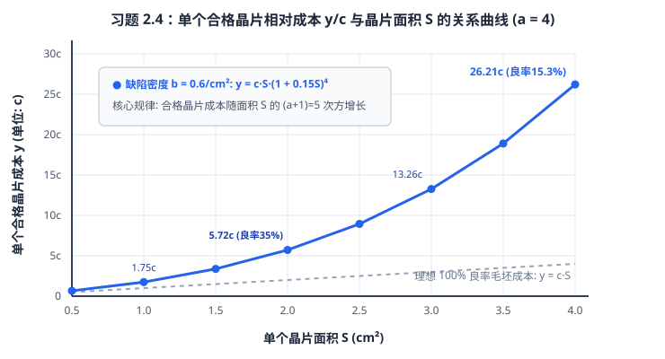

**(2) 当缺陷密度 $b = 2.0/\text{cm}^2, a = 4$ 时的成本多项式与计算**：
- 代入 $b = 2.0, a = 4$，得 $\text{Yield}(S) = (1 + 0.5 S)^{-4}$，单个合格晶片成本的理论多项式为：
  $$y(S) = c \cdot S \cdot (1 + 0.5 S)^4 = c \left( S + 2 S^2 + 1.5 S^3 + 0.5 S^4 + 0.0625 S^5 \right)$$
- 当 **$S = 1.0\text{ cm}^2$** 时：成品率 $\text{Yield} = (1.5)^{-4} = \frac{16}{81} \approx 19.75\%$，单个合格晶片成本 $y(1.0) = \frac{81}{16}c \approx \mathbf{5.063 c}$（计入边缘损耗为 $5.59 c$）。
- 当 **$S = 2.0\text{ cm}^2$** 时：成品率 $\text{Yield} = (1 + 1)^{-4} = 2^{-4} = 6.25\%$，单个合格晶片成本 $y(2.0) = c \cdot 2 \cdot 2^4 = \mathbf{32.0 c}$（计入边缘损耗为 $36.96 c$）。

---

### 习题 2.5
**题目**：对某处理器进行功耗测试，得到如下数据：时钟不翻转，电压 $1.05\text{ V}$ 时，电流为 $500\text{ mA}$；时钟频率为 $1\text{ GHz}$，电压 $1.1\text{ V}$ 时，电流为 $2500\text{ mA}$。请计算在 $1.1\text{ V}$ 下，此处理器的静态功耗以及 $500\text{ MHz}$ 下的总功耗。
**解答与解析**：
1. **计算 $1.1\text{ V}$ 下的静态功耗 $P_{\text{static}}$**：
   - 时钟不翻转时，处理器无动态开关功耗，全部为静态漏电功耗。将芯片静态漏电等效为电阻 $R$：
     $$R = \frac{V_1}{I_{\text{static}, 1}} = \frac{1.05\text{ V}}{0.5\text{ A}} = 2.1\ \Omega$$
   - 当电压升高到 $V_2 = 1.1\text{ V}$ 时，静态电流为 $I_{\text{static}, 2} = \frac{1.1}{2.1}\text{ A}$，因此 $1.1\text{ V}$ 下的静态功耗为：
     $$P_{\text{static}}(1.1\text{ V}) = \frac{V_2^2}{R} = \frac{1.1^2}{2.1} = \frac{1.21}{2.1} \approx 0.576\text{ W}$$
     *(注：若假定静态漏电流近似恒定为 $500\text{ mA}$，则 $P_{\text{static}} = 1.1 \times 0.5 = 0.55\text{ W}$；课程标准答案按等效电阻模型取 $0.576\text{ W}$)*。
2. **计算 $1.1\text{ V}$、$1\text{ GHz}$ 下的动态功耗 $P_{\text{dynamic}}(1\text{ GHz})$**：
   - $1.1\text{ V}$、$1\text{ GHz}$ 下的总功耗为：
     $$P_{\text{total}}(1\text{ GHz}) = V_2 \times I_{\text{total}} = 1.1\text{ V} \times 2.5\text{ A} = 2.75\text{ W}$$
   - 故 $1\text{ GHz}$ 下的动态功耗为：
     $$P_{\text{dynamic}}(1\text{ GHz}) = P_{\text{total}}(1\text{ GHz}) - P_{\text{static}}(1.1\text{ V}) = 2.75 - 0.576 = 2.174\text{ W}$$
3. **计算 $1.1\text{ V}$、$500\text{ MHz}$ 下的总功耗**：
   - 动态功耗 $P_{\text{dynamic}} = C V^2 f$ 与时钟频率 $f$ 成正比。当电压保持 $1.1\text{ V}$、频率降为 $500\text{ MHz} = 0.5\text{ GHz}$ 时，动态功耗减半：
     $$P_{\text{dynamic}}(500\text{ MHz}) = 2.174 \times \frac{0.5\text{ GHz}}{1.0\text{ GHz}} = 1.087\text{ W}$$
   - 因此，$1.1\text{ V}$、$500\text{ MHz}$ 下的总功耗为：
     $$P_{\text{total}}(500\text{ MHz}) = P_{\text{static}}(1.1\text{ V}) + P_{\text{dynamic}}(500\text{ MHz}) = 0.576 + 1.087 = 1.663\text{ W}$$

---

### 习题 2.6
**题目**：证明以下结论：
- **(1)** $N$ 个正数的几何平均小于等于算术平均。
- **(2)** 用归一化的 SPEC CPU 2000 程序分值进行 A、B 两台计算机的性能比较与所使用的参考机无关。
**解答与解析**：
**(1) 证明均值不等式（Cauchy 反向归纳法）**：
设 $a_1, a_2, \dots, a_N > 0$，欲证：
$$\frac{a_1 + a_2 + \dots + a_N}{N} \ge \sqrt[N]{a_1 a_2 \cdots a_N}$$
- **第一步**：先用数学归纳法证明当 $N = 2^k\ (k \ge 1)$ 时成立：
  - 当 $k = 1\ (N = 2)$ 时，$\frac{a_1 + a_2}{2} - \sqrt{a_1 a_2} = \frac{(\sqrt{a_1} - \sqrt{a_2})^2}{2} \ge 0$，显然成立。
  - 假设当 $N = 2^{k-1}$ 时结论成立，则当 $N = 2^k$ 时，将 $2^k$ 个正数分为前后两组（各 $m = 2^{k-1}$ 个数）：
    $$\frac{\sum_{i=1}^{2^k} a_i}{2^k} = \frac{1}{2} \left( \frac{\sum_{i=1}^{m} a_i}{m} + \frac{\sum_{i=m+1}^{2m} a_i}{m} \right) \ge \sqrt{ \left(\frac{\sum_{i=1}^{m} a_i}{m}\right) \left(\frac{\sum_{i=m+1}^{2m} a_i}{m}\right) } \ge \sqrt{ \sqrt[m]{\prod_{i=1}^{m} a_i} \cdot \sqrt[m]{\prod_{i=m+1}^{2m} a_i} } = \sqrt[2^k]{\prod_{i=1}^{2^k} a_i}$$
    故对任意 $N = 2^k$ 均成立。
- **第二步**：当 $2^{k-1} < N < 2^k$ 时，令这 $N$ 个正数的算术平均值为 $A = \frac{a_1 + a_2 + \dots + a_N}{N}$。
  构造 $2^k$ 个正数：$a_1, a_2, \dots, a_N, \underbrace{A, A, \dots, A}_{2^k - N \text{ 个}}$。对这 $2^k$ 个正数应用第一步结论：
  $$\frac{a_1 + \dots + a_N + (2^k - N)A}{2^k} \ge \sqrt[2^k]{a_1 a_2 \cdots a_N \cdot A^{2^k - N}}$$
  注意左边分子恰为 $N \cdot A + (2^k - N)A = 2^k A$，故左边 $= A$。两边同时取 $2^k$ 次方得：
  $$A^{2^k} \ge (a_1 a_2 \cdots a_N) \cdot A^{2^k - N} \implies A^N \ge a_1 a_2 \cdots a_N \implies A \ge \sqrt[N]{a_1 a_2 \cdots a_N}$$
  证毕。

**(2) 证明采用几何平均的归一化 SPEC 分值之比与参考机无关**：
设 SPEC CPU 2000 共有 $n$ 个测试程序。
- 设参考机（Reference Machine）在各程序上的运行时间（或基准分值）为 $Z = \{z_1, z_2, \dots, z_n\}$；
- A 机和 B 机在各程序上的成绩分别为 $X = \{x_1, x_2, \dots, x_n\}$ 和 $Y = \{y_1, y_2, \dots, y_n\}$。
- SPEC 采用相对于参考机归一化后的**几何平均值**作为机器的总分：
  $$\text{SPEC}_A = \sqrt[n]{\prod_{i=1}^{n} \frac{x_i}{z_i}} = \frac{\sqrt[n]{x_1 x_2 \cdots x_n}}{\sqrt[n]{z_1 z_2 \cdots z_n}}, \quad \text{SPEC}_B = \sqrt[n]{\prod_{i=1}^{n} \frac{y_i}{z_i}} = \frac{\sqrt[n]{y_1 y_2 \cdots y_n}}{\sqrt[n]{z_1 z_2 \cdots z_n}}$$
- A、B 两台机器的综合性能之比为：
  $$\frac{\text{SPEC}_A}{\text{SPEC}_B} = \frac{\frac{\sqrt[n]{x_1 x_2 \cdots x_n}}{\sqrt[n]{z_1 z_2 \cdots z_n}}}{\frac{\sqrt[n]{y_1 y_2 \cdots y_n}}{\sqrt[n]{z_1 z_2 \cdots z_n}}} = \sqrt[n]{\frac{x_1 x_2 \cdots x_n}{y_1 y_2 \cdots y_n}}$$
  该比值中参考机的参数 $z_1, \dots, z_n$ 被完全约去，说明用几何平均计算的归一化性能比与所选的参考机无关。证毕。

---

### 习题 2.7 & 2.8(1)（闭卷笔试改编：冯·诺依曼结构特点、处理器浮点峰值计算与存储层次参数权衡）
**题目**：试讨论冯·诺依曼结构的主要特点。
- **(1)** 假设某 4 核处理器（如 Intel Core i7 / AMD Opteron）主频为 $2.8\text{ GHz}$，每个处理器核每拍可同时执行 1 条 128 位 SSE 双精度浮点乘法指令和 1 条 128 位 SSE 双精度浮点加法指令；配备三通道 DDR3-1333 内存（每个通道位宽 64 bit，传输速率 $1333\text{ MT/s}$）。请计算该处理器的双精度浮点运算峰值（GFLOPS）和主存理论峰值访存带宽（GB/s）。
- **(2)** 分析处理器的访存带宽与多级存储层次参数（一级 Cache 大小和延迟、二级/三级 Cache 大小和延迟）之间的设计权衡关系。
**解答与解析**：
**冯·诺依曼结构的主要特点**：
1. 计算机由运算器、控制器、存储器、输入设备和输出设备五大基本部件组成；
2. **存储程序（Stored-Program）原理**：指令和数据以同等地位存放在同一个存储器中，均以二进制形式表示，按地址寻址；
3. 指令由操作码和地址码组成，在存储器中按顺序存放，由程序计数器（PC）指明要执行的指令地址，默认按顺序执行，遇到转移指令时改变执行流；
4. 机器以运算器（现代为处理器 CPU）为中心，而现代冯·诺依曼结构计算机的最大瓶颈是**“冯·诺依曼瓶颈（存储墙）”**，即 CPU 运算速度远快于主存访问速度，必须依靠多级 Cache 存储层次和分支预测来持续“喂饱”饥饿的 CPU。

**(1) 处理器浮点运算峰值与主存理论带宽计算公式**：
- **双精度浮点运算峰值（GFLOPS）**：
  - 每个双精度浮点数占 $64\text{ bits}$，故一条 128 位 SSE 浮点指令每次可并行完成 $128 / 64 = 2$ 次双精度浮点运算；
  - 每个核每拍可同时执行 1 条 128 位乘法 + 1 条 128 位加法 $= 2 + 2 = 4\text{ FLOPs/cycle}$；
  - 4 核 $2.8\text{ GHz}$ 处理器的双精度浮点峰值为：
    $$\text{Peak GFLOPS} = \text{核数} \times \text{主频} \times \text{每核每拍浮点操作数} = 4 \times 2.8\text{ GHz} \times 4 = \mathbf{44.8\text{ GFLOPS}}$$
    *(若为单精度 32-bit 浮点，则每核每拍完成 $4 + 4 = 8$ 次运算，单精度峰值为 $89.6\text{ GFLOPS}$)*。
- **主存理论峰值访存带宽（GB/s）**：
  $$\text{Memory Bandwidth} = \text{通道数} \times \text{每通道位宽 (Bytes)} \times \text{传输速率} = 3 \times \left(\frac{64}{8}\text{ B}\right) \times 1.333\text{ GT/s} \approx \mathbf{31.99\text{ GB/s}}$$

**(2) 访存带宽与多级 Cache 存储层次参数之间的设计关系**：
1. **峰值计算能力与主存带宽的巨大剪刀差**：
   - 上述处理器每秒可执行 $4.48 \times 10^{10}$ 次双精度浮点运算（每次运算涉及 8 字节操作数），若无 Cache，每秒需要数百 $\text{GB/s}$ 的数据带宽，而主存带宽仅有约 $32\text{ GB/s}$（平均每执行 1 次双精度运算，主存只能供给约 $0.7\text{ Byte}$ 数据）。
2. **各级 Cache 容量与延迟的协同权衡**：
   - **一级 Cache（L1I / L1D，典型为 $32\text{ KB}\sim 64\text{ KB}$，延迟 2~4 拍）**：直接面向高速超标量执行核心，首要目标是**极低的命中延迟和极高的访存带宽**（支持每拍 1~2 次 128 位读写），为此必须限制容量和相联度以保证能在 2~4 拍内完成地址索引与数据读出。
   - **二级 Cache（L2，典型为 $256\text{ KB}\sim 512\text{ KB}$，延迟 10~12 拍）**：作为 L1 缺失后的高速缓冲，兼顾较低的命中延迟（约 10 拍）与中等容量，过滤掉绝大多数 L1 容量/冲突缺失。
   - **三级共享 Cache（L3 / LLC，典型为 $4\text{ MB}\sim 16\text{ MB}$，延迟 30~40 拍）**：首要目标是**大幅降低主存缺失率以减轻有限片外内存带宽的压力**，同时作为多核间共享数据与维护 Cache 一致性的枢纽。

---

## 第3章 二进制与逻辑电路

### 习题 3.1
**题目**：定点数的表示：
- **(1)** 分别给出 64 位定点原码和补码表示的数的范围；
- **(2)** 在 32 位定点补码表示中，`0x80000000` 表示什么数？
**解答与解析**：
**(1) 64 位定点原码和补码的表示范围**：
- **64 位定点原码**：最高位为符号位，低 63 位为数值位，正负对称（存在 $+0$ 和 $-0$），表示范围为：
  $$\left[ -(2^{63} - 1),\ 2^{63} - 1 \right] \quad (\text{即 } -9223372036854775807 \sim +9223372036854775807)$$
- **64 位定点补码**：最高位权值为 $-2^{63}$，编码 `0x8000000000000000` 表示 $-2^{63}$，故表示范围为：
  $$\left[ -2^{63},\ 2^{63} - 1 \right] \quad (\text{即 } -9223372036854775808 \sim +9223372036854775807)$$

**(2) 32 位定点补码中 `0x80000000` 表示的数**：
- 在 32 位定点补码中，最高位（第 31 位）为 $1$，其余 31 位全为 $0$，其权值为 $-2^{31}$，因此它表示 32 位有符号整数的最小值：
  $$-2^{31} = -2147483648$$

---

### 习题 3.2
**题目**：按照以下要求将浮点数表示出来。
- **(1)** 把单精度数转化为十进制数：`0x7ff0000`, `0xbe400000`, `0xff800000`。
- **(2)** 把双精度数转化为十进制数：`0x4035000000000000`, `0x8008000000000000`。
- **(3)** 把十进制数转化为单精度数：`−100.0`, `0.25`。
- **(4)** 把十进制数转化为双精度数：`1024.0`, `0.25`。
**解答与解析**：
**(1) 单精度浮点数（32 位：1 位符号 $s$ + 8 位阶码 $e$（偏移 $127$）+ 23 位尾数 $f$）转十进制**：
- **`0x7ff0000`**：
  > **【题干说明】**：教材题干此处只印了 7 位十六进制数 `0x7ff0000`，可能为前导零省略 `0x07ff0000` 或末尾零漏印 `0x7ff00000`，以下将两种情况均列出：
  - **情况 A（按前导零省略 `0x07ff0000` 计算）**：
    二进制为 `0_00001111_11111110000000000000000`。
    - 符号位 $s = 0$；
    - 阶码 $e = 00001111_2 = 15$，真实指数 $E = 15 - 127 = -112$；
    - 尾数 $1.f = 1.1111111_2 = 1 + \frac{127}{128} = \frac{255}{128} = 1.9921875$；
    - 十进制值 $= +1.9921875 \times 2^{-112} \approx 3.83681356 \times 10^{-34}$。
  - **情况 B（按末尾漏印一个 0 即 `0x7ff00000` 计算）**：
    二进制为 `0_11111111_11100000000000000000000`。
    - 阶码 $e = 255$，尾数 $f \neq 0$（且最高位为 $1$），根据教材表 3.3，表示 **Signaling NaN（或 Quiet NaN，非数）**。
- **`0xbe400000`**：
  - 二进制：`1_01111100_10000000000000000000000`。
  - $s = 1$（负数）；阶码 $e = 01111100_2 = 124$，指数 $E = 124 - 127 = -3$；
  - 尾数 $1.f = 1.1_2 = 1.5$；
  - 十进制值 $= -1.5 \times 2^{-3} = -\frac{3}{16} = -0.1875$。
- **`0xff800000`**：
  - 二进制：`1_11111111_00000000000000000000000`。
  - $s = 1$；阶码 $e = 255$（全 1），尾数 $f = 0$（全 0）；
  - 表示**负无穷大（$-\infty$）**。

**(2) 双精度浮点数（64 位：1 位符号 $s$ + 11 位阶码 $e$（偏移 $1023$）+ 52 位尾数 $f$）转十进制**：
- **`0x4035000000000000`**：
  - 二进制：`0_10000000011_01010000...0`。
  - $s = 0$；阶码 $e = 10000000011_2 = 1024 + 3 = 1027$，指数 $E = 1027 - 1023 = 4$；
  - 尾数 $1.f = 1.0101_2 = 1 + \frac{1}{4} + \frac{1}{16} = \frac{21}{16} = 1.3125$；
  - 十进制值 $= +1.3125 \times 2^4 = 21.0$。
- **`0x8008000000000000`**：
  - 二进制：`1_00000000000_10000000...0`。
  - $s = 1$；阶码 $e = 0$（全 0），尾数 $f = 1000\dots 0_2 \neq 0$，故为**非规格化浮点数**（指数固定为 $1 - 1023 = -1022$，隐藏整数位为 $0$）；
  - 尾数 $0.f = 0.1_2 = 2^{-1}$；
  - 十进制值 $= -0.1_2 \times 2^{-1022} = -2^{-1023} \approx -1.11253693 \times 10^{-308}$。

**(3) 十进制数转单精度浮点数**：
- **`-100.0`**：
  - $-100.0 = -1100100.0_2 = -1.100100_2 \times 2^6$；
  - $s = 1$；$e = 6 + 127 = 133 = 10000101_2$；$f = 10010000000000000000000_2$；
  - 二进制：`1_10000101_10010000000000000000000`，十六进制为 **`0xC2C80000`**。
- **`0.25`**：
  - $0.25 = 2^{-2} = 1.0_2 \times 2^{-2}$；
  - $s = 0$；$e = -2 + 127 = 125 = 01111101_2$；$f = 000\dots 0_2$；
  - 二进制：`0_01111101_00000000000000000000000`，十六进制为 **`0x3E800000`**。

**(4) 十进制数转双精度浮点数**：
- **`1024.0`**：
  - $1024.0 = 1.0_2 \times 2^{10}$；
  - $s = 0$；$e = 10 + 1023 = 1033 = 10000001001_2$；$f = 0$（52 位全 0）；
  - 二进制：`0_10000001001_0000...0`，十六进制为 **`0x4090000000000000`**。
- **`0.25`**：
  - $0.25 = 1.0_2 \times 2^{-2}$；
  - $s = 0$；$e = -2 + 1023 = 1021 = 01111111101_2$；$f = 0$（52 位全 0）；
  - 二进制：`0_01111111101_0000...0`，十六进制为 **`0x3FD0000000000000`**。

---

### 习题 3.3
**题目**：画出 $e = a \ \&\ b \mid c \ \&\ d$ 的晶体管级电路图。
**解答与解析**：
由于基本静态 CMOS 复合门（AOI，与或非门）只能直接实现反相逻辑（因为 PMOS 接电源 $V_{DD}$ 传强 1，NMOS 接地 $GND$ 传强 0），因此实现 $e = ab + cd$ 有以下两种标准晶体管级方案：

#### 方案一：与或非门（AOI22）+ 反相器（共 10 个晶体管，教材推荐方案）
先用 1 个 4 输入与或非门（AOI22）实现 $\bar{e} = \overline{a \cdot b + c \cdot d}$，再用 1 个反相器取反得到 $e = \overline{\bar{e}}$：
- **第一级（AOI22，输出 $\bar{e}$）**：
  - **下拉网络（NMOS，导通条件 $ab + cd = 1$）**：管 $N_a, N_b$ 串联成支路 1，管 $N_c, N_d$ 串联成支路 2，两条支路**并联**在输出节点 $\bar{e}$ 与 $GND$ 之间。
  - **上拉网络（PMOS，导通条件 $(\bar{a}+\bar{b})(\bar{c}+\bar{d}) = 1$）**：管 $P_a, P_b$ 并联成组 1，管 $P_c, P_d$ 并联成组 2，两组**串联**在 $V_{DD}$ 与输出节点 $\bar{e}$ 之间。
- **第二级（CMOS 反相器，输出 $e$）**：1 个 PMOS 和 1 个 NMOS 将 $\bar{e}$ 反相得到 $e$。

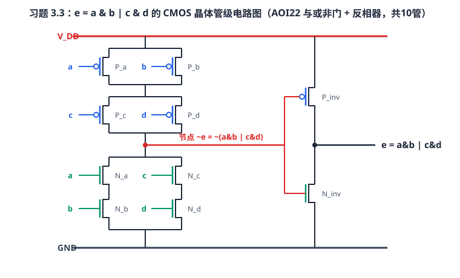

#### 方案二：两级 2 输入与非门（NAND2）实现（共 12 个晶体管）
利用德·摩根定律：$e = a b + c d = \overline{\overline{a b} \cdot \overline{c d}}$，用 3 个二输入与非门（每个与非门由 2 个并联 PMOS 和 2 个串联 NMOS 组成）搭成两级与非结构：

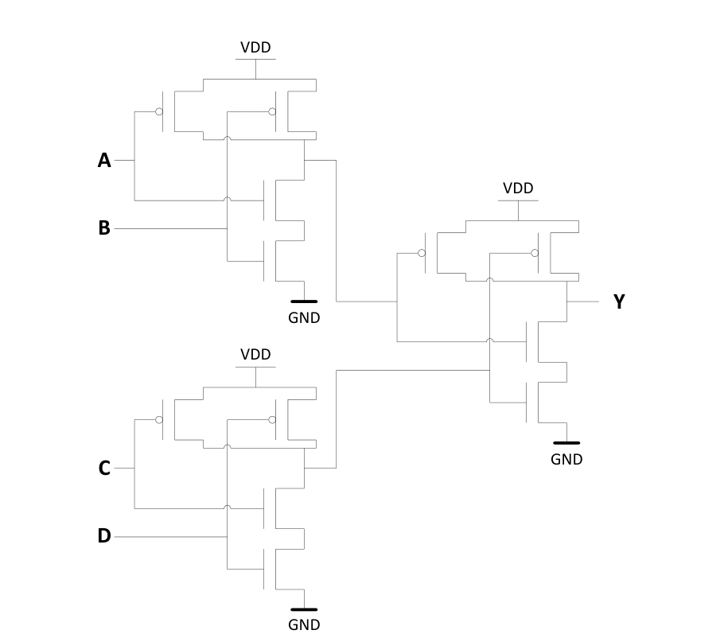

---

### 习题 3.4
**题目**：计算一个 FO4 的延迟，假设反相器的输入电容为 $0.0036\text{ pF}$，平均每个负载连线电容为 $0.0044\text{ pF}$，翻转延迟为 $0.023\text{ ns}$，每 $\text{pF}$ 延迟为 $4.5\text{ ns}$。
**解答与解析**：
- **FO4（Fan-out of 4）** 是指 1 个反相器驱动 4 个相同大小的反相器时的延迟。
- 根据教材 3.3.3 节公式：
  $$\text{门延迟} = \text{本征翻转延迟} + \text{每 pF 驱动延迟系数} \times C_{\text{load}}$$
- **计算负载电容 $C_{\text{load}}$**：
  - 驱动 4 个反相器，每个负载反相器具有输入电容 $C_{\text{in}} = 0.0036\text{ pF}$ 和负载连线电容 $C_{\text{wire}} = 0.0044\text{ pF}$：
    $$C_{\text{load}} = 4 \times (0.0036 + 0.0044)\text{ pF} = 4 \times 0.0080\text{ pF} = 0.032\text{ pF}$$
  - 代入延迟公式得：
    $$T_{\text{FO4}} = 0.023\text{ ns} + 4.5\text{ ns/pF} \times 0.032\text{ pF} = 0.023 + 0.144 = 0.167\text{ ns}$$
    *(注：若按“整条连线总电容为 $0.0044\text{ pF}$、仅输入电容乘以 4”理解，则 $C_{\text{load}} = 0.0044 + 4 \times 0.0036 = 0.0188\text{ pF}$，$T_{\text{FO4}} = 0.023 + 4.5 \times 0.0188 = 0.1076\text{ ns}$；课程标准答案按“每个负载连线电容均为 $0.0044\text{ pF}$”计，结果为 **$0.167\text{ ns}$**)*。

---

### 习题 3.5
**题目**：分析附图 3.1 的 CMOS EDFF 触发器（边沿触发的 CMOS D 触发器）的建立时间、保持时间和 $\text{CLK} \to Q$ 延迟。假设反相器的延迟为 $1\text{ ns}$，传输门从源到漏（或从漏到源）的延迟为 $0.5\text{ ns}$，传输门从栅到漏（或源）的延迟为 $0.75\text{ ns}$，不考虑由于 latch 的 fight 对反相器延迟的影响。

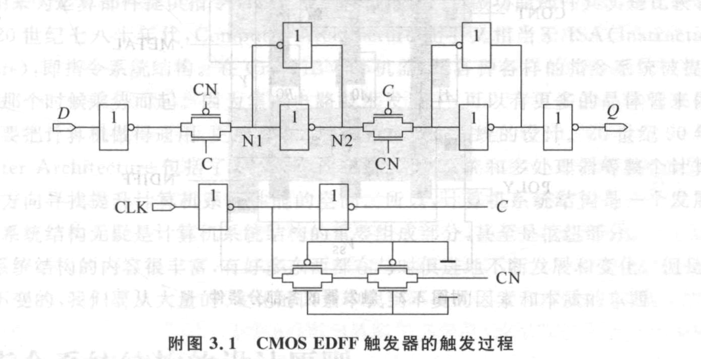
**解答与解析**：
首先明确附图 3.1 电路结构（拆分为时钟通路与主从数据锁存通路，见下图）：

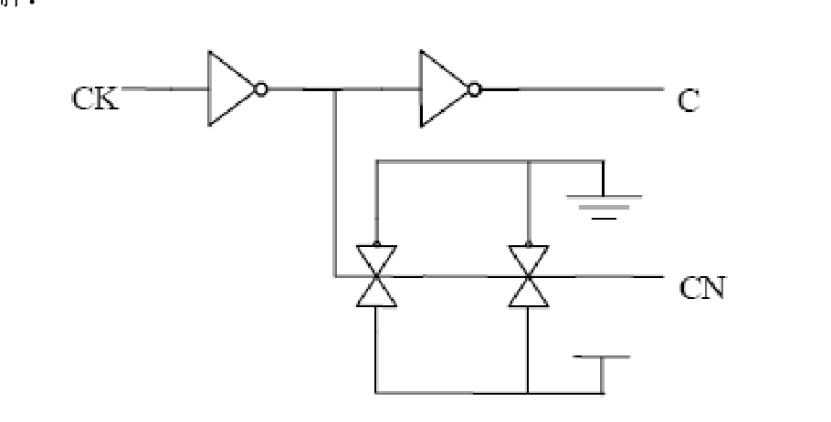

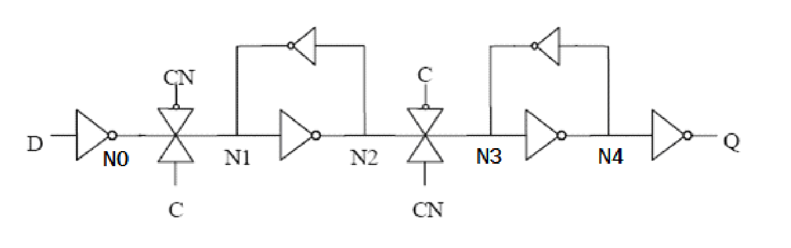
- **时钟生成通路**：输入 `CLK` 经过第 1 个反相器生成 `CN`，再分两路：一路经过第 2 个反相器生成 `C`（因此 `C` 与 `CLK` 同相，`CN` 与 `CLK` 反相）；另一路在底部经过一个常通传输门平衡延迟（使 $T_{\text{CLK}\to C} = 1 + 1 = 2\text{ ns}$，$T_{\text{CLK}\to CN} = 1 + 0.5 + 0.5 = 2\text{ ns}$，两者严格同步，均为 $2\text{ ns}$）。
- **主锁存器（Master Latch，左半部分）**：输入 $D$ 经过输入反相器 $I_0$（延迟 $1\text{ ns}$）到达主传输门 $TG_1$（PMOS 栅接 $C$，NMOS 栅接 $CN$，故当 $C=0, CN=1$ 即 `CLK=0` 时导通；当 $C$ 从 $0 \to 1$ 即 `CLK` 上升沿时关断；注：若将附图 3.1 中气泡画法视作 `CLK` 下降沿关断，延时数值完全相同）。$TG_1$ 输出至节点 $N_1$，经反相器 $I_1$（$1\text{ ns}$）到节点 $N_2$，反馈路径经反馈反相器 $I_2$（$1\text{ ns}$）和反馈传输门回到 $N_1$。
- **从锁存器（Slave Latch，右半部分）**：节点 $N_2$ 经从传输门 $TG_2$（与 $TG_1$ 相位相反，在触发沿到来时导通）到达节点 $N_3$，再经反相器 $I_3$（$1\text{ ns}$）输出至 $Q$。

下面给出**两种标准计算口径**（两者区别仅在于是否把芯片内部的时钟缓冲延迟 $T_{\text{CLK}\to C/CN} = 2\text{ ns}$ 和传输门开关时间 $T_{\text{gate}} = 0.75\text{ ns}$ 从外部引脚 `CLK` 算起）：

#### 口径一：直接相对于内部触发时钟沿（教材《数字集成电路——设计与透视》标准定义）
1. **建立时间 $T_{\text{setup}}$**：
   在触发沿到来（$TG_1$ 关断、主锁存器反馈环闭合）之前，数据 $D$ 必须穿过 $I_0$（$1\text{ ns}$）、$TG_1$（$0.5\text{ ns}$）、$I_1$（$1\text{ ns}$）到达 $N_2$，并经过反馈反相器 $I_2$（$1\text{ ns}$）稳定锁存（防止反馈环路竞争翻转）：
   $$T_{\text{setup, internal}} = T_{I_0} + T_{TG_1(\text{S}\to\text{D})} + T_{I_1} + T_{I_2} = 1 + 0.5 + 1 + 1 = 3.5\text{ ns}$$
   *(若不计反馈反相器 $I_2$，仅要求到达 $N_2$，则为 $1 + 0.5 + 1 = 2.5\text{ ns}$)*。
2. **保持时间 $T_{\text{hold}}$**：
   从时钟触发沿到达 $TG_1$ 栅极，到 $TG_1$ 完全关断需要 $T_{\text{gate}} = 0.75\text{ ns}$，而新数据从 $D$ 经过 $I_0$（$1\text{ ns}$）和 $TG_1$（$0.5\text{ ns}$）到达 $N_1$ 需要 $1.5\text{ ns}$，故相对于内部时钟沿：
   $$T_{\text{hold, internal}} = T_{\text{gate}} - (T_{I_0} + T_{TG_1}) = 0.75 - 1.5 = -0.75\text{ ns} \quad (\text{或取 } 0\text{ ns})$$
3. **时钟到输出延迟 $T_{\text{CLK}\to Q}$**：
   触发沿到来后，$TG_2$ 开启（栅到漏延迟 $0.75\text{ ns}$），$N_2$ 的信号到达 $N_3$，再经输出反相器 $I_3$（$1\text{ ns}$）到达 $Q$（在附图 3.1 中若把 $N_3$ 之后画为两级反相器则为 $1 + 1 = 2\text{ ns}$）：
   $$T_{C \to Q} = T_{TG_2(\text{G}\to\text{D})} + T_{I_3} = 0.75 + 1 = 1.75\text{ ns}$$

#### 口径二：相对于外部 `CLK` 输入引脚（计入时钟缓冲延迟 $T_{\text{CLK}\to C/CN} = 2\text{ ns}$）
由于 `CLK` 到内部 $C/CN$ 有 $T_{\text{clk\_buf}} = 2\text{ ns}$ 的延迟，且传输门栅到漏关断/开启延迟为 $T_{\text{tran}} = 0.75\text{ ns}$（合计 $2.75\text{ ns}$）：
1. **建立时间 $T_{\text{setup}}$**：
   $$T_{\text{setup}} = (1 + 0.5 + 1 + 1) - (2 + 0.75) = 3.5 - 2.75 = 0.75\text{ ns}$$
2. **保持时间 $T_{\text{hold}}$**：
   $$T_{\text{hold}} = (2 + 0.75) - (1 + 0.5) = 2.75 - 1.5 = 1.25\text{ ns}$$
3. **$\text{CLK} \to Q$ 延迟 $T_{\text{CLK}\to Q}$**：
   $$T_{\text{CLK}\to Q} = T_{\text{clk\_buf}} + T_{\text{tran}} + T_{N_2 \to Q} = (2 + 0.75) + (0.5 + 1 + 1) = 5.25\text{ ns}$$
   *(注：若 $N_3 \to Q$ 仅计 1 个反相器延迟，则为 $2.75 + 0.5 + 1 = 4.25\text{ ns}$)*。

---

### 习题 3.6
**题目**：附图 3.2 是一个触发器的逻辑图，说明该触发器的工作原理。

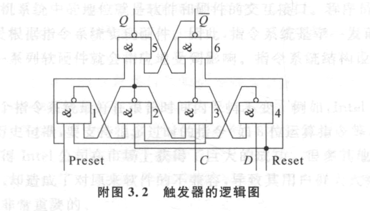
**解答与解析**：
附图 3.2 是由 **6 个与非门（编号 1~6）组成的带异步置位（`Preset`）和异步复位（`Reset`）的维持-阻塞正边沿触发 D 触发器**（参照教材第 43 页图 3.12）：
- **门 5、门 6**：构成基本的 RS 锁存器（输出 $Q$ 和 $\bar{Q}$）。
- **门 2、门 3**：构成时钟控制门，产生置位脉冲 $\bar{S}$ 和复位脉冲 $\bar{R}$ 去控制门 5、门 6。
- **门 1、门 4**：构成数据输入控制门，并引入反馈维持-阻塞线。

**详细工作过程分析**：
1. **正常工作模式（当异步置位/复位无效，即 $\text{Preset} = 1, \text{Reset} = 1$ 时）**：
   - **当 $C = 0$（时钟低电平期间）**：
     - 门 2 和门 3 的时钟输入端均为 $0$，因此无论 $D$ 如何变化，门 2 和门 3 的输出均被强制为 $1$（即 $S_2 = 1, S_3 = 1$）。
     - 门 5 和门 6 构成的 RS 锁存器两个输入均为 $1$，**保持原状态 $Q, \bar{Q}$ 不变**。
     - 同时，数据 $D$ 在门 4 和门 1 中建立准备：门 4 的三个输入为 $(S_3=1, D, \text{Reset}=1)$，故门 4 输出 $S_4 = \bar{D}$；门 1 的两个输入为 $(S_2=1, S_4=\bar{D})$，故门 1 输出 $S_1 = D$。
   - **当 $C$ 由 $0 \to 1$（时钟上升沿到来瞬间）**：
     - **若 $D = 0$**：上升沿前 $S_4 = 1, S_1 = 0$。当 $C \to 1$ 时，门 2 输出 $S_2 = \overline{S_1 \cdot C \cdot 1} = \overline{0 \cdot 1} = 1$；门 3 输出 $S_3 = \overline{S_2 \cdot C \cdot S_4} = \overline{1 \cdot 1 \cdot 1} = 0$。于是 $S_3 = 0$ 使门 6 输出 $\bar{Q} = 1$，进而使门 5 输出 **$Q = 0$**。
     - **若 $D = 1$**：上升沿前 $S_4 = 0, S_1 = 1$。当 $C \to 1$ 时，门 3 因 $S_4 = 0$ 输出 $S_3 = 1$；门 2 因 $S_1 = 1, C = 1$ 输出 $S_2 = 0$。于是 $S_2 = 0$ 使门 5 输出 **$Q = 1$**，进而使门 6 输出 $\bar{Q} = 0$。
   - **当 $C = 1$（时钟高电平维持期间，维持-阻塞机制）**：
     - 若触发沿采样了 $D = 0$，则 $S_3 = 0$；因为 $S_3$ 反馈连接到门 4 的输入端，$S_3 = 0$ 将门 4 输出强制锁定为 $S_4 = 1$，此时无论外部输入 $D$ 怎么跳变，都无法改变 $S_4$，从而阻塞了 $D$ 的变化。
     - 若触发沿采样了 $D = 1$，则 $S_2 = 0$；因为 $S_2$ 反馈连接到门 1 和门 3 的输入端，$S_2 = 0$ 将门 1 输出锁定为 $S_1 = 1$（维持 $S_2 = 0$），同时将门 3 输出锁定为 $S_3 = 1$，此时即使 $D$ 变为 $0$ 使 $S_4$ 变为 $1$，也无法改变 $S_2$ 和 $S_3$ 的状态。
     - **结论**：该电路仅在时钟 $C$ 的**上升沿（$0 \to 1$）**采样输入 $D$ 并更新至输出 $Q$，是一个**上升沿触发的 D 触发器**。
2. **异步置位与异步复位功能**：
   - **当 $\text{Preset} = 0, \text{Reset} = 1$（异步置 1）**：$\text{Preset} = 0$ 直接接入门 5，使 $Q = 1$；同时接入门 2 使 $S_2 = 1$，进而配合 $\text{Reset} = 1$ 使 $\bar{Q} = 0$（无需等待时钟沿）。
   - **当 $\text{Preset} = 1, \text{Reset} = 0$（异步清 0）**：$\text{Reset} = 0$ 直接接入门 6 和门 4，强制使 $\bar{Q} = 1, S_4 = 1$，进而使 $Q = 0$（无需等待时钟沿）。
   - **当 $\text{Preset} = 0, \text{Reset} = 0$**：会同时强制 $Q = 1$ 且 $\bar{Q} = 1$，破坏互补逻辑，属于禁止输入状态。

---

## 第4章 指令系统结构

### 习题 4.1
**题目**：给定下面的代码片段：
```c
A = B - C;
D = A - C;
B = D + A;
```
- **(1)** 分别写出上述代码片段在 4 种指令系统类型（堆栈型、累加器型、寄存器-存储器型、寄存器-寄存器型）下的汇编语言代码。
(2) 假设操作码占用 8 位编码，内存地址和操作数都是 16 位，寄存器型结构有 16 个通用寄存器。对每种结构回答以下问题：
  - **①** 需要读取多少指令字节？
  - **②** 与内存交换的数据有多少字节？
  - **③** 依据代码量衡量哪种结构最好？
  - **④** 依据与内存交换的数据（指令和数据）量衡量哪种结构最好？
**解答与解析**：
先分析单条指令长度规则：
- 操作码（Opcode）：$8\text{ bits} = 1\text{ Byte}$；
- 内存地址（Mem Addr）：$16\text{ bits} = 2\text{ Bytes}$；
- 内存数据操作数（Data Operand）：$16\text{ bits} = 2\text{ Bytes}$；
- 寄存器号（Reg ID）：16 个通用寄存器需 $\log_2 16 = 4\text{ bits} = 0.5\text{ Byte}$。
> **注意**：在指令编码中，若单条指令必须按整字节（Byte）对齐：
> - **堆栈型**：`Push/Pop Mem` 为 $1 + 2 = 3\text{ B}$；`Sub/Add`（零地址）为 $1\text{ B}$。
> - **累加器型**：`Load/Store/Add/Sub Mem` 为 $1 + 2 = 3\text{ B}$；`Neg`（单操作码）为 $1\text{ B}$。
> - **寄存器-存储器型（RM）**：`Load/Store/Add/Sub Reg, Mem` 含 $8\text{ bits}$ 操作码 + $4\text{ bits}$ 寄存器号 + $16\text{ bits}$ 地址 $= 28\text{ bits}$，按整字节对齐为 **$4\text{ B}$**（若不按整字节对齐则为 $3.5\text{ B}$）。
> - **寄存器-寄存器型（RR / Load-Store）**：
>   - `Load/Store Reg, Mem`：$8 + 4 + 16 = 28\text{ bits} \to$ 按字节对齐为 **$4\text{ B}$**（未对齐为 $3.5\text{ B}$）；
>   - `Add/Sub R1, R2, R3`：$8 + 4 \times 3 = 20\text{ bits} \to$ 按字节对齐为 **$3\text{ B}$**（未对齐为 $2.5\text{ B}$）。

**(1) & (2) 四种指令系统类型的汇编代码及字节数统计**：

> **【说明】**：
> 1. “累加器型”若假定指令集不含 `Sub` 指令，则需用 `Load C` + `Neg` + `Add B`（共 10 条指令）；若直接支持 `Sub Mem` 指令，则仅需 7 条指令。
> 2. 在“寄存器-寄存器型”中，若 `A, D, B` 三个结果最终都需要写回内存，则 `B` 和 `C` 只需 `Load` 一次，`A, D, B` 各 `Store` 一次（共 2 次 Load + 3 次 Store = 5 次数据访存，共 8 条指令）。
> 下面汇总对比表（以**单条指令按整字节对齐**且**A、D、B 均需写回内存**为准，括号内附累加器直接有 `Sub` 指令的数值）：

| 维度 | 堆栈型 (Stack) | 累加器型 (Accumulator) | 寄存器-存储器型 (Reg-Mem) | 寄存器-寄存器型 (Load-Store) |
| :--- | :--- | :--- | :--- | :--- |
| **汇编代码** | `Push B` (3B, 读2B)<br>`Push C` (3B, 读2B)<br>`Sub` (1B)<br>`Pop A` (3B, 写2B)<br>`Push A` (3B, 读2B)<br>`Push C` (3B, 读2B)<br>`Sub` (1B)<br>`Pop D` (3B, 写2B)<br>`Push D` (3B, 读2B)<br>`Push A` (3B, 读2B)<br>`Add` (1B)<br>`Pop B` (3B, 写2B) | **无 `Sub` 指令（共10条）**：<br>`Load C` (3B, 读2B)<br>`Neg` (1B)<br>`Add B` (3B, 读2B)<br>`Store A` (3B, 写2B)<br>`Load C` (3B, 读2B)<br>`Neg` (1B)<br>`Add A` (3B, 读2B)<br>`Store D` (3B, 写2B)<br>`Add A` (3B, 读2B)<br>`Store B` (3B, 写2B)<br>*(若有Sub则仅需7条：Load B, Sub C, Store A, Sub C, Store D, Add A, Store B)* | `Load R1, B` (4B, 读2B)<br>`Sub R1, C` (4B, 读2B)<br>`Store R1, A` (4B, 写2B)<br>`Sub R1, C` (4B, 读2B)<br>`Store R1, D` (4B, 写2B)<br>`Add R1, A` (4B, 读2B)<br>`Store R1, B` (4B, 写2B)<br>*(注：若用 R2 暂存 A、R3 暂存 C，还可省去第2次读C和读A)* | `Load R1, B` (4B, 读2B)<br>`Load R2, C` (4B, 读2B)<br>`Sub R3, R1, R2` (3B)<br>`Store R3, A` (4B, 写2B)<br>`Sub R4, R3, R2` (3B)<br>`Store R4, D` (4B, 写2B)<br>`Add R5, R4, R3` (3B)<br>`Store R5, B` (4B, 写2B) |
| **① 指令字节数** | $9 \times 3 + 3 \times 1 = \mathbf{30\text{ B}}$ | 无Sub：$\mathbf{26\text{ B}}$<br>（有Sub：$7 \times 3 = \mathbf{21\text{ B}}$） | $7 \times 4 = \mathbf{28\text{ B}}$ | $5 \times 4 + 3 \times 3 = \mathbf{29\text{ B}}$ |
| **数据访存字节** | $9 \times 2 = \mathbf{18\text{ B}}$ | 无Sub：$8 \times 2 = \mathbf{16\text{ B}}$<br>（有Sub：$7 \times 2 = \mathbf{14\text{ B}}$） | $7 \times 2 = \mathbf{14\text{ B}}$ | $5 \times 2 = \mathbf{10\text{ B}}$ |
| **② 总内存交换量<br>（指令 + 数据）** | $30 + 18 = \mathbf{48\text{ B}}$ | 无Sub：$26 + 16 = \mathbf{42\text{ B}}$<br>（有Sub：$21 + 14 = \mathbf{35\text{ B}}$） | $28 + 14 = \mathbf{42\text{ B}}$ | $29 + 10 = \mathbf{39\text{ B}}$ |

- **③ 依据代码量（指令字节数）衡量**：**累加器型**结构最好（仅需 $26\text{ B}$，若支持 `Sub` 指令则仅需 $21\text{ B}$）。
- **④ 依据与内存交换的总数据量衡量**：
  - 数据流量上，**寄存器-寄存器型（Load-Store）** 仅需 $10\text{ B}$ 数据访存，总内存交换量为 **$39\text{ B}$**，在四种结构中最优（若累加器型支持 `Sub` 指令，则累加器型总交换量为 $35\text{ B}$）。

---

### 习题 4.2
**题目**：十六进制数 `0x4C4F4F4E47534F4E` 要存在 64 位双字中。
- **(1)** 假设存储是 8 字节对齐的，请依据小尾端的格式将此十六进制数写入内存中，并将每个字节解释为一个 ASCII 字符写在对应的字节下边。
- **(2)** 按照大尾端的格式重做上题。
**解答与解析**：
首先将 64 位十六进制数 `0x4C4F4F4E47534F4E` 从最高有效字节（MSB）到最低有效字节（LSB）拆分并查 ASCII 表：
- `0x4C` = `'L'` ($76$)，`0x4F` = `'O'` ($79$)，`0x4F` = `'O'` ($79$)，`0x4E` = `'N'` ($78$)
- `0x47` = `'G'` ($71$)，`0x53` = `'S'` ($83$)，`0x4F` = `'O'` ($79$)，`0x4E` = `'N'` ($78$)

**(1) 小尾端（Little-Endian：低有效字节存放在低地址）**：

| 内存字节地址 | `0x...000` | `0x...001` | `0x...002` | `0x...003` | `0x...004` | `0x...005` | `0x...006` | `0x...007` |
| :---: | :---: | :---: | :---: | :---: | :---: | :---: | :---: | :---: |
| **十六进制值** | `0x4E` | `0x4F` | `0x53` | `0x47` | `0x4E` | `0x4F` | `0x4F` | `0x4C` |
| **ASCII 字符** | `N` | `O` | `S` | `G` | `N` | `O` | `O` | `L` |

**(2) 大尾端（Big-Endian：高有效字节存放在低地址）**：

| 内存字节地址 | `0x...000` | `0x...001` | `0x...002` | `0x...003` | `0x...004` | `0x...005` | `0x...006` | `0x...007` |
| :---: | :---: | :---: | :---: | :---: | :---: | :---: | :---: | :---: |
| **十六进制值** | `0x4C` | `0x4F` | `0x4F` | `0x4E` | `0x47` | `0x53` | `0x4F` | `0x4E` |
| **ASCII 字符** | `L` | `O` | `O` | `N` | `G` | `S` | `O` | `N` |

*(可见大尾端顺序恰好拼出“龙芯”的英文名 **`LOONGSON`**！)*

---

### 习题 4.3
**题目**：假定在指令系统设计中需要考虑两种条件转移指令的设计方法，这两种方法如下。
- **(1)** CPU A：先通过一条比较指令设置条件码 A，再用一条分支指令检测条件码。
- **(2)** CPU B：比较操作包含在分支指令中。
在两种 CPU 中，条件转移指令都需要两个时钟周期，所有其他指令都需要一个时钟周期。在 CPU A 中，全部指令的 $25\%$ 是条件转移指令，因为每次条件转移都需要一次比较，所以比较指令约占所有指令的 $25\%$。因为 CPU A 不需要在转移中包含分支（比较），所以它的时钟频率是 CPU B 的 $1.2$ 倍。请问哪一种 CPU 性能更高？如果 CPU A 的时钟频率只是 CPU B 的 $1.1$ 倍，结果又是多少？
**解答与解析**：
1. **计算 CPU A 的总时钟周期数 $C_A$**：
   - 设某程序在 CPU A 上执行的总指令数为 $I_A = x$。
   - 根据题意，CPU A 中包含：
     - $25\% x$ 的条件转移指令（每条 2 拍）；
     - $25\% x$ 的专用比较指令（每条 1 拍）；
     - $50\% x$ 的其他普通指令（每条 1 拍）。
   - 因此 CPU A 执行该程序所需的总时钟周期数为：
     $$C_A = 0.25x \times 2 + 0.25x \times 1 + 0.50x \times 1 = 1.25x$$
2. **计算 CPU B 的总时钟周期数 $C_B$**：
   - 在 CPU B 中，比较操作直接合并在条件转移指令内部，因此省去了那 $25\% x$ 的专用比较指令，总指令数为 $I_B = 0.75x$，其中：
     - $0.25x$ 为条件转移指令（每条 2 拍）；
     - $0.50x$ 为其他普通指令（每条 1 拍）。
   - 因此 CPU B 执行该程序所需的总时钟周期数为：
     $$C_B = 0.25x \times 2 + 0.50x \times 1 = 1.00x$$
3. **比较两者的执行时间与性能**：
   - **当 $f_A = 1.2 f_B$（即 $T_{\text{clk}, B} = 1.2 T_{\text{clk}, A}$）时**：
     $$\frac{\text{Performance}_A}{\text{Performance}_B} = \frac{\text{Time}_B}{\text{Time}_A} = \frac{C_B / f_B}{C_A / f_A} = \frac{1.00x}{1.25x} \times 1.2 = \frac{1.2}{1.25} = 0.96 < 1$$
     即 CPU A 的性能是 CPU B 的 **$0.96$ 倍**，**CPU B 的性能更高**。
   - **当 $f_A = 1.1 f_B$ 时**：
     $$\frac{\text{Performance}_A}{\text{Performance}_B} = \frac{1.00x}{1.25x} \times 1.1 = \frac{1.1}{1.25} = 0.88 < 1$$
     即 CPU A 的性能是 CPU B 的 **$0.88$ 倍**，仍然是 **CPU B 的性能更高**。

---

### 习题 4.4
**题目**：如果对通常的 MIPS 指令集增加寄存器—内存形式的指令，如下所示，可以减少一些 load 数量。
```mips
LW  R1, 0(R3)
ADD R2, R2, R1
```
可以合并成一条指令：
```mips
ADD R2, 0(R3)
```
- **(1)** 给出一段符合上述例子的代码（load 得到的值立即作为运算指令的源操作数），但是编译器依然无法用寄存器—内存形式的指令消除这条 load 指令。
- **(2)** 假设这样的修改带来了 $5\%$ 的主频下降，同时没有 CPI 影响。如果 load 占所有指令的 $26\%$，最少要消灭 load 指令的百分之多少，才能使得新指令集不导致性能下降？
- **(3)** 在传统的静态 5 级流水线（IF ID EXE MEM WB）上，寄存器—内存形式的指令有何实现困难？
**解答与解析**：
**(1) 编译器无法消除该 Load 指令的代码示例**：
当 `LW` 读出的寄存器 `R1` 除了作为紧邻的 `ADD` 指令的源操作数外，**在后续指令中还会被再次使用（即 `R1` 在 `ADD` 之后仍活跃 Live）**时，若将两条指令合并为 `ADD R2, 0(R3)`，内存中 `0(R3)` 的值就不会被加载并保存到寄存器 `R1` 中，导致后续使用 `R1` 的指令出错。例如：
```mips
LW   R1, 0(R3)      ; 加载 0(R3) 到 R1
ADD  R2, R2, R1     ; R1 立即作为 ADD 的源操作数
SUB  R4, R5, R1     ; 后续指令仍需使用 R1（或 BNEZ R1, Label），故不能消除 LW R1!
```
*(另外，如果题干仅提供两操作数累加形式的 `ADD Rd, offset(Rs)` 即 `Rd = Rd + Mem[Rs+offset]`，那么当原指令为三操作数且目的寄存器与另一源寄存器不同、同时原源寄存器后续仍活跃时，如 `LW R1, 0(R3); ADD R4, R2, R1`，也无法直接合并)*。

**(2) 不导致性能下降所需消除的 Load 指令最小比例**：
设原程序总指令数为 $I$，原主频为 $f$，由于 CPI 不变，执行时间 $T \propto \frac{\text{指令数}}{\text{主频}}$。
设消除了比例为 $x$ 的 Load 指令，则新指令总数为 $I' = I \cdot (1 - 0.26x)$。
- **按“新主频下降为原主频的 $95\%$（即 $f' = 0.95 f$）”计算**：
  $$T' \le T \implies \frac{1 - 0.26x}{0.95 f} \le \frac{1}{f} \implies 1 - 0.26x \le 0.95 \implies 0.26x \ge 0.05 \implies x \ge \frac{5}{26} \approx 19.23\%$$
- *(注：若按“时钟周期延长 $5\%$”即 $T_{\text{clk}}' = 1.05 T_{\text{clk}}$ 计算，则 $(1 - 0.26x) \times 1.05 \le 1 \implies x \ge \frac{0.05}{1.05 \times 0.26} \approx 18.32\%$)*。
故最少要消灭约 **$19.2\%$**（或 $19\%$）的 Load 指令。

**(3) 在传统静态 5 级流水线（IF-ID-EXE-MEM-WB）上的实现困难**：
1. **流水级顺序与功能部件冲突**：在经典 5 级流水线中，`EXE`（ALU 运算）在 `MEM`（数据存储器访问）**之前**。而寄存器—内存指令 `ADD R2, 0(R3)` 需要：① 先用 ALU 计算访存有效地址 `0 + R3`；② 访问数据 Cache（`MEM`）读出操作数；③ **再次使用 ALU** 将读出的内存数据与 `R2` 相加。
2. **带来的流水线问题**：
   - 在原有的 `IF-ID-EXE-MEM-WB` 5 级流水线中，`MEM` 阶段之后已经没有 ALU 运算级了；
   - 如果在 `MEM` 之后再增加一级 `ALU`（变成 6 级流水线），或者在 `EXE` 之前增加独立的地址计算级（`AGEN` + `MEM` + `EXE`），就会改变整个流水线结构，增加后续相关指令的数据冲突停顿拍数或分支延迟损失；若让该指令在流水线中占用两拍 `EXE`，又会引起严重的流水线结构相关和阻塞。

---

### 习题 4.5
**题目**：根据 MIPS 指令的编码格式回答下列问题。
- **(1)** 条件转移指令的跳转范围是多少？
- **(2)** 直接跳转指令的跳转范围是多少？
**解答与解析**：
**(1) 条件转移指令（I 型格式，如 `BEQ`/`BNE`）的跳转范围**：
- 包含 16 位有符号立即数偏移量 `offset`（字偏移，范围 $-2^{15} \sim +2^{15}-1$），左移 2 位（乘以 4 字节）后为 18 位有符号字节偏移量，以**延迟槽指令的地址（$PC + 4$）**为基准进行相对寻址：
  $$\text{Target} = (PC + 4) + \text{sign\_extend}(\text{offset}) \times 4$$
- 跳转范围是以 $PC + 4$ 为中心的 **$-2^{17}\text{ B} \sim +(2^{17} - 4)\text{ B}$（即 $-128\text{ KB} \sim +128\text{ KB}-4\text{ B}$，总跨度为 $2^{18}\text{ B} = 256\text{ KB}$ 或 $\pm 32\text{ K}$ 条指令）**。

**(2) 直接跳转指令（J 型格式，如 `J`/`JAL`）的跳转范围**：
- 包含 26 位无符号字索引 `instr_index`，左移 2 位后变成 28 位字节地址，高 4 位直接拼接**延迟槽指令地址（$PC + 4$）的最高 4 位**：
  $$\text{Target} = \{ (PC + 4)[31:28],\ \text{instr\_index}[25:0],\ 2\text{'b}00 \}$$
- 跳转范围是延迟槽指令（$PC + 4$）所在的当前 **$2^{28}\text{ B} = 256\text{ MB}$ 地址空间段（即高 4 位相同的 $256\text{ MB}$ 区域内任意字对齐地址）**。注意它是分段绝对寻址，而非以当前 PC 为中心的 $\pm 128\text{ MB}$。

---

### 习题 4.6
**题目**：在一台小尾端 MIPS 机器上，用 `LWL`/`LWR`/`SWL`/`SWR` 指令编写一段程序，把内存单元 `1005~1008` 的值取到寄存器 `R1`，再存到内存单元 `2005~2008` 中。
**解答与解析**：
- 在**小尾端（Little-Endian）** MIPS 机器中，一个非对齐的 4 字节字存放在字节地址 `1005~1008` 时：
  - 低地址 **`1005`** 存放的是该字的**最低有效字节（LSB，最右端）**，使用 `LWR` / `SWR` 访问；
  - 高地址 **`1008`**（即 `1005 + 3`）存放的是该字的**最高有效字节（MSB，最左端）**，使用 `LWL` / `SWL` 访问。
- 汇编代码如下：
```mips
    ORI   R2, R0, 1005      ; (或 DLI/LI R2, 1005) 将源起始地址 1005 装入 R2
    LWR   R1, 0(R2)         ; 从低地址 1005 读取非对齐字的低字节部分到 R1 右端
    LWL   R1, 3(R2)         ; 从高地址 1008 读取非对齐字的高字节部分到 R1 左端，拼成完整 32 位字

    ORI   R2, R0, 2005      ; 将目的起始地址 2005 装入 R2
    SWR   R1, 0(R2)         ; 将 R1 右端（低字节部分）存入低地址 2005~2007
    SWL   R1, 3(R2)         ; 将 R1 左端（高字节部分）存入高地址 2008
```

---

### 习题 4.7
**题目**：用 MIPS 的 `LL`/`SC` 指令编写一段从内存单元 `100(R2)` 取数、把取出来的数加 100 并存回到 `100(R2)` 的原子操作代码，并说明如果在此过程中处理器发生中断或该单元被其他处理器修改时处理器如何保证上述操作的原子性。
**解答与解析**：
1. **MIPS 汇编代码**：
```mips
retry:
    LL    R1, 100(R2)       ; 链接加载(Load-Linked)：从内存 100(R2) 读数到 R1，并在硬件中设置链接状态位 LLbit=1 及监控地址
    ADDIU R1, R1, 100       ; 将取出的数加 100（若需检测有符号溢出则用 ADDI）
    SC    R1, 100(R2)       ; 条件存储(Store-Conditional)：若 LLbit==1，则将 R1 写入 100(R2) 并置 R1=1；否则不写内存并置 R1=0
    BEQZ  R1, retry         ; 若 R1==0（说明原子性被破坏，写入失败），跳回 retry 重新执行
    NOP                     ; 分支延迟槽指令
```
2. **硬件保证原子性的机理**：
   - 处理器内部设有一个硬件状态寄存器位 **`LLbit`（链接位）** 和一个记录物理地址的 **`LLAddr` 寄存器**。
   - 执行 `LL R1, 100(R2)` 时，处理器除了将 `100(R2)` 的内容读入 `R1` 外，还会自动将 `LLbit` 置为 `1`，并将 `100(R2)` 对应的物理地址记录到 `LLAddr` 中。
   - 在 `LL` 执行之后、`SC` 执行之前，如果发生以下任一事件，硬件会自动将 **`LLbit` 清零（置为 `0`）**：
     1. **处理器发生异常或中断**（异常处理返回执行 `ERET` 指令时会清除 `LLbit`，防止上下文切换破坏原子性）；
     2. **其他处理器核（或 DMA）对该地址所在 Cache 行进行了写操作**（通过 Cache 一致性协议的监听或目录无效消息检测到对该地址的写/失效请求时，将 `LLbit` 清零）。
   - 当执行到 `SC R1, 100(R2)` 时，硬件检查 `LLbit`：
     - 若 `LLbit == 1`，说明期间无中断且该内存单元未被其他处理器修改，则将 `R1` 的新值写入内存 `100(R2)`，并将寄存器 `R1` 改写为 `1`（表示成功）；
     - 若 `LLbit == 0`，则**放弃写内存操作**（内存保持原值不被破坏），并将寄存器 `R1` 改写为 `0`（表示失败）。随后 `BEQZ R1, retry` 检测到 `R1 == 0` 便跳回 `LL` 重试，直至整个“读-改-写”过程无干扰地原子完成。

---

### 习题 4.8
**题目**：列出 X86 和 MIPS 的所有减法指令（包括不同字长、定点和浮点、不同寻址方式等）并比较它们的异同。
**解答与解析**：
#### 1. X86 架构的减法指令体系
- **定点减法指令**：
  - **普通减法 `SUB`** 与 **带借位减法 `SBB`**（以及只修改标志位不写结果的比较指令 `CMP`、自减 1 指令 `DEC`、取负指令 `NEG`）：
    - 支持 **4 种操作数字长**：8 位（`AL/r8/m8`）、16 位（`AX/r16/m16`）、32 位（`EAX/r32/m32`）、64 位（`RAX/r64/m64`）。
    - 支持 **5 类操作数组合**：`Reg <- Reg - Imm`、`Mem <- Mem - Imm`、`Reg <- Reg - Reg`、`Mem <- Mem - Reg`、`Reg <- Reg - Mem`（包括 8 位符号扩展立即数 `imm8` 与 16/32 位立即数）。
  - **SIMD 向量定点减法（MMX/SSE/AVX）**：`PSUBB`/`PSUBW`/`PSUBD`/`PSUBQ`（打包 8/16/32/64 位整数减法），以及饱和减法 `PSUBSB`/`PSUBSW`（有符号饱和）、`PSUBUSB`/`PSUBUSW`（无符号饱和）。
- **浮点减法指令**：
  - **x87 FPU 浮点栈式减法**（内部按 **80 位扩展双精度**运算）：
    - 正向减法：`FSUB m32fp/m64fp`、`FSUB ST(0), ST(i)`、`FSUB ST(i), ST(0)`、`FSUBP`（减法并弹栈）、`FISUB m16int/m32int`（浮点减去内存整数）；
    - 反向减法：`FSUBR`、`FSUBRP`、`FISUBR`（被减数与减数互换）。
  - **SSE/AVX 标量与向量浮点减法**：`SUBSS`（标量单精度）、`SUBSD`（标量双精度）、`SUBPS`（打包 4 路单精度）、`SUBPD`（打包 2 路双精度）、`HSUBPS`/`HSUBPD`（水平减法）。

#### 2. MIPS 架构的减法指令体系
- **定点减法指令（仅支持寄存器-寄存器寻址）**：
  - 32 位有符号减法（溢出产生 `Integer Overflow` 例外）：`SUB rd, rs, rt`
  - 32 位无符号减法（溢出不产生例外）：`SUBU rd, rs, rt`
  - 64 位有符号减法（溢出产生例外）：`DSUB rd, rs, rt`
  - 64 位无符号减法（溢出不产生例外）：`DSUBU rd, rs, rt`
  - *(注：MIPS 没有专门的立即数减法指令，减立即数通过加负数立即数 `ADDI`/`ADDIU`/`DADDI`/`DADDIU` 实现)*。
- **浮点减法指令（仅支持浮点寄存器寻址）**：
  - 单精度浮点减法（32 位）：`SUB.S fd, fs, ft`
  - 双精度浮点减法（64 位）：`SUB.D fd, fs, ft`
  - 配对单精度浮点减法（2 路 32 位 SIMD）：`SUB.PS fd, fs, ft`

#### 3. X86 与 MIPS 减法指令的异同对比

| 比较维度 | X86 减法指令 (CISC) | MIPS 减法指令 (RISC) |
| :--- | :--- | :--- |
| **指令格式与操作数个数** | 二地址指令为主（目的寄存器/内存同时是第一源操作数，结果覆盖源操作数；AVX 起支持三操作数） | 严格的三地址指令（`rd, rs, rt`，目的寄存器与源寄存器独立，不破坏源操作数） |
| **支持的操作数字长** | 定点支持 8 位、16 位、32 位、64 位；x87 浮点统一用 80 位扩展双精度，SSE 支持 32/64 位 | 定点仅支持 32 位和 64 位（无 8/16 位专用减法指令）；浮点支持 32 位单精度、64 位双精度和配对单精度 |
| **寻址方式** | 支持寄存器、立即数和丰富的**内存寻址**（基址+变址$\times$比例因子+位移），运算指令可直接读写内存 | **Load-Store 结构**，所有减法指令的操作数**只能在寄存器中**，不支持内存操作数，甚至无立即数减法 |
| **条件标志位 (Flags)** | 定点减法自动改写 `EFLAGS`（`OF, SF, ZF, AF, PF, CF`），x87 修改 FPU 状态字 `C0~C3` | **无状态标志寄存器（No Flags）**，条件判断由独立的比较指令（`SLT`）或转移指令完成 |
| **溢出与异常处理** | 定点减法溢出仅设置 `OF=1`（不自动触发异常，需软件执行 `INTO` 或判断）；由于支持访存，可触发缺页 `#PF`、段保护 `#GP`、栈异常 `#SS`、对齐检查 `#AC` 等复杂异常 | 通过指令操作码区分：带 `U` 的 `SUBU`/`DSUBU` 忽略溢出，不带 `U` 的 `SUB`/`DSUB` 在有符号溢出时直接触发硬件 `Integer Overflow` 例外；因不访存，绝对不会触发缺页或地址错例外 |

---

### 习题 4.9（闭卷笔试改编：Load-to-Use 延迟的概念、硬件决定因素与典型处理器对比）
**题目**：什么是处理器的 Load-to-Use 延迟？为什么经典 5 级静态流水线（有旁路）的 Load-to-Use 延迟为 1 拍（总延迟 2 拍），而现代高性能超标量处理器（如 Pentium III、Pentium 4、MIPS R10000、Alpha 21264、Power 4、AMD K8 等）的 Load-to-Use 延迟通常达到 2~4 拍？
**解答与解析**：
1. **Load-to-Use 延迟的定义**：
   - 指一条访存加载指令（`Load`）从发射执行（或计算地址）开始，到紧随其后依赖该加载数据的运算指令（`Use`）能够通过旁路网络（Bypass）获得数据并开始运算之间所需的时钟周期数（在静态流水线中常表示为中间必须插入的无关指令拍数/停顿气泡数，在现代微架构参数表如教材第 186 页表 10.1 中常表示为 L1 D-Cache 的命中延迟周期数）。
2. **决定 Load-to-Use 延迟的硬件关键路径**：
   一条 `Load` 指令在一级数据 Cache（L1 D-Cache）命中时，必须依次完成以下硬件操作：
   $$\text{① 有效地址生成 (AGEN: 基址+偏移)} \to \text{② TLB 虚实地址转换与 VIPT Cache 索引读阵列} \to \text{③ Tag 比较与多路组相联选择 (Way Mux)} \to \text{④ 字节对齐/符号扩展与跨功能部件旁路传输}$$
   - 在主频较低的**经典 5 级静态流水线**中，① 占 1 拍（`EX` 级），②③④ 合并在 1 拍（`MEM` 级）内完成，因此从 `EX` 开始算共 2 拍（仅产生 **1 拍** Load-Use 停顿气泡）。
   - 而在**现代高主频、多发射乱序超标量处理器**中，为了提高时钟频率（缩短单拍时钟周期）并支持更大容量（$32\text{ KB}\sim 64\text{ KB}$）、更高相联度（2~8 路）及多端口的 L1 D-Cache，同时由于乱序执行中还需要查询 Store Buffer 进行存数前递检查以及跨越更复杂的全相连旁路网络，上述 ②③④ 无法在 1 个高频时钟周期内完成，必须被**切分为 2~4 个流水级**，从而使 L1 D-Cache 命中延迟（Load-to-Use 延迟）增加到 **2~4 拍**（浮点部件因距离访存部件物理布线更远且需格式转换，延迟通常比定点再多 1~2 拍）。
3. **教材表 10.1 所列典型处理器的 L1 D-Cache Load-to-Use 延迟参考表**：

| 处理器型号 | L1 D-Cache 容量与相联度 | 定点 Load-to-Use 延迟 | 浮点 Load-to-Use 延迟 |
| :--- | :--- | :---: | :---: |
| **MIPS R10000** | $32\text{ KB}$，2 路组相联 | **2 拍** | **3 拍** |
| **Pentium III / AMD K8** | $16\text{ KB}$（4 路）/ $64\text{ KB}$（2 路） | **3 拍** | **3~4 拍** |
| **Alpha 21264 / Power 4** | $64\text{ KB}$（2 路）/ $32\text{ KB}$（2 路） | **3~4 拍** | **4~5 拍** |
| **Pentium 4** | $8\text{ KB}\sim 16\text{ KB}$，4 路组相联 | **2~4 拍** | **6~12 拍** |

---

## 第5章 静态流水线

### 习题 5.1
**题目**：假定某 RISC 处理器采用如图 5.13 所示的 5 级流水线（IF/ID/EX/MEM/WB）结构。对于下列指令序列：

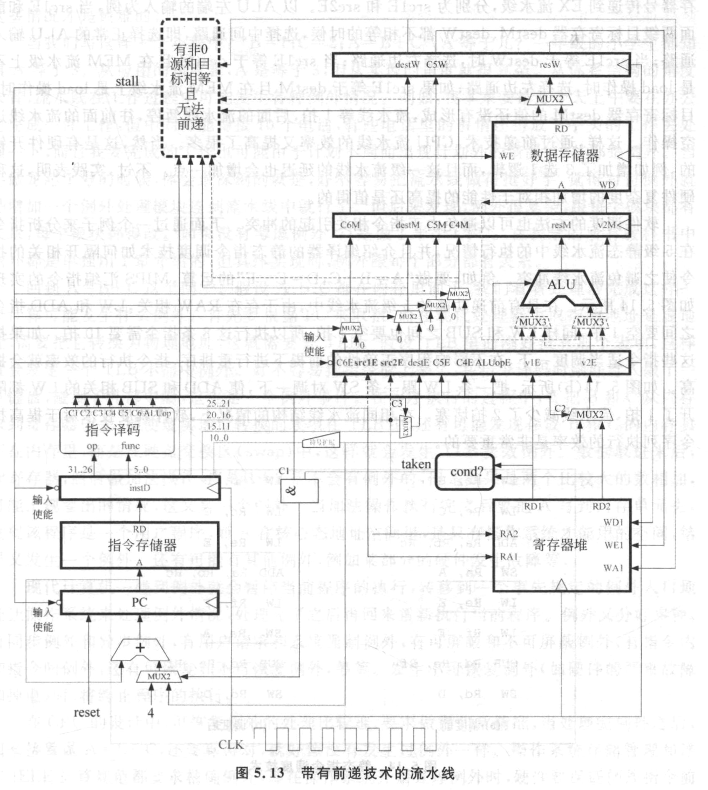
```mips
LW   R1, 0(R0)
LW   R2, 4(R0)
ADD  R3, R1, R2    ; a = b + e
SW   R3, 12(R0)
LW   R4, 8(R0)
ADD  R5, R1, R4    ; c = b + f
SW   R5, 16(R0)
```
分析上述指令序列之间的相关，并重排序执行序列避免相关。重排序指令序列可以比原先指令序列的执行减少多少拍？
**解答与解析**：
1. **指令序列的数据相关（RAW 真相关）分析**：
   - `I1: LW R1, 0(R0)` 与 `I3: ADD R3, R1, R2`、`I6: ADD R5, R1, R4` 存在关于 **`R1`** 的 RAW 相关；
   - `I2: LW R2, 4(R0)` 与 `I3: ADD R3, R1, R2` 存在关于 **`R2`** 的 RAW 相关（紧邻 Load-Use 相关）；
   - `I3: ADD R3, R1, R2` 与 `I4: SW R3, 12(R0)` 存在关于 **`R3`** 的 RAW 相关（运算结果立即作为 `SW` 的存数源操作数）；
   - `I5: LW R4, 8(R0)` 与 `I6: ADD R5, R1, R4` 存在关于 **`R4`** 的 RAW 相关（紧邻 Load-Use 相关）；
   - `I6: ADD R5, R1, R4` 与 `I7: SW R5, 16(R0)` 存在关于 **`R5`** 的 RAW 相关。

2. **两种流水线前递模型下的对比计算**（考试中建议同时列出）：

#### 模型 A：严格按照教材图 5.13 所示的部分前递结构
在教材图 5.13（第 87 页）中：
- **仅在 ALU 的两个输入端（EX 阶段）设置了来自 `MEM` 级（`resM`）和 `WB` 级（`resW`）的前递多路选择器 `MUX3`**；
- **不考虑前递给存数指令（`SW` 的存数寄存器 `rt` 在 ID 阶段读出，无前递通路）**，且寄存器堆**不支持**同一拍内“先写后读（WB->ID）”前递。
- **重排序前**（共需 **15 拍**）：
  - `I2 (LW R2)` 在第 5 拍 `MEM`、第 6 拍 `WB`；`I3 (ADD R3, R1, R2)` 虽然 `R2` 可在 `I2` 处于 `WB` 时前递到 `EX`，但由于 `I1 (LW R1)` 在第 5 拍已经处于 `WB`，当 `I3` 因等待 `R2` 而在 ID 阻塞 1 拍到第 5 拍时，`I1` 在第 6 拍已退出流水线，且 `I3` 在第 4 拍 ID 读寄存器时 `I1` 尚未写回，故 `I3` 必须等到 `I1` 写回完成后在第 7 拍重新在 ID 读出 `R1`（第 4~7 拍均在 ID，第 8 拍进 EX）！
  - `I4 (SW R3)` 的存数操作数 `R3` 无前递，必须在 `I3` 完成第 10 拍 `WB` 后于第 11 拍完成 ID？不，在图 5.13 中，`SW` 若通过 ALU 前递或阻塞，最终第 7 条指令在第 **15 拍**完成 `WB`。
- **重排序后（将 `LW R4, 8(R0)` 提前，并先算 `ADD R5, R1, R4` 使 `R1` 在 `WB` 级恰好前递给 `ADD R5`）**：
  ```mips
  LW   R1, 0(R0)
  LW   R2, 4(R0)
  LW   R4, 8(R0)
  ADD  R5, R1, R4    ; c = b + f
  SW   R5, 16(R0)
  ADD  R3, R1, R2    ; a = b + e
  SW   R3, 12(R0)
  ```
  - 重排序后共需 **12 拍**，比原先减少了 **$15 - 12 = 3$ 拍**。

#### 模型 B：标准全前递 5 级流水线（对照教材图 5.14，第 88 页正文示例）
教材第 88 页图 5.14 专门以本题的同类程序说明静态指令调度：在标准全前递 5 级流水线中，只有紧邻的 `LW` 后接 `ADD`（Load-to-Use）会产生 **1 拍阻塞（气泡）**：
- **重排序前**：
  - `LW R2, 4(R0)` 与紧邻的 `ADD R3, R1, R2` 之间产生 **1 拍 Load-Use 阻塞**；
  - `LW R4, 8(R0)` 与紧邻的 `ADD R5, R1, R4` 之间产生 **1 拍 Load-Use 阻塞**；
  - 7 条指令共需 $(7 + 5 - 1) + 2 = \mathbf{13}$ **拍**。
- **重排序后**：
  将 `LW R4, 8(R0)` 移到 `ADD R3, R1, R2` 之前（或把 `SW R3, 12(R0)` 移到 `LW R4, 8(R0)` 与 `ADD R5, R1, R4` 之间）：
  ```mips
  LW   R1, 0(R0)
  LW   R2, 4(R0)
  LW   R4, 8(R0)
  ADD  R3, R1, R2    ; 与 LW R2 隔开了 1 条指令，消除第 1 个气泡
  ADD  R5, R1, R4    ; 与 LW R4 隔开了 1 条指令，消除第 2 个气泡
  SW   R3, 12(R0)
  SW   R5, 16(R0)
  ```
  - 消除了全部 2 拍 Load-Use 阻塞，7 条指令理想流水执行仅需 $7 + 5 - 1 = \mathbf{11}$ **拍**，比原先减少了 **$13 - 11 = 2$ 拍**。

---

### 习题 5.2
**题目**：对于下面的计算：
```c
A = A + B
C = A - B
```
写出 MIPS 程序代码，并且画出 5 级静态流水线（无旁路）的流水线时空图。
**解答与解析**：
1. **MIPS 汇编代码**（设 `A, B, C` 分别存放在内存 `0(R0), 4(R0), 8(R0)` 中）：
```mips
LW   R1, 0(R0)      ; 取 A
LW   R2, 4(R0)      ; 取 B
ADD  R3, R1, R2     ; 计算新 A = A + B
SUB  R4, R3, R2     ; 计算 C = 新 A - B
SW   R3, 0(R0)      ; 存回 A
SW   R4, 8(R0)      ; 存回 C
```
2. **5 级静态流水线（无旁路，且寄存器堆不支持同拍先写后读，即必须在写回 WB 的下一拍才能完成 ID 读寄存器）时空图**：
   - `I1 (LW R1)` 在第 5 拍 `WB`；`I2 (LW R2)` 在第 6 拍 `WB`。
   - `I3 (ADD R3, R1, R2)` 需等待 `R2` 在第 6 拍完成 `WB`，故在第 7 拍完成 `ID`，第 8 拍 `EX`，第 9 拍 `MEM`，第 10 拍 `WB`。
   - `I4 (SUB R4, R3, R2)` 在 `I3` 阻塞在 `ID` 的第 4~7 拍期间被阻塞在 `IF`，第 8 拍进入 `ID`；它需等待 `I3` 在第 10 拍完成 `WB`，故在第 11 拍完成 `ID`，第 12 拍 `EX`，第 13 拍 `MEM`，第 14 拍 `WB`。
   - `I5 (SW R3, 0(R0))` 在 `I4` 处于 `ID` 的第 8~11 拍期间被阻塞在 `IF`，第 12 拍进入 `ID`（此时 `R3` 已在第 10 拍写回完毕，无需再等），第 13 拍 `EX`，第 14 拍 `MEM`，第 15 拍 `WB`。
   - `I6 (SW R4, 8(R0))` 在第 12 拍进入 `IF`，第 13 拍进入 `ID`；需等待 `I4` 在第 14 拍完成 `WB`，故在第 15 拍完成 `ID`，第 16 拍 `EX`，第 17 拍 `MEM`，第 18 拍 `WB`。

| 指令 \ 周期 | 1 | 2 | 3 | 4 | 5 | 6 | 7 | 8 | 9 | 10 | 11 | 12 | 13 | 14 | 15 | 16 | 17 | 18 |
| :--- | :-: | :-: | :-: | :-: | :-: | :-: | :-: | :-: | :-: | :-: | :-: | :-: | :-: | :-: | :-: | :-: | :-: | :-: |
| `LW R1, 0(R0)` | IF | ID | EX | MEM | WB | | | | | | | | | | | | | |
| `LW R2, 4(R0)` | | IF | ID | EX | MEM | WB | | | | | | | | | | | | |
| `ADD R3, R1, R2` | | | IF | *ID* | *ID* | *ID* | ID | EX | MEM | WB | | | | | | | | |
| `SUB R4, R3, R2` | | | | *IF* | *IF* | *IF* | IF | *ID* | *ID* | *ID* | ID | EX | MEM | WB | | | | |
| `SW R3, 0(R0)` | | | | | | | | *IF* | *IF* | *IF* | IF | ID | EX | MEM | WB | | | |
| `SW R4, 8(R0)` | | | | | | | | | | | | IF | *ID* | *ID* | ID | EX | MEM | WB |

*(共需 **18 个时钟周期**执行完毕)*。

---

### 习题 5.3
**题目**：对于浮点向量运算 $X(i) = a * X(i) + Y(i)$，假设 $X$ 和 $Y$ 的首地址分别存在定点寄存器 `R1` 和 `R2` 中，$a$ 的值存在浮点寄存器 `F0` 中。
- **(1)** 试写出对应的 MIPS 汇编代码。
- **(2)** 假设处理器为标准的单发射 5 级流水线（IF/ID/EX/MEM/WB）结构，功能部件足够，Load、Store 操作和整数操作都花费 1 个时钟周期，浮点加法操作为 3 个周期，浮点乘法操作为 4 个周期。给出第一个循环所有指令的流水线时空图。
**解答与解析**：
**(1) MIPS 汇编代码**（以单精度浮点 `LWC1`/`MUL.S`/`ADD.S`/`SWC1`，数组元素占 4 字节为例；若为双精度则用 `LDC1`/`MUL.D`/`ADD.D`/`SDC1`，地址步进为 8）：
- 初始化循环上界地址存于 `R3`（`R3 = R1 + 4*N`），并利用分支延迟槽将 `SWC1` 放入 `BNE` 之后：
```mips
    ADDIU R3, R0, N         ; 数组长度 N
    SLL   R3, R3, 2         ; N * 4
    ADDU  R3, R1, R3        ; R3 = X 数组结束边界地址
Loop:
    LWC1  F1, 0(R1)         ; 读 X(i)
    LWC1  F2, 0(R2)         ; 读 Y(i)
    MUL.S F3, F0, F1        ; F3 = a * X(i) (EX 需 4 拍)
    ADD.S F4, F2, F3        ; F4 = a * X(i) + Y(i) (EX 需 3 拍)
    ADDIU R1, R1, 4         ; X 指针 + 4
    ADDIU R2, R2, 4         ; Y 指针 + 4
    BNE   R1, R3, Loop      ; 若未到达边界则继续循环
    SWC1  F4, -4(R1)        ; (分支延迟槽) 存回 X(i)
```

**(2) 第一个循环所有指令的流水线时空图（支持前递）**：
- `LWC1 F1, 0(R1)` 在第 4 拍 `MEM` 结束时产生 `F1` 并前递给 `MUL.S` 的第 5 拍 `EX1`；
- `MUL.S F3, F0, F1` 在第 5~8 拍执行 `EX1~EX4`（共 4 拍），在第 8 拍结束时将结果前递给 `ADD.S` 的第 9 拍 `EX1`；
- `ADD.S F4, F2, F3` 在第 5~8 拍停留在 `ID` 等待 `F3`，第 9~11 拍执行 `EX1~EX3`（共 3 拍），第 12 拍 `MEM`，第 13 拍 `WB`；
- 后续指令依次被阻塞，直至第 **17 拍**完成第一个循环体的全部写回：

| 指令 \ 周期 | 1 | 2 | 3 | 4 | 5 | 6 | 7 | 8 | 9 | 10 | 11 | 12 | 13 | 14 | 15 | 16 | 17 |
| :--- | :-: | :-: | :-: | :-: | :-: | :-: | :-: | :-: | :-: | :-: | :-: | :-: | :-: | :-: | :-: | :-: | :-: |
| `LWC1 F1, 0(R1)` | IF | ID | EX | MEM | WB | | | | | | | | | | | | |
| `LWC1 F2, 0(R2)` | | IF | ID | EX | MEM | WB | | | | | | | | | | | |
| `MUL.S F3, F0, F1` | | | IF | ID | EX1 | EX2 | EX3 | EX4 | MEM | WB | | | | | | | |
| `ADD.S F4, F2, F3` | | | | IF | *ID* | *ID* | *ID* | ID | EX1 | EX2 | EX3 | MEM | WB | | | | |
| `ADDIU R1, R1, 4` | | | | | *IF* | *IF* | *IF* | IF | *ID* | *ID* | ID | EX | MEM | WB | | | |
| `ADDIU R2, R2, 4` | | | | | | | | | *IF* | *IF* | IF | ID | EX | MEM | WB | | |
| `BNE R1, R3, Loop` | | | | | | | | | | | | IF | ID | EX | MEM | WB | |
| `SWC1 F4, -4(R1)` | | | | | | | | | | | | | IF | ID | EX | MEM | WB |

---

### 习题 5.4
**题目**：假定某 RISC 处理器为标准的单发射 5 级流水线（IF/ID/EX/MEM/WB）结构。下面的代码在该处理器中执行。
```mips
Loop: LD    R1, 0(R2)       ; 从地址 0+R2 处读入 R1
      DADDI R1, R1, #4      ; R1 = R1 + 4
      SD    0(R2), R1       ; 将 R1 存入地址 0+R2 处
      DADDI R2, R2, #4      ; R2 = R2 + 4
      DSUB  R4, R3, R2      ; R4 = R3 - R2
      BNEZ  R4, Loop        ; R4 不等于 0 时跳转到 Loop
      NOP
```
已知 `R3` 的初值为 `R2 + 400`。
- **(1)** 不使用旁路硬件，但在同一个周期内寄存器的读和写能进行旁路，分支预测采用 not taken 策略，如果猜测错误则在转移指令执行（EX）后刷新（flushing）流水线上的错误指令，计算执行一个循环需要多少个时钟周期。
- **(2)** 使用旁路硬件，采用 taken 策略进行分支预测，如果猜测错误则在转移指令执行（EX）后刷新（flushing）流水线上的错误指令，计算执行一个循环需要多少个时钟周期。
- **(3)** 使用旁路硬件，分支指令具有单拍的分支延迟，可以重排指令序列并对包括延迟槽在内的指令序列进行调度，计算执行一个循环需要的时钟周期数。
**解答与解析**：
已知 `R3 = R2 + 400`，每次循环 `R2` 增加 `4`，故总共执行 **$400 / 4 = 100$ 次循环**（前 99 次循环 `BNEZ` 实际跳转 Taken，第 100 次循环不跳转 Not Taken）。
> **注意读题细节**：
> - 本题明确指出：转移指令 `BNEZ` 在 **`EX` 阶段**判断并计算分支结果（若有延迟槽指令 `NOP`，则延迟槽指令不刷新；在 `EX` 后刷新意味着 `BNEZ` 处于 `EX` 的下一拍才开始取目标指令 `LD`）。
> - 在第 (1) 问中，**“在同一个周期内寄存器的读和写能进行旁路”**，即当生产者指令在第 $t$ 拍处于 `WB` 时，消费者指令可以在**同一拍（第 $t$ 拍）完成 `ID` 读寄存器**，第 $t+1$ 拍进入 `EX`（比第 5.2 题少停顿 1 拍）！

**(1) 无旁路硬件（支持同拍 WB->ID 寄存器堆内旁路），预测 Not Taken**：
- 单次循环内各指令进入各阶段的拍数分析：
  - `I1: LD R1, 0(R2)`：`IF`(1), `ID`(2), `EX`(3), `MEM`(4), `WB`(5)。
  - `I2: DADDI R1, R1, #4`：`IF`(2)，因等待 `R1` 到第 5 拍 `WB`，故 `ID` 停顿在 3, 4，第 5 拍完成 `ID`，`EX`(6), `MEM`(7), `WB`(8)。
  - `I3: SD 0(R2), R1`：`IF` 停顿在 3, 4, 5；因等待 `R1` 到第 8 拍 `WB`，`ID` 停顿在 6, 7，第 8 拍完成 `ID`，`EX`(9), `MEM`(10), `WB`(11)。
  - `I4: DADDI R2, R2, #4`：`IF` 停顿在 6, 7, 8，第 9 拍完成 `ID`，`EX`(10), `MEM`(11), `WB`(12)。
  - `I5: DSUB R4, R3, R2`：`IF`(9)，因等待 `R2` 到第 12 拍 `WB`，`ID` 停顿在 10, 11，第 12 拍完成 `ID`，`EX`(13), `MEM`(14), `WB`(15)。
  - `I6: BNEZ R4, Loop`：`IF` 停顿在 10, 11, 12；因等待 `R4` 到第 15 拍 `WB`，`ID` 停顿在 13, 14，第 15 拍完成 `ID`，**第 16 拍执行 `EX` 判断出需要跳转**！
  - `I7: NOP`（或错误路径指令）：在第 16 拍完成 `ID`，第 17 拍 `EX`，第 18 拍 `MEM`，第 19 拍 `WB`。
  - **下一次循环的 `LD R1, 0(R2)`**：在 `BNEZ` 完成 `EX`（第 16 拍）后的下一拍——即**第 17 拍**开始 `IF`！
- **时钟周期统计**：
  - **单个循环迭代耗时（Iteration Interval）**：从第 1 拍 `LD` 的 `IF` 到下一次循环第 17 拍 `LD` 的 `IF`，**每执行一个循环需要 $16$ 个时钟周期**（该次循环的最后一条指令在第 19 拍完成 `WB`）。
  - **100 次循环总周期数**：前 99 次循环每次间隔 $16$ 拍，第 100 次循环预测 Not Taken 正确，在第 19 拍全部完成 `WB`，故总时间为：
    $$16 \times 99 + 19 = 1584 + 19 = \mathbf{1603\text{ 个时钟周期}}$$

**(2) 有旁路硬件，预测 Taken**：
- 单次循环内各指令进入各阶段的拍数分析：
  - `I1: LD R1, 0(R2)`：`IF`(1), `ID`(2), `EX`(3), `MEM`(4), `WB`(5)。
  - `I2: DADDI R1, R1, #4`：`IF`(2), `ID`(3, 4 — Load-Use 停顿 1 拍), `EX`(5, 由 `MEM/WB` 前递 `R1`), `MEM`(6), `WB`(7)。
  - `I3: SD 0(R2), R1`：`IF`(3, 4), `ID`(5), `EX`(6), `MEM`(7), `WB`(8)。
  - `I4: DADDI R2, R2, #4`：`IF`(5), `ID`(6), `EX`(7), `MEM`(8), `WB`(9)。
  - `I5: DSUB R4, R3, R2`：`IF`(6), `ID`(7), `EX`(8, 前递 `R2`), `MEM`(9), `WB`(10)。
  - `I6: BNEZ R4, Loop`：`IF`(7), `ID`(8), `EX`(9, 前递 `R4`), `MEM`(10), `WB`(11)。
  - `I7: NOP`（延迟槽）：`IF`(8), `ID`(9), `EX`(10), `MEM`(11), `WB`(12)。
  - 由于预测 Taken，下一次循环的 `LD R1, 0(R2)` 在 `NOP` 之后的**第 9 拍**直接开始 `IF`！
- **时钟周期统计**：
  - **单个循环迭代耗时**：从第 1 拍到第 9 拍，**执行一个循环需要 $8$ 个时钟周期**（单次循环首尾总跨度为 12 拍）。
  - **100 次循环总周期数**：
    - 若不计第 100 次循环末尾预测 Taken 错误后的冲洗代价：$8 \times 99 + 12 = \mathbf{804\text{ 个时钟周期}}$；
    - 若计入第 100 次循环预测 Taken 错误，在 `BNEZ` 的 `EX`（该迭代第 9 拍）后刷新已取指的错误目标指令并重新取循环外指令，则第 100 次循环本身到 `NOP` 写回依然是第 $8 \times 99 + 12 = 804$ 拍完成。

**(3) 有旁路硬件，单拍分支延迟，重排指令并填充延迟槽**：
- **优化调度后的代码**：
  将 `DADDI R2, R2, #4` 和 `DSUB R4, R3, R2` 插入到 `LD R1` 与 `DADDI R1` 之间（消除 `LD` 的 1 拍 Load-Use 停顿），并将 `SD -4(R2), R1` 放入 `BNEZ` 的分支延迟槽中（消除 `NOP`）：
```mips
Loop: LD    R1, 0(R2)       ; 1. 读入 R1
      DADDI R2, R2, #4      ; 2. R2 = R2 + 4 (提前，填充 LD 延迟)
      DSUB  R4, R3, R2      ; 3. R4 = R3 - R2
      DADDI R1, R1, #4      ; 4. R1 = R1 + 4 (此时 LD 已完成 MEM，无停顿!)
      BNEZ  R4, Loop        ; 5. 分支跳转 (此时 DSUB 已完成 EX，即使在 ID 判断也仅隔 1 拍，在 EX 判断完全无停顿)
      SD    -4(R2), R1      ; 6. (分支延迟槽) 存入原地址 0 + (R2 - 4)
```
- **时钟周期统计**：
  - 循环体缩减为 **6 条有效指令**，且**0 拍数据冲突停顿、0 拍分支空泡**！
  - **单个循环迭代耗时**：**每执行一个循环仅需 $6$ 个时钟周期**（单次循环首尾完成 `WB` 为 10 拍）。
  - **100 次循环总周期数**：$6 \times 99 + 10 = \mathbf{604\text{ 个时钟周期}}$。

---

### 习题 5.5
**题目**：许多指令集中都会提供空操作指令（例如 MIPS 指令集中的 `nop` 指令），请指出设计空指令的作用。
**解答与解析**：
在处理器指令集与编译器设计中，空操作指令（`NOP`，在 MIPS 中编码为全 0，即 `SLL R0, R0, 0`）不改变任何架构可见寄存器、状态标志位或内存状态，其主要作用包括：
1. **填充流水线延迟槽（Branch / Load Delay Slot）**：当静态编译器在转移指令的分支延迟槽或早期 RISC（如 MIPS I）的加载延迟槽中找不到合适且无冲突的有效指令进行调度填充时，必须填入 `NOP` 指令以保证程序语义正确。
2. **消除流水线数据冲突与结构冲突（软件消除 Hazard）**：在没有硬件互锁（Hardware Interlock，如早期 MIPS，意为 Microprocessor without Interlocked Pipeline Stages）或超长指令字（VLIW）处理器中，编译器通过在相关指令之间插入 `NOP` 指令来等待前序指令完成执行或写回。
3. **指令地址对齐（Code / Fetch Alignment）**：在多发射处理器或带有指令 Cache 的系统中，将循环入口标号（Loop Target）或函数入口通过插入 `NOP` 对齐到 Cache 行边界或取指字块边界（如 16B/32B 对齐），可以提高取指带宽利用率。
4. **软件调试、动态打补丁与定时延时**：在调试（设置软件断点替换）、动态二进制插桩、内核热补丁（Hot-patching）中预留指令占位空间，或在简单嵌入式程序中实现精确的时钟周期级短延时。

---

### 习题 5.7 (1)
**题目**：下面是第 5 章静态流水线中讲述的 5 级流水处理器的部分 Verilog 代码。该处理器的结构框图如图 5.11（实为图 5.1/5.3）所示，指令编码如表 5.1（实为表 5.2）所示。
- **(1)** 请采用 Verilog 语言完善其中的 ALU 模块。（注：(2)* 为带星号选做实验题）

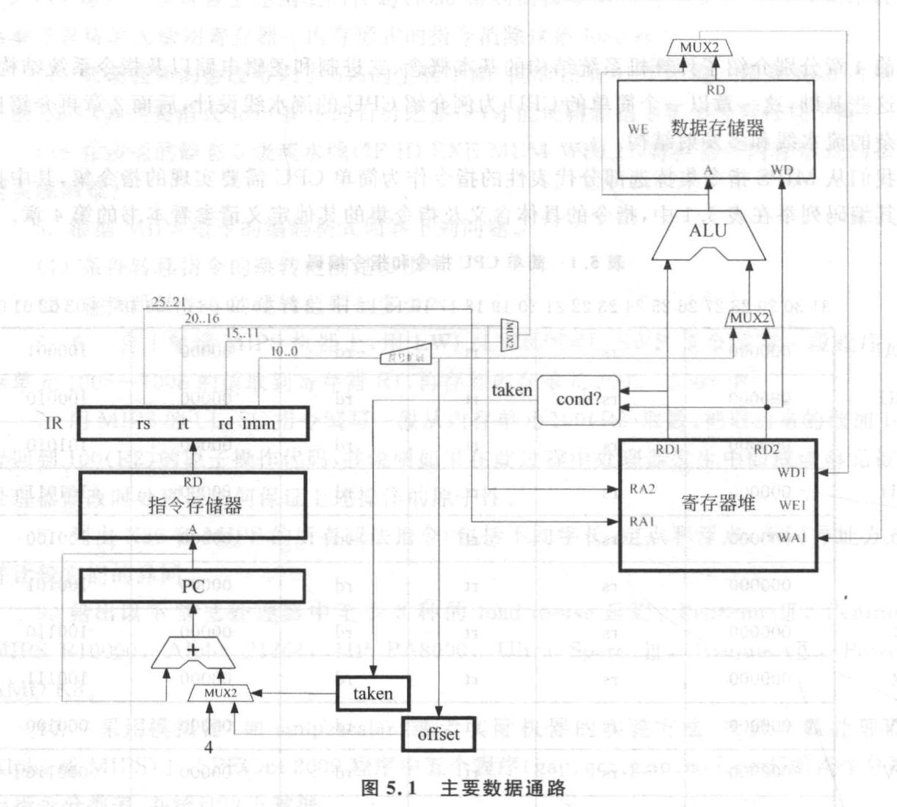

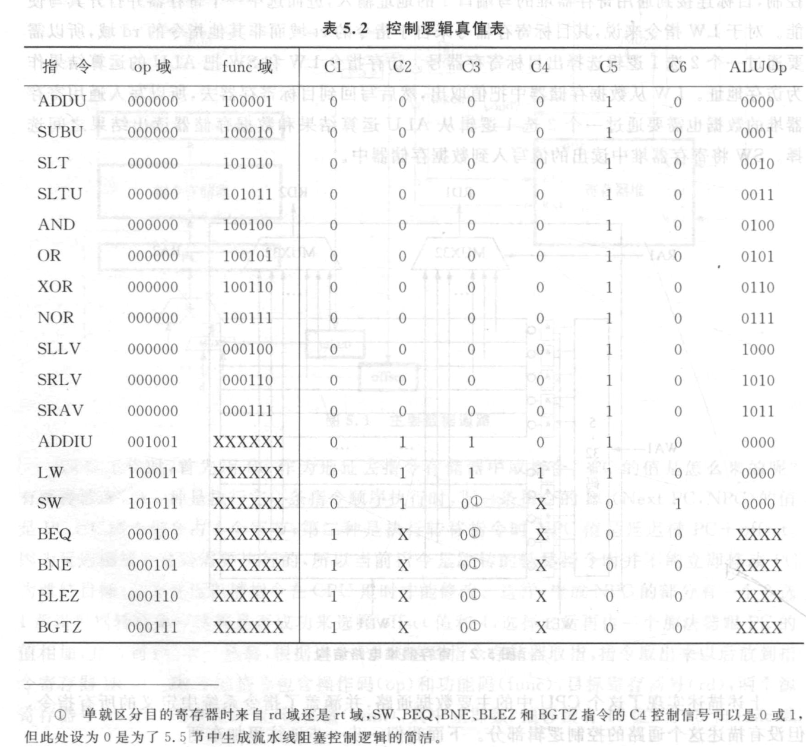
**解答与解析**：
对照教材第 76 页表 5.2（控制逻辑真值表）及第 77 页译码逻辑，4 位 `aluop` 对应的 11 种运算编码如下：
- `4'b0000`：`ADDU` / `ADDIU` / `LW` / `SW`（加法 `in1 + in2`）
- `4'b0001`：`SUBU`（减法 `in1 - in2`）
- `4'b0010`：`SLT`（有符号小于置 1：若 `$signed(in1) < $signed(in2)` 则输出 `32'd1`，否则 `32'd0`）
- `4'b0011`：`SLTU`（无符号小于置 1：若 `in1 < in2` 则输出 `32'd1`，否则 `32'd0`）
- `4'b0100`：`AND`（按位与 `in1 & in2`）
- `4'b0101`：`OR`（按位或 `in1 | in2`）
- `4'b0110`：`XOR`（按位异或 `in1 ^ in2`）
- `4'b0111`：`NOR`（按位或非 `~(in1 | in2)`）
- `4'b1000`：`SLLV`（逻辑左移 `in2 << in1[4:0]` 或 `in1 << in2[4:0]`）
- `4'b1010`：`SRLV`（逻辑右移 `in1 >> in2[4:0]`）
- `4'b1011`：`SRAV`（算术右移 `$signed(in1) >>> in2[4:0]`）

完整的 `alu_module` Verilog 代码如下：
```verilog
module alu_module(
    input  [ 3:0] aluop,
    input  [31:0] in1,
    input  [31:0] in2,
    output [31:0] out
);

    // 有符号数比较 SLT: in1 < in2 (考虑正负符号位 in1[31] 和 in2[31])
    wire slt_res;
    assign slt_res = (in1[31] && !in2[31]) ? 1'b1 :
                     (!in1[31] && in2[31]) ? 1'b0 :
                     (in1 < in2);

    // 算术右移 SRAV
    wire [31:0] sra_res;
    assign sra_res = ($signed(in1)) >>> in2[4:0];

    // 根据 aluop 选择输出结果
    assign out = ({32{aluop == 4'b0000}} & (in1 + in2))                |
                 ({32{aluop == 4'b0001}} & (in1 - in2))                |
                 ({32{aluop == 4'b0010}} & {31'b0, slt_res})           |
                 ({32{aluop == 4'b0011}} & {31'b0, (in1 < in2)})       |
                 ({32{aluop == 4'b0100}} & (in1 & in2))                |
                 ({32{aluop == 4'b0101}} & (in1 | in2))                |
                 ({32{aluop == 4'b0110}} & (in1 ^ in2))                |
                 ({32{aluop == 4'b0111}} & ~(in1 | in2))               |
                 ({32{aluop == 4'b1000}} & (in1 << in2[4:0]))          |
                 ({32{aluop == 4'b1010}} & (in1 >> in2[4:0]))          |
                 ({32{aluop == 4'b1011}} & sra_res);

endmodule
```

---

## 第6章 动态流水线

### 习题 6.1
**题目**：在乱序执行的指令流水线中，指令有序进入流水线、乱序执行并有序退出，分别说明保留站、重命名寄存器和重排序缓存在乱序执行流水线中的作用。
**解答与解析**：
1. **保留站（Reservation Station, RS）的作用**：
   - 作为指令有序译码/分派（Dispatch）与乱序发射执行（Issue/Execute）之间的**指令等待窗口与缓冲队列**。
   - 存放已译码但源操作数尚未就绪（或功能部件忙碌）的指令；一旦某条指令所需的所有源操作数均准备就绪（通过侦听公共数据总线 CDB 获得结果）且对应功能部件空闲，保留站便将该指令**乱序发射**到功能部件执行，从而让无数据相关的后续指令越过前面被阻塞的指令先行执行，挖掘指令级并行性（ILP）。
   - 在经典 Tomasulo 算法中，保留站还兼作隐式的重命名存储单元，用于缓冲已就绪的源操作数值。
2. **重命名寄存器（Rename Registers / Physical Register File）的作用**：
   - 通过将指令中有限的架构逻辑寄存器映射（重命名）到数量更多的物理重命名寄存器（或 ROB 项/保留站号），**彻底消除由于寄存器名字复用引起的假相关——反相关（WAR）和输出相关（WAW）**。
   - 使得同一个逻辑寄存器的不同生命周期写入不同的物理存储位置，后继写指令无需等待前面读/写同一逻辑寄存器的指令完成即可乱序执行。
3. **重排序缓存（Reorder Buffer, ROB）的作用**：
   - 维护所有在飞（In-flight）指令的**原始程序顺序（Program Order）**，暂存已乱序执行完成但尚未提交（Commit）的指令运算结果与异常状态标志。
   - 控制指令 strictly **按程序顺序退出（提交/退休，In-order Commit）**：只有当一条指令到达 ROB 队头且无异常时，才将其结果真正更新到架构可见的寄存器堆或数据存储器（Cache）中。
   - **实现精确例外（Precise Exception）与分支预测错误的快速恢复**：一旦某条指令发生例外或分支预测失败，只需在该指令到达 ROB 队头（或检测到分支错误）时将 ROB 中该指令及其之后的所有指令清空（Flush）并恢复重命名映射表，而该指令之前的指令均已按序提交，从而保证精确的体系结构现场。

---

### 习题 6.2
**题目**：证明：如果数组元素 `A(a*i+b)` 和 `A(c*i+d)` 之间存在相关，那么 $\text{GCD}(c, a)$ 能够整除 $(d - b)$。
**解答与解析**：
**证明（循环数组访存相关的 GCD 测试定理）**：
1. 假设在循环的某两次迭代 $i = i_1$ 和 $i = i_2$（其中 $i_1, i_2 \in \mathbb{Z}$ 为整数循环下标）中，数组元素 `A(a*i + b)` 与 `A(c*i + d)` 访问了同一个内存单元（即存在存储器数据相关），则必有下标相等：
   $$a \cdot i_1 + b = c \cdot i_2 + d$$
2. 移项整理可得线性丢番图方程（二元一次不定方程）：
   $$c \cdot i_2 - a \cdot i_1 = b - d \quad \text{或} \quad a \cdot i_1 - c \cdot i_2 = d - b$$
3. 设 $g = \text{GCD}(c, a)$ 为整数 $c$ 和 $a$ 的最大公约数。根据最大公约数的定义，存在整数 $c' = \frac{c}{g} \in \mathbb{Z}$ 和 $a' = \frac{a}{g} \in \mathbb{Z}$，使得 $c = g \cdot c'$，$a = g \cdot a'$。
4. 将 $c = g \cdot c'$ 和 $a = g \cdot a'$ 代入上式：
   $$g \cdot (a' \cdot i_1 - c' \cdot i_2) = d - b \implies \frac{d - b}{\text{GCD}(c, a)} = a' \cdot i_1 - c' \cdot i_2$$
5. 由于 $a', c', i_1, i_2$ 均为整数，等式右端 $a' \cdot i_1 - c' \cdot i_2$ 必为整数，因此 $\text{GCD}(c, a)$ 必定能够整除 $(d - b)$。证毕。

---

### 习题 6.3
**题目**：请比较 Tomasulo 算法和记分板技术分别是如何处理 RAW、WAR 和 WAW 相关的。
**解答与解析**：

| 相关类型 | 记分板技术（Scoreboard，如 CDC 6600） | Tomasulo 算法（如 IBM 360/91） |
| :--- | :--- | :--- |
| **真相关 (RAW)** | **在读取操作数（Read Operands）阶段阻塞**：指令已发射到功能部件后，记分板监控源寄存器状态；只有当所有源操作数都由前序指令写回寄存器堆后，才通知功能部件读取操作数并开始执行。 | **在保留站（Reservation Station）中通过标记追踪与结果总线（CDB）广播解决**：发射时若源操作数未就绪，则在保留站的 `Qj/Qk` 域记录将产生该结果的保留站号；当生产者完成执行并在 CDB 上广播结果时，等待该标记的所有保留站同时截取数据并就绪执行。 |
| **反相关 (WAR)** | **在写回（Write Result）阶段阻塞**：当一条指令执行完毕准备写回目的寄存器时，记分板检查是否有前序已发射指令尚未读取该寄存器（`Rj/Rk == Yes`）；若有，则**暂停当前指令的写回**，直到前序指令读完操作数。 | **在发射（Issue）阶段通过寄存器重命名和直接拷贝操作数彻底消除**：发射时若源寄存器已就绪，直接将值读入保留站 `Vj/Vk`；若未就绪，则记录产生旧值的前序保留站号 `Qj/Qk`。此后即便后继指令覆写了该寄存器名，也不会影响前面指令获取正确的旧值，无需任何阻塞。 |
| **输出相关 (WAW)** | **在发射（Issue）阶段阻塞**：在指令发射时检查其目的寄存器是否已被某条正在执行、尚未写回的前序指令占用；若存在 WAW 冲突，则**停止发射该指令及后续所有指令**，直至前序指令完成写回。 | **在发射（Issue）阶段通过寄存器重命名彻底消除**：每当新指令发射时，直接将寄存器状态表（RAT/Qi）中该目的寄存器的标记更新为**最新指令所在的保留站号**。前序写同一寄存器的指令完成时只广播给依赖它的保留站，不再写回该寄存器，无需阻塞发射。 |

---

### 习题 6.4
**题目**：请简述动态流水线中如何实现精确例外。
**解答与解析**：
1. **精确例外的定义**：当某条指令 $I_k$ 触发例外（Exception）时，处理器现场必须满足：① 在程序顺序上位于 $I_k$ **之前**的所有指令都已经执行完毕并完整修改了机器状态；② 位于 $I_k$ **及之后**的所有指令均像从未执行过一样（没有对体系结构可见的寄存器或存储器产生任何修改）。
2. **动态流水线中面临的挑战**：由于指令乱序执行、不同指令执行延迟不同，$I_k$ 之后的指令可能比 $I_k$ 先执行完，若直接写回寄存器堆或存储器，就会破坏精确例外现场。
3. **基于重排序缓存（ROB）的实现机制**：
   - **按序分配、乱序写回 ROB**：指令在译码/发射阶段按程序顺序在 ROB 中分配表项；指令乱序执行完成后，其结果只写回对应的 ROB 表项（或物理寄存器），**不直接修改架构状态（架构寄存器堆或数据 Cache）**。
   - **异常状态随指令在 ROB 中记录**：当某条指令在取指、译码、执行或访存阶段发生例外时，硬件**不立即响应例外**，而是将例外原因记录在该指令的 ROB 表项中，等待其到达 ROB 队头。
   - **按序提交（In-order Commit）与异常处理**：ROB 仅从队头按程序顺序提交指令。当带有例外标记的指令到达 ROB 队头时，表明它之前的所有指令均已正常提交完毕；此时处理器正式触发例外处理，将 **ROB 中该指令及其之后的所有表项全部清空（Flush）**，恢复重命名映射表（RAT）到架构状态，保存该指令的 PC 到 `EPC` 并跳转到操作系统例外处理入口。这样就严格保证了动态乱序流水线的精确例外。

---

### 习题 6.5
**题目**：以下这个循环是高斯消元法中的核心操作，称为 DAXPY 循环（双精度的 $a$ 乘以 $X$ 再加上 $Y$），以下代码实现了对长度为 100 的向量进行 DAXPY 操作：$Y = a * X + Y$。
```mips
bar:  LDC1   F2, 0(R1)       ; 取数 X(i)
      MUL.D  F4, F2, F0      ; 乘法操作 a * X(i)
      LDC1   F6, 0(R2)       ; 取数 Y(i)
      ADD.D  F6, F4, F6      ; 加法操作 a * X(i) + Y(i)
      SDC1   F6, 0(R2)       ; 存数 Y(i)
      DADDIU R1, R1, #8      ; X 的下标加 1
      DADDIU R2, R2, #8      ; Y 的下标加 1
      DSGTUI R3, R1, #800    ; 测试循环是否结束
      BEQZ   R3, bar         ; 如果循环没有结束，转移到 bar
      NOP
```
在单发射静态流水线上，假定浮点流水线的延迟如附表 6.1 所示（延迟为 $N$ 表示第 $T$ 拍操作数准备好开始运算，第 $T + N - 1$ 拍可以写回结果），分支指令在译码阶段（ID）计算结果，采用了分支延迟槽技术，整数操作在一拍之内发射和完成，并且结果是完全旁路的（fully bypassed）。

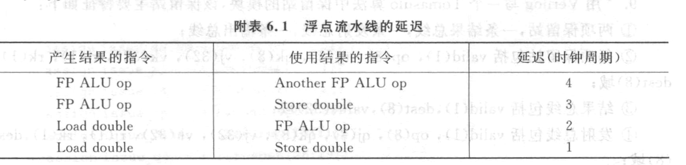

- **(1)** 把这个循环展开足够的次数，要求消除所有停顿周期和循环开销指令。循环将会被展开多少次？写出调度后的代码，每产生一个结果需要多少执行时间？
- **(2)** 写出 DAXPY 循环在软件流水后的代码，可以省略软件流水的装入代码和排空代码，每产生一个结果需要多少执行时间？
**解答与解析**：
先理解附表 6.1 中“延迟为 $N$”的含义（教材定义：第 $T$ 拍开始运算，第 $T+N-1$ 拍写回，意味着第 $T+N$ 拍消费者可以开始运算，即生产者与消费者发射间隔至少为 $N$ 拍，中间需插入 $N - 1$ 条无关指令）：
- `Load double` $\to$ `FP ALU op`：延迟为 $2$ 拍（中间至少隔 **1 条**指令）；
- `FP ALU op (MUL.D)` $\to$ `FP ALU op (ADD.D)`：延迟为 $4$ 拍（中间至少隔 **3 条**指令）；
- `FP ALU op (ADD.D)` $\to$ `Store double (SDC1)`：延迟为 $3$ 拍（中间至少隔 **2 条**指令）；
- 整数操作延迟为 $1$ 拍（完全旁路，0 停顿），分支具有 1 个延迟槽。

**(1) 循环展开与指令调度**：
> **【展开次数分析】**：采用“展开 2 次（Unroll by 2）”时：
> - 共有 2 条 `LDC1 X`、2 条 `LDC1 Y`、2 条 `MUL.D`、2 条 `ADD.D`、2 条 `SDC1`、4 条循环控制指令（`DADDIU R1`, `DADDIU R2`, `DSGTUI R3`, `BEQZ`），共计 **14 条指令**。
> - 验证展开 2 次能否消除全部停顿：
>   - `MUL.D F4`（第 4 条）与 `ADD.D F6`（第 8 条）相距 $8 - 4 = 4$ 拍 $\ge 4$（无停顿！）；
>   - `MUL.D F5`（第 5 条）与 `ADD.D F7`（第 9 条）相距 $9 - 5 = 4$ 拍 $\ge 4$（无停顿！）；
>   - `ADD.D F6`（第 8 条）与 `SDC1 F6`（第 11 条）相距 $11 - 8 = 3$ 拍 $\ge 3$（无停顿！）；
>   - `ADD.D F7`（第 9 条）与放入分支延迟槽的 `SDC1 F7`（第 14 条）相距 $14 - 9 = 5$ 拍 $\ge 3$（无停顿！）。
> - 因此**最少只需展开 2 次（每次循环处理 2 个元素）**即可完全消除所有数据相关停顿与 `NOP`！（若展开 4 次，则每个元素耗时从 $7$ 拍进一步降至 $24 / 4 = 6$ 拍）。下面给出**最少展开 2 次**和**展开 4 次**的标准代码：

- **方案 A：最少展开次数——展开 2 次（共 14 条指令，0 停顿）**：
```mips
bar:
    LDC1   F2, 0(R1)        ; 1. 取 X(i)
    LDC1   F3, 8(R1)        ; 2. 取 X(i+1)
    LDC1   F6, 0(R2)        ; 3. 取 Y(i)   (隔开 F2->MUL.D 2拍)
    MUL.D  F4, F2, F0       ; 4. F4 = a * X(i)
    MUL.D  F5, F3, F0       ; 5. F5 = a * X(i+1)
    LDC1   F7, 8(R2)        ; 6. 取 Y(i+1)
    DADDIU R1, R1, #16      ; 7. X 指针 + 16 (填充 MUL->ADD 的 4 拍延迟)
    ADD.D  F6, F4, F6       ; 8. F6 = F4 + Y(i)   (距第4条恰为 4 拍，0 停顿!)
    ADD.D  F7, F5, F7       ; 9. F7 = F5 + Y(i+1) (距第5条恰为 4 拍，0 停顿!)
    DADDIU R2, R2, #16      ; 10. Y 指针 + 16 (填充 ADD->SD 的 3 拍延迟)
    SDC1   F6, -16(R2)      ; 11. 存 Y(i)   (距第8条恰为 3 拍，0 停顿!)
    DSGTUI R3, R1, #800     ; 12. 测试循环结束
    BEQZ   R3, bar          ; 13. 条件转移
    SDC1   F7, -8(R2)       ; 14. [分支延迟槽] 存 Y(i+1) (距第9条为 5 拍 >= 3 拍，0 停顿!)
```
  - **执行时间**：每次循环执行 14 条指令（0 停顿，耗时 14 拍）产生 2 个结果，因此**每产生一个结果需要 $14 / 2 = 7$ 个时钟周期**。
  *(注：若展开 4 次，则循环体有 $5 \times 4 + 4 = 24$ 条指令，耗时 24 拍产生 4 个结果，每产生一个结果需要 $24 / 4 = 6$ 个时钟周期)*。

**(2) 软件流水（Software Pipelining）后的代码**：
首先分析原有循环中的数据流图并对运算部分进行跨迭代软件流水切分（见下图）：

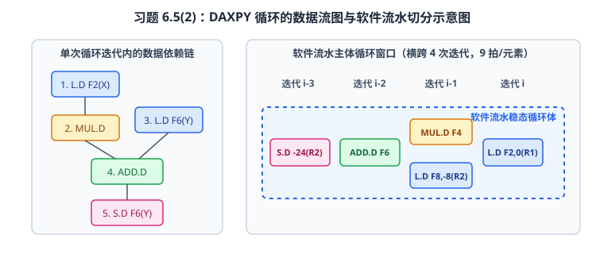

将第 $i-3$ 次循环的 `SDC1`、第 $i-2$ 次循环的 `ADD.D`、第 $i-1$ 次循环的 `MUL.D` 以及第 $i$ 次循环的 `LDC1 X(i)` 和 `LDC1 Y(i-1)` 组合在同一个循环体内，并利用指令间隔自然满足延迟要求（省略装入 Prologue 和排空 Epilogue 代码）：
```mips
bar:
    SDC1   F6, -24(R2)      ; 1. 存第 i-3 次循环的结果 Y(i-3)
    ADD.D  F6, F4, F8       ; 2. 算第 i-2 次循环的加法 a*X(i-2) + Y(i-2)
    MUL.D  F4, F2, F0       ; 3. 算第 i-1 次循环的乘法 a*X(i-1)
    LDC1   F2, 0(R1)        ; 4. 取第 i 次循环的 X(i)
    LDC1   F8, -8(R2)       ; 5. 取第 i-1 次循环的 Y(i-1)
    DADDIU R1, R1, #8       ; 6. 更新 R1
    DSGTUI R3, R1, #800     ; 7. 循环结束判断
    BEQZ   R3, bar          ; 8. 分支转移
    DADDIU R2, R2, #8       ; 9. [分支延迟槽] 更新 R2
```
- **相关性与停顿检验**：
  - 同一迭代内：`SDC1` 使用上一轮迭代第 2 拍计算的 `F6`（间隔 8 拍 $\ge 3$ 拍）；`ADD.D` 使用上一轮第 3 拍计算的 `F4`（间隔 8 拍 $\ge 4$ 拍）和第 5 拍加载的 `F8`（间隔 6 拍 $\ge 2$ 拍）；`MUL.D` 使用上一轮第 4 拍加载的 `F2`（间隔 8 拍 $\ge 2$ 拍）；同拍内先读后写（WAR）在静态顺序流水线中天然无冲突。
- **执行时间**：主体循环共 9 条指令，0 拍停顿，每次迭代产生 1 个结果，故**每产生一个结果需要 $9$ 个时钟周期**。

---

### 习题 6.6
**题目**：假设有一个如附图 6.1 所示的支持精确例外处理的浮点流水线。流水线分成发射、执行并写回以及提交 3 个阶段，其中浮点加法部件延迟为 2 拍（即假设第 $T$ 拍操作数准备好开始运算，第 $T+1$ 拍可以写回结果），浮点乘法部件延迟为 3 拍，浮点操作队列中已有如图所示的指令，且寄存器的初值如图 6.1 所示，请给出 6 拍内每一拍的寄存器以及结果总线值的变化。

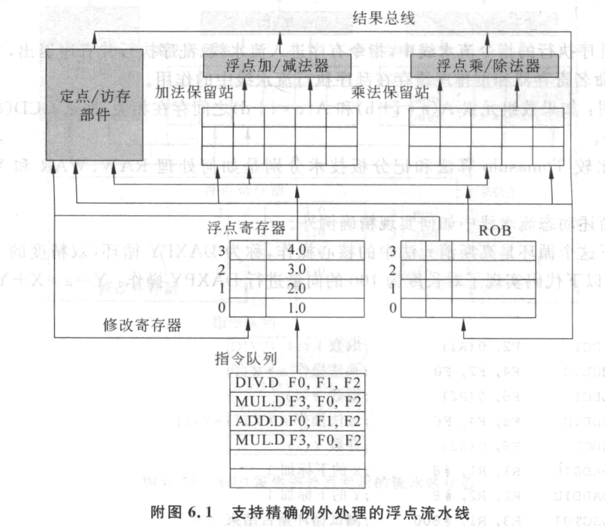

指令队列中的 4 条指令（自底向上依次为第 1~4 条）：
1. `DIV.D F0, F1, F2`
2. `MUL.D F3, F0, F2`
3. `ADD.D F0, F1, F2`
4. `MUL.D F3, F0, F2`
浮点寄存器初值：`F0 = 1.0`, `F1 = 2.0`, `F2 = 3.0`, `F3 = 4.0`。
**解答与解析**：
> **【关于 `DIV.D` 延迟的说明】**：
> 题干给出了“浮点加法部件延迟为 2 拍（第 $T$ 拍运算，第 $T+1$ 拍写回），浮点乘法部件延迟为 3 拍（第 $T$ 拍运算，第 $T+2$ 拍写回）”，但未在题干中直接写出 `DIV.D` 的延迟：
> - **口径一（3 拍除法延迟口径）**：将 `DIV.D` 视作 3 拍延迟（第 1 拍发射，第 2~4 拍执行并于第 4 拍写回结果总线 `resbus`，第 5 拍提交）。
> - **口径二（教材第 6.5 节图 6.14 正文口径）**：教材正文中 `DIV.D` 执行需 6 拍，因此在第 1~6 拍内 `DIV.D` 一直处于执行中，只有第 3 条指令 `ADD.D F0, F1, F2`（延迟 2 拍）和第 4 条指令 `MUL.D F3, F0, F2`（延迟 3 拍）会先完成写回！
> 下面首先按**口径一**给出完整的 6 拍逐拍状态表，并附教材正文口径说明：

#### 1. 指令执行周期总表（口径一：`DIV.D` 第 4 拍写回，`ADD.D` 延迟 2 拍，`MUL.D` 延迟 3 拍）

| ROB 项号 | 指令 | 发射 (Issue) | 开始执行 (EX) | 写回结果总线 (WB) | 提交 (Commit) |
| :---: | :--- | :---: | :---: | :---: | :---: |
| **ROB 0** | `DIV.D F0, F1, F2` | 第 1 拍 | 第 2 拍 | 第 4 拍（值 $2.0/3.0 \approx 0.67$） | 第 5 拍 |
| **ROB 1** | `MUL.D F3, F0, F2` | 第 2 拍 | 第 4 拍（获 ROB 0 结果） | 第 6 拍（值 $0.67 \times 3.0 = 2.0$） | 第 7 拍 |
| **ROB 2** | `ADD.D F0, F1, F2` | 第 3 拍 | 第 4 拍 | 第 5 拍（值 $2.0 + 3.0 = 5.0$） | 第 8 拍 |
| **ROB 3** | `MUL.D F3, F0, F2` | 第 4 拍 | 第 5 拍（获 ROB 2 结果） | 第 7 拍（值 $5.0 \times 3.0 = 15.0$） | 第 9 拍 |

#### 2. 第 1 ~ 6 拍每一拍的寄存器（重命名表/架构值）、ROB 与结果总线（`resbus`）状态表

| 周期 | 浮点寄存器状态 `(重命名ROB号, 架构值)` | ROB 表项状态 `ROB[0..3]: (操作, 目的, 结果值, 状态)` | 结果总线 `resbus: (ROB号, 值)` |
| :---: | :--- | :--- | :---: |
| **第 1 拍** | `F3: (-, 4.0)`<br>`F2: (-, 3.0)`<br>`F1: (-, 2.0)`<br>`F0: (ROB0, 1.0)` | `ROB[0]: (div, F0, -, 发射)` | 空 |
| **第 2 拍** | `F3: (ROB1, 4.0)`<br>`F2: (-, 3.0)`<br>`F1: (-, 2.0)`<br>`F0: (ROB0, 1.0)` | `ROB[1]: (mul, F3, -, 发射-等ROB0)`<br>`ROB[0]: (div, F0, -, 执行)` | 空 |
| **第 3 拍** | `F3: (ROB1, 4.0)`<br>`F2: (-, 3.0)`<br>`F1: (-, 2.0)`<br>`F0: (ROB2, 1.0)` *(WAW重命名更新为ROB2)* | `ROB[2]: (add, F0, -, 发射)`<br>`ROB[1]: (mul, F3, -, 等待ROB0)`<br>`ROB[0]: (div, F0, -, 执行)` | 空 |
| **第 4 拍** | `F3: (ROB3, 4.0)` *(WAW重命名更新为ROB3)*<br>`F2: (-, 3.0)`<br>`F1: (-, 2.0)`<br>`F0: (ROB2, 1.0)` | `ROB[3]: (mul, F3, -, 发射-等ROB2)`<br>`ROB[2]: (add, F0, -, 执行)`<br>`ROB[1]: (mul, F3, -, 执行)`<br>`ROB[0]: (div, F0, 0.67, 写回)` | **`(ROB 0, 0.67)`** |
| **第 5 拍** | `F3: (ROB3, 4.0)`<br>`F2: (-, 3.0)`<br>`F1: (-, 2.0)`<br>`F0: (ROB2, 0.67)` *(ROB0提交更新架构F0为0.67，但重命名标记仍指ROB2)* | `ROB[3]: (mul, F3, -, 执行)`<br>`ROB[2]: (add, F0, 5.0, 写回)`<br>`ROB[1]: (mul, F3, -, 执行)`<br>`ROB[0]: (已提交退出)` | **`(ROB 2, 5.0)`** |
| **第 6 拍** | `F3: (ROB3, 4.0)`<br>`F2: (-, 3.0)`<br>`F1: (-, 2.0)`<br>`F0: (ROB2, 0.67)` *(ROB2被ROB1挡在前面尚未提交)* | `ROB[3]: (mul, F3, -, 执行)`<br>`ROB[2]: (add, F0, 5.0, 等待提交)`<br>`ROB[1]: (mul, F3, 2.0, 写回)`<br>`ROB[0]: (已提交退出)` | **`(ROB 1, 2.0)`** |

---

### 习题 6.7
**题目**：假设有一个处理器的浮点流水线结构和指令延迟同第 6 题。
- **(1)** 请写出一段程序，会使得流水线因争用结果总线而停顿。
- **(2)** 为了避免结果总线争用带来的停顿，至少需要多少条结果总线？
**解答与解析**：
**(1) 引起结果总线（CDB）写回争用停顿的程序**：
- 因为浮点乘法部件延迟为 3 拍（第 $T$ 拍开始运算，第 $T+2$ 拍写回结果总线），浮点加法部件延迟为 2 拍（第 $T$ 拍开始运算，第 $T+1$ 拍写回结果总线）。
- 如果一条**浮点乘法指令**在第 1 拍发射（第 2 拍开始运算，将于**第 4 拍**写回结果总线），紧接着一条**无数据相关的浮点加法指令**在第 2 拍发射（第 3 拍开始运算，也将在于**第 4 拍**写回结果总线），这两条指令就会在**第 4 拍同时争用唯一的一条结果总线**，导致其中一条指令必须停顿 1 拍！
- 代码示例如下：
```mips
MUL.D  F0, F1, F2     ; 第 1 拍发射，第 2~4 拍执行（延迟 3 拍），第 4 拍请求结果总线写回
ADD.D  F3, F4, F5     ; 第 2 拍发射（与上一条无相关），第 3~4 拍执行（延迟 2 拍），同样在第 4 拍请求结果总线写回 -> 发生总线冲突停顿！
```

**(2) 避免结果总线争用所需的最少结果总线数量**：
- 从附图 6.1 可以看到，共享该结果总线的功能部件共有 **3 个**：**定点/访存部件**、**浮点加/减法器**、**浮点乘/除法器**。
- 在最坏情况下，这 3 个具有不同延迟的功能部件可能在同一拍各自完成一条指令并同时请求写回结果总线，因此为了彻底避免结果总线争用带来的停顿，**最多（至少）需要 $3$ 条结果总线**（每个功能部件独立一条写回通路）。
- *(补充讨论：对于单发射流水线，如果定点/访存部件的延迟固定与浮点加/减法器相同（如固定为 2 拍）或与浮点乘法器相同（固定为 3 拍），由于每拍只发射 1 条指令，两个相同固定延迟的全流水部件不可能在同一拍同时完成，此时最少只需要 **$2$ 条**结果总线)*。

---

## 第7章 多发射数据通路

### 习题 7.1
**题目**：在多发射乱序执行的处理器上，编译器的调度还需要吗？请举例论证你的观点。
**解答与解析**：
- **结论**：**仍然非常需要编译器的静态指令调度**。现代高性能处理器普遍采用“编译器静态调度 + 硬件动态乱序调度”协同工作的方式来最大化流水线效率。
- **核心原因与举例论证**：
  1. **硬件动态调度的指令窗口（Instruction Window）大小有限**：硬件保留站和重排序缓存（ROB）受面积、功耗和时序限制，通常只能容纳几十到一两百条指令（例如 32~128 项）。而**编译器可以在大得多的基本块、跨基本块（全局调度）乃至整个函数范围内**进行分析和重排，把距离很远的无关指令调度到一起，为硬件有限的指令窗口输送具有高并行度的指令流。
  2. **循环展开（Loop Unrolling）与软件流水（Software Pipelining）**：硬件动态调度无法自动消除循环控制指令本身（如指针自增和分支指令）并复制循环体，而编译器通过循环展开可以大幅减少分支指令频率、扩大基本块规模，并通过寄存器重命名把不同迭代的独立指令交织在一起。
  3. **减少取指与发射瓶颈**：在多发射处理器中，如果同一拍取出的 $N$ 条相邻指令之间存在密集的真数据相关链，即便后续能乱序执行，当前拍的发射宽度也会受限；编译器提前将无关指令排在一起，有助于硬件每拍满负荷发射。
  4. **访存消歧（Memory Disambiguation）与预取调度**：编译器可以利用高级语言的指针别名分析（Alias Analysis）确定两条访存指令是否无关，从而提前把长延迟的 `Load` 指令（或 `Prefetch` 预取指令）调度到使用点之前足够远的位置，隐藏 Cache 访存延迟。

---

### 习题 7.2
**题目**：请给出一种在多发射动态调度的处理器上解决访存相关的方案。
**解答与解析**：
在多发射乱序执行处理器中，访存指令（Load/Store）之间通过存储器地址发生相关（RAW、WAR、WAW）。由于有效地址在译码/发射阶段尚未计算出来，需要通过 **访存排序缓存（MOB，即 Load/Store Queue，包含 Load Buffer 和 Store Buffer）** 配合以下机制解决访存相关：
1. **利用 Store Buffer 消除访存 WAR 和 WAW 相关（按序提交写内存）**：
   - `Store` 指令在乱序执行阶段只计算访存地址并将待写数据暂存到 **Store Buffer（写缓冲/存储队列）** 中，**绝不真正写入数据 Cache**。
   - 只有当 `Store` 指令到达 ROB 队头**按序提交（Commit）**时，才真正将数据从 Store Buffer 写入数据 Cache。这样彻底消除了 `Store` 与前面 `Load` 的 WAR 相关以及两个 `Store` 之间的 WAW 相关。
2. **解决 Store -> Load 的 RAW 相关（Store-to-Load Forwarding，存数前递）**：
   - 当一条 `Load` 指令计算出访存地址后，除了访问数据 Cache 外，还必须**并行查询（CAM 匹配）Store Buffer 中所有程序顺序在该 `Load` 之前的未提交 `Store` 指令地址**：
     - 如果发现有匹配的 `Store` 地址，则直接从**最近一条（Youngest）匹配的前序 `Store` 表项**中把数据旁路前递（Forwarding）给该 `Load` 指令，而无需等待该 `Store` 提交写回 Cache。
3. **处理前序 Store 地址未知的两种策略**：
   - **方案 A（非推测保守方案，Non-speculative Load）**：如果程序顺序在 `Load` 之前还有任何一条 `Store` 指令的**地址尚未计算出来**，则暂停该 `Load` 指令执行，直到前面所有 `Store` 的地址都计算完毕并确认无冲突（或完成前递）后再执行 `Load`。
   - **方案 B（推测访存方案，Speculative Load Reordering + 违例重放）**：即使前面有 `Store` 地址未计算出来，也允许后续 `Load` 推测性地提前访问数据 Cache 并将其地址记录在 **Load Buffer** 中。当后续那条前序 `Store` 计算出地址时，硬件检索 Load Buffer 中程序顺序在该 `Store` 之后且已提前执行的 `Load`；一旦发现地址相同（发生了访存 RAW 违例），则像分支预测失败一样，**取消（Squash/Replay）该 `Load` 及其后续相关指令并重新执行**（还可以结合访存相关预测器如 Store Sets 预测哪些 Load 容易冲突）。

---

### 习题 7.3
**题目**：以下有 4 段 MIPS 代码片段，每段包含两条指令：
- **①** `DADDI R2, R2, 2` 与 `LD R2, 4(R2)`
- **②** `DSUB R3, R1, R2` 与 `SD R2, 7(R1)`
- **③** `SDC1 F2, 7(R1)` 与 `SDC1 F2, 200(R7)`
- **④** `BLEZ R2, place` 与 `SD R2, 7(R2)`
- **(1)** 分析上述 4 个代码片段，给出可能的相关和解决办法。
- **(2)** 假设目标硬件的流水线是支持乱序执行的双发射结构且指令在保留站后读寄存器，每个代码段的两条指令能够同时发射吗？
**解答与解析**：
**(1) 各代码片段的相关性分析与解决办法**：
- **代码段 ① (`DADDI R2, R2, 2`; `LD R2, 4(R2)`)**：
  - **存在的相关**：
    1. **真数据相关（RAW）**：`DADDI` 写入目的寄存器 `R2`，`LD` 需要读取 `R2` 作为基址寄存器；
    2. **输出相关（WAW）**：两条指令的目的寄存器都是 `R2`；
    3. **反相关（WAR）**：`DADDI` 读取旧 `R2`，`LD` 写入新 `R2`。
  - **解决办法**：WAW 和 WAR 假相关可通过**硬件寄存器重命名**消除；RAW 真相关无法消除，必须由第二条指令 `LD` 等待第一条指令 `DADDI` 计算出结果并通过**旁路前递（Forwarding）**获得 `R2` 的新值后再计算访存地址。
- **代码段 ② (`DSUB R3, R1, R2`; `SD R2, 7(R1)`)**：
  - **存在的相关**：**没有任何数据相关或控制相关**（两条指令只是共同只读源寄存器 `R1` 和 `R2`，RAR 不是相关）。
  - **解决办法**：若通用寄存器堆有足够的读端口（4 个读端口），两条指令可完全并行执行。
- **代码段 ③ (`SDC1 F2, 7(R1)`; `SDC1 F2, 200(R7)`)**：
  - **存在的相关**：当 `R1 + 7 == R7 + 200` 时，两条 Store 指令访问同一个内存地址，存在**存储器输出相关（Memory WAW 相关）**。
  - **解决办法**：通过 **Store Buffer（写缓冲/存储队列）** 让两条 Store 指令按程序顺序提交写回数据 Cache（或通过动态访存地址消歧保持对同一地址的写顺序）。
- **代码段 ④ (`BLEZ R2, place`; `SD R2, 7(R2)`)**：
  - **存在的相关**：存在**控制相关（Control Hazard）**（若不采用分支延迟槽，`SD` 是否应该执行取决于 `BLEZ` 是否发生跳转；若采用 MIPS 单指令分支延迟槽，则 `SD` 为延迟槽指令，总是无条件执行，此时无控制相关）。
  - **解决办法**：采用**动态分支预测 + 推测执行（Speculative Execution）**，并在 ROB 中支持分支预测失败时的指令取消（或采用架构级**分支延迟槽**技术）。

**(2) 在“支持乱序执行的双发射结构且指令在保留站后读寄存器”中能否同时发射**：
> **【注意“发射（Issue）”一词在教材正文与 PPT 中的两种界定】**：
> 题干特别注明了**“指令在保留站后读寄存器”**（对应教材第 7.2 节图 7.2(b) 的方案：指令先经重命名分派进入保留站，在**从保留站发射（Issue）到功能部件时**才读物理寄存器堆）：
- **角度 A（按教材正文术语：“发射”指从保留站发往功能部件读寄存器并开始执行）**：
  - **① 不能同时发射**：因为 `LD` 与 `DADDI` 存在关于 `R2` 的 RAW 真相关，`LD` 必须在保留站中等待 `DADDI` 发射执行完（或至少晚 1 拍通过旁路）产生 `R2` 后才能从保留站发射执行。
  - **②、③、④ 都可以同时发射**：② 完全无相关；③ 两条 Store 计算地址互不依赖（假设有两个访存地址部件，写顺序由 Store Buffer 在提交阶段保证）；④ 在推测执行下，`SD` 与 `BLEZ` 的源操作数 `R2` 均已就绪，可同时从保留站发射到分支部件和访存部件执行。
- **角度 B（若将“发射”理解为前端译码/重命名后在同一个周期双发射送入保留站 Dispatch）**：
  - 在支持双发射同拍重命名相关性检查（Intra-group Rename Dependency Check）和分支预测的乱序处理器中，**①、②、③ 均可同时进入保留站**（④ 若 `SD` 是延迟槽指令或预测 Not Taken，也可同时取指并进入保留站；若预测 Taken 且无延迟槽，则 `SD` 在取指/译码阶段即被丢弃不发射）。

---

### 习题 7.4
**题目**：假设流水线延迟如附表 7.1 所示（同附表 6.1），分支延迟为 1 个周期，没有延迟槽。下面循环计算 $Y[i] = a * X[i] + Y[i]$：
```mips
L:  LDC1   F4, 0(R2)        ; 读 Y[i]
    LDC1   F0, 0(R1)        ; 读 X[i]
    MUL.D  F0, F0, F2       ; 求 a * X[i]
    ADD.D  F0, F0, F4       ; 求 a * X[i] + Y[i]
    SDC1   F0, 0(R2)        ; 保存 Y[i]
    DADDIU R2, R2, -8
    DADDIU R1, R1, -8
    BNEZ   R1, L
    NOP
```
- **(1)** 假设目标机器的流水线是单发射的，将次循环展开足够的次数，使得代码执行没有不必要的延迟，写出调度后的代码并计算一个元素的执行时间。
- **(2)** 假设目标机器的流水线是双发射的，将次循环展开足够的次数，使得代码执行没有不必要的延迟，写出调度后的代码并计算一个元素的执行时间。
- **(3)** 简述编译器（如 GCC 在 `-O0, -O1, -O2, -O3` 不同优化选项下）针对此类循环会做哪些编译优化。


**解答与解析**：
> **注意本题条件与第 6.5 题的区别**：本题明确说明**“分支延迟为 1 个周期，没有延迟槽”**！这意味着在 `BNEZ R1, L` 之后**不能通过分支延迟槽免费执行有效指令**，`BNEZ` 后面会有 1 拍的分支延迟开销（1 cycle stall）！
> 实际上，原循环末尾的 `NOP` 只是表示那 1 拍的分支停顿周期。因此，要使“代码执行没有不必要的延迟”，展开后通过指令调度填满浮点延迟，每次循环结束处的 `BNEZ` 会占用 2 拍（1 拍指令本身 + 1 拍分支延迟），或者如果将 `DADDIU` 放在前面，分支本身带 1 拍停顿。

**(1) 单发射流水线下的循环展开与调度**：
- **展开 2 次（Unroll by 2）**：
  共有 2 组访存与浮点指令（10 条）+ 3 条循环控制指令（`DADDIU R2`, `DADDIU R1`, `BNEZ R1`）= **13 条指令** + `BNEZ` 后的 **1 拍分支延迟** = **14 拍**：
```mips
L:  LDC1   F0, 0(R1)        ; 1. 读 X[i]
    LDC1   F6, -8(R1)       ; 2. 读 X[i-1]
    MUL.D  F0, F0, F2       ; 3. F0 = a * X[i]   (距第1条 2 拍，0 停顿)
    MUL.D  F6, F6, F2       ; 4. F6 = a * X[i-1] (距第2条 2 拍，0 停顿)
    LDC1   F4, 0(R2)        ; 5. 读 Y[i]
    LDC1   F8, -8(R2)       ; 6. 读 Y[i-1]
    ADD.D  F0, F0, F4       ; 7. F0 = F0 + F4    (距第3条 4 拍，距第5条 2 拍，0 停顿)
    ADD.D  F6, F6, F8       ; 8. F6 = F6 + F8    (距第4条 4 拍，距第6条 2 拍，0 停顿)
    DADDIU R2, R2, -16      ; 9. 更新 R2
    SDC1   F0, 16(R2)       ; 10. 存 Y[i]        (距第7条 3 拍，0 停顿)
    DADDIU R1, R1, -16      ; 11. 更新 R1
    SDC1   F6, 8(R2)        ; 12. 存 Y[i-1]      (距第8条 4 拍 >= 3 拍，0 停顿)
    BNEZ   R1, L            ; 13. 分支跳转 (后跟 1 拍无延迟槽的分支延迟，共 14 拍)
```
- **计算一个元素的执行时间**：每次循环耗时 $13 + 1 = 14$ 拍，处理 2 个元素，故**计算一个元素需要 $14 / 2 = 7$ 个时钟周期**。

**(2) 双发射流水线（1 条定点/访存流水线 + 1 条浮点运算流水线）下的循环展开与调度**：
- 在双发射流水线中，每拍最多可同时发射 **1 条定点/访存指令（`LDC1`/`SDC1`/`DADDIU`/`BNEZ`）** 和 **1 条浮点运算指令（`MUL.D`/`ADD.D`）**。
- 将循环**展开 4 次（Unroll by 4）**，每次循环包含 15 条定点/访存指令（8 条 `LDC1` + 4 条 `SDC1` + 2 条 `DADDIU` + 1 条 `BNEZ`，外加 1 拍分支延迟，共占 16 拍定点/访存槽位）和 8 条浮点指令（4 条 `MUL.D` + 4 条 `ADD.D`），浮点指令完全重叠在定点/访存指令的周期内并行发射：

| 周期 | 定点 / 访存指令流水线 | 浮点运算指令流水线 |
| :---: | :--- | :--- |
| **1** | `L: LDC1 F0, 0(R1)` | *(空)* |
| **2** | `   LDC1 F6, -8(R1)` | *(空)* |
| **3** | `   LDC1 F10, -16(R1)` | `MUL.D F0, F0, F2` *(距周期1恰2拍)* |
| **4** | `   LDC1 F14, -24(R1)` | `MUL.D F6, F6, F2` *(距周期2恰2拍)* |
| **5** | `   LDC1 F4, 0(R2)` | `MUL.D F10, F10, F2` *(距周期3恰2拍)* |
| **6** | `   LDC1 F8, -8(R2)` | `MUL.D F14, F14, F2` *(距周期4恰2拍)* |
| **7** | `   LDC1 F12, -16(R2)` | `ADD.D F0, F0, F4` *(距周期3恰4拍，距周期5恰2拍)* |
| **8** | `   LDC1 F16, -24(R2)` | `ADD.D F6, F6, F8` *(距周期4恰4拍，距周期6恰2拍)* |
| **9** | `   DADDIU R2, R2, -32` | `ADD.D F10, F10, F12` *(距周期5恰4拍，距周期7恰2拍)* |
| **10** | `   SDC1 F0, 32(R2)` *(距周期7恰3拍)* | `ADD.D F14, F14, F16` *(距周期6恰4拍，距周期8恰2拍)* |
| **11** | `   SDC1 F6, 24(R2)` *(距周期8恰3拍)* | *(空)* |
| **12** | `   DADDIU R1, R1, -32` | *(空)* |
| **13** | `   SDC1 F10, 16(R2)` *(距周期9恰4拍)* | *(空)* |
| **14** | `   SDC1 F14, 8(R2)` *(距周期10恰4拍)* | *(空)* |
| **15** | `   BNEZ R1, L` | *(空)* |
| **16** | *(1 拍分支延迟气泡)* | *(空)* |

- **计算一个元素的执行时间**：每次循环共需 **16 个时钟周期**，处理 4 个元素，因此**计算一个元素需要 $16 / 4 = 4$ 个时钟周期**。

**(3) 编译器在不同优化级别（`-O0`, `-O1`, `-O2`, `-O3`）下对该循环实施的优化措施**：
1. **`-O0`（不优化）**：将每个局部变量和循环下标 `i` 均存放在栈帧内存中，每次运算前 `Load`、运算后 `Store`，存在大量冗余访存与流水线停顿。
2. **`-O1`（基础寄存器与循环优化）**：执行**寄存器分配（Register Allocation）**和**归纳变量强度削弱（Strength Reduction）**，将循环变量和数组地址指针直接保存在寄存器中自增，消除了冗余栈访存。
3. **`-O2`（指令调度优化）**：启用**静态指令调度（Instruction Scheduling）**，分析指令间的 RAW 延迟（如 Load 延迟和浮点乘加延迟），在不改变语义的前提下重排循环体内指令顺序以减少流水线停顿，但默认不进行循环展开。
4. **`-O3`（高级循环展开与向量化优化）**：自动进行**循环展开（Loop Unrolling）**、**寄存器重命名**、**软件流水**以及 **SIMD 自动向量化（Auto-Vectorization）**，大幅降低分支指令占比并充分填满多发射流水线。

---

### 习题 7.5
**题目**：一个 $n$ 发射的处理器，流水线情况如下：取指，译码，重命名到物理寄存器后送入发射队列，发射队列乱序发射，功能部件乱序执行，乱序写回物理寄存器，最后顺序提交并释放物理寄存器。已知该处理器有 $m$ 个逻辑寄存器，$i$ 个功能部件（$i > n$），每条指令从重命名到写回需要 $t_1$ 拍，从重命名到提交需要 $t_2$ 拍。为了能让流水线满负荷工作，最少需要多少个物理寄存器？（提示：并不是每个参数都有用）
**解答与解析**：
- **答案**：最少需要 **$n \times t_2 + m$** 个物理寄存器。
- **详细解析**：
  1. **架构状态始终占用的物理寄存器数**：处理器有 $m$ 个逻辑（架构）寄存器。在任何时刻，最新已提交（或当前架构映射表中指向）的 $m$ 个逻辑寄存器都各自占用 1 个物理寄存器，共计 **$m$ 个**。
  2. **流水线在飞（In-flight）指令占用的物理寄存器数**：
     - 每条指令在**重命名阶段**都需要分配 1 个新的空闲物理寄存器来存放其目的操作数；
     - 而一个被旧映射关系占用的物理寄存器，只有当**覆写同一逻辑寄存器的后继指令到达提交（Commit）阶段**时，才能确认之前的旧值不再被任何指令或异常处理需要，从而被安全释放！
     - 从重命名阶段到提交阶段共经历 **$t_2$ 拍**；当 $n$ 发射流水线满负荷工作时，每拍有 $n$ 条指令经过重命名，因此在重命名到提交这 $t_2$ 拍的流水线窗口中，同时在飞的未提交指令共有 **$n \times t_2$ 条**，最多同时额外占用 **$n \times t_2$ 个**物理寄存器。
  3. **汇总**：两者相加，为了保证流水线满负荷工作且绝不因物理寄存器耗尽而停顿（题目中的 $i$ 和 $t_1$ 为干扰参数），最少需要的物理寄存器总数为：
     $$N_{\text{PRF}} = n \times t_2 + m$$

---

### 习题 7.6
**题目**：设计一个采用如下结构的流水线，画出结构图并写出每个流水阶段的相应操作。
- **①** 采用物理寄存器堆重命名；
- **②** 保留站后读寄存器；
- **③** 全局保留站；
- **④** 一个定点部件、一个浮点部件、一个访存部件；
- **⑤** 双发射；
- **⑥** 流水阶段：取指、译码（包括重命名）、发射（包括读寄存器）、执行（包括写回）、提交。
**解答与解析**：
#### 1. 流水线结构框图（参照教材第 7.2 节图 7.2(b) 与图 6.12）

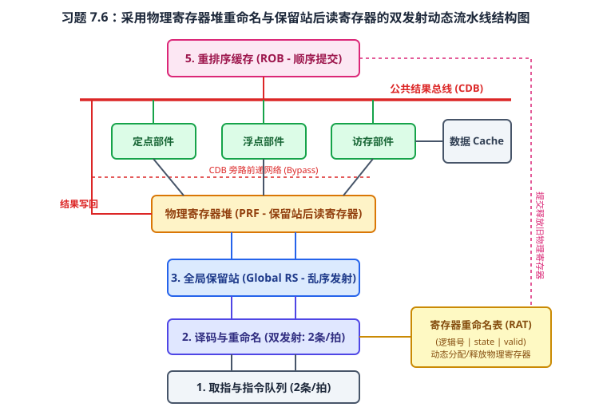

#### 2. 每个流水阶段的相应操作
1. **取指阶段（Fetch）**：
   - 根据 PC 和分支预测器每个时钟周期从指令 Cache 中取出 **2 条指令**，送入指令队列（Instruction Queue）。
2. **译码（包括重命名）阶段（Decode & Rename）**：
   - 每拍从指令队列取出 2 条指令同时译码。
   - **寄存器重命名**：用每条指令的逻辑源寄存器号查询**重命名映射表（RAT）**，获得对应的物理源寄存器号；从**空闲物理寄存器列表（Free List）**中为每条指令的逻辑目的寄存器分配一个新的空闲物理寄存器，更新 RAT 并将该物理寄存器的状态置为“未就绪（Busy/Mapped）”。
   - **同拍相关性检查**：检查同一拍双发射的两条指令之间是否存在 RAW/WAW 相关；若第 1 条指令的目的逻辑寄存器恰为第 2 条指令的源逻辑寄存器，则将第 2 条指令的物理源寄存器号直接替换为第 1 条指令新分配的物理目的寄存器号。
   - 将重命名后的 2 条指令（仅携带**物理寄存器号/指针**，不携带操作数数值）同时分派送入**全局保留站（Global RS）**和**重排序缓存（ROB）**。
3. **发射（包括读寄存器）阶段（Issue & Register Read）**：
   - 全局保留站监控所有指令的物理源操作数状态标志（是否已写回 PRF 或正在 CDB 上广播）。
   - 每拍从全局保留站中选择最多 2 条（或匹配对应功能部件的）所有源操作数均已就绪且目标功能部件空闲的指令**乱序发射**。
   - **保留站后读寄存器**：指令从全局保留站发射出来后，根据其携带的物理源寄存器号**读取物理寄存器堆（PRF）**（或者从 CDB 旁路网络直接截取正在写回的操作数），送入对应的功能部件（定点部件、浮点部件或访存部件）。
4. **执行（包括写回）阶段（Execute & Writeback）**：
   - 定点部件执行整数 ALU 运算，浮点部件执行浮点运算，访存部件计算有效地址并访问数据 Cache（或 Load/Store Queue）。
   - 运算完成后，结果通过公共结果总线（CDB）**写回物理寄存器堆（PRF）**（无需写回保留站，因为保留站不存操作数值，只更新该物理寄存器的就绪状态位 `Ready = 1` 以唤醒等待它的指令），同时在 ROB 中将该指令标记为“已完成（Completed）”。
5. **提交阶段（Commit）**：
   - ROB 从队头检查指令状态，按**原始程序顺序**每拍最多提交 2 条已完成且无异常的指令。
   - 提交时更新架构状态，并将被该指令覆写的同一个逻辑寄存器**上一次映射的旧物理寄存器**回收到空闲物理寄存器列表（Free List）中（若发生异常或分支预测错误，则清空 ROB 并恢复重命名映射表）。

---

### 习题 7.7
**题目**：请简述 Intel 的 Nehalem 处理器核的多发射机制。Nehalem 做了哪些措施来配合高的发射宽度？
**解答与解析**：
#### 1. Intel Nehalem 处理器核的多发射机制概述
Intel Nehalem（Core i7 第一代架构）采用 **4 路前端译码、6 路乱序微指令（$\mu\text{op}$）发射、4 路提交** 的超标量动态多发射结构：
- **前端取指与译码**：每拍从 $32\text{ KB}$ L1 指令 Cache 中取 16 字节指令流，经预译码后送入 18 项指令队列；通过 **4 个 X86 译码器**（1 个复杂译码器 + 3 个简单译码器）每拍最多将 **4 条 X86 宏指令**译码为 **4 条微指令（$\mu\text{ops}$）**，送入 28 项微指令循环缓冲队列（Loop Stream Detector / $\mu\text{op}$ Buffer）。
- **重命名与分配**：每拍对 **4 条 $\mu\text{ops}$** 进行寄存器重命名，并分配 **128 项 ROB**、**36 项集中式保留站（Unified Reservation Station）** 以及访存排序缓冲（48 项 Load Buffer、32 项 Store Buffer）。
- **6 端口乱序发射与执行**：36 项集中式保留站每拍最多可向 **6 个执行端口（Port 0~Port 5）同时乱序发射 6 条 $\mu\text{ops}$**：
  - **3 个算术/逻辑与分支运算端口（Port 0, 1, 5）**：包含 3 个整数 ALU、2 个向量/SIMD 整数 ALU、浮点乘/加/除及分支执行单元；
  - **3 个访存操作端口（Port 2, 3, 4）**：Port 2 负责 **128 位 Load 地址与数据读取**，Port 3 负责 **Store 地址计算**，Port 4 负责 **128 位 Store 数据写入**。

#### 2. Nehalem 为配合高发射宽度所采取的关键配套措施
为了“喂饱”每拍 4 译码 / 6 发射的宽流水线，Nehalem 在前端指令供给、指令窗口和数据访存三个维度采取了以下核心措施：
1. **强化前端指令供给能力**：
   - **宏指令融合（Macro-Fusion）**：在译码前将相邻的“比较指令（`CMP`/`TEST`）+ 条件转移指令（`Jcc`）”融合为 **1 条微指令（$\mu\text{op}$）** 进行译码、重命名和发射，支持 32 位和 64 位模式，有效提高了前端译码和发射带宽。
   - **循环流检测器（Loop Stream Detector, LSD）**：放置在译码器**之后**（28 项 $\mu\text{op}$ 缓冲）；当检测到不超过 28 条 $\mu\text{ops}$ 的循环时，直接关闭取指、分支预测和 X86 译码器，由 LSD 直接向重命名级连续供应已译码的 $\mu\text{ops}$，消除了 X86 变长译码瓶颈并降低功耗。
   - **两级分支预测器与两级 BTB + 独立返回地址栈（RAS）**：减少宽发射下因分支预测错误造成的流水线断流。
2. **扩大乱序指令窗口与采用同步多线程（SMT / 超线程）**：
   - 将 **ROB 扩大到 128 项**、保留站 36 项，可在更大指令范围内挖掘并行性以填满 6 个发射端口。
   - 引入 **2 路超线程（Hyper-Threading, SMT）**，当单个线程因长延迟访存或数据相关无法填满 6 个发射端口时，由同一核心上的另一个硬件线程互补填充空闲发射槽位。
3. **高带宽、低延迟的激进访存子系统**：
   - **庞大的访存排序缓存（MOB）**：配备 48 项 Load Buffer 和 32 项 Store Buffer（支持最多 80 条访存指令同时在飞），支持激进的推测乱序 Load 执行与快速 Store-to-Load Forwarding。
   - **三级 Cache 层次与两级 TLB + 片上集成三通道 DDR3 内存控制器（IMC）**：每核私有 $32\text{ KB}$ L1I / $32\text{ KB}$ L1D（4 拍）+ 低延迟私有 $256\text{ KB}$ L2（10 拍）+ 多核共享 $8\text{ MB}$ 包含式 L3 Cache，配合多级硬件预取器，保障高发射宽度下的数据供给。

---

## 第8章 转移预测

### 习题 8.1
**题目**：附表 8.1 是转移猜测的 Yeh 和 Patt 分类中根据转移历史表（BHT）和模式历史表（PHT）的不同组合形成的转移猜测种类。PC 中用来索引 BHT 表的位数为低 6 位，索引 PHT 表的位数为低 8 位，BHT 表每项 9 位，请画出 SAs 转移猜测的结构图，说明其基本原理，并计算该结构使用的存储单元位数。

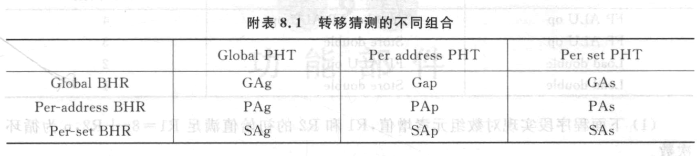
**解答与解析**：
1. **SAs（Per-Set BHR + Per-Set PHT）转移预测器基本原理**：
   - 在 Yeh 和 Patt 的两级自适应分支预测分类（`XAy`）中，第 1 个字母 **`S`（Per-Set BHT）** 表示按指令地址集合（用 PC 的低 6 位索引）分组共享**转移历史表（BHT）**，共有 $2^6 = 64$ 项，每项记录 9 位的局部集合转移历史（BHR）；
   - 第 3 个字母 **`s`（Per-Set PHT）** 表示**模式历史表（PHT）**也按指令地址集合（用 PC 的低 8 位索引，分成 $2^8 = 256$ 个 PHT 组/表）分组设置，每组有 $2^9 = 512$ 项 2 位饱和计数器；
   - **工作流程**：当遇到一条条件转移指令时，一方面用其 PC 的低 6 位索引 64 项的 **BHT**，读出 9 位历史向量（BHR）；另一方面将该 **9 位历史向量** 与 **PC 的低 8 位** 拼接起来（共 $8 + 9 = 17$ 位地址），去索引 **PHT**，读出对应的 **2 位饱和计数器**，以其最高位作为本次转移预测的方向（1 为跳转 Taken，0 为不跳转 Not Taken）；当分支结果确定后，将实际跳转结果移入该 BHT 表项，并更新对应的 2 位饱和计数器。

2. **SAs 转移猜测结构图**：

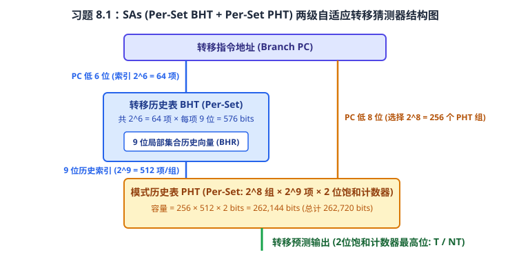

3. **存储单元总位数计算**：
   - **BHT（转移历史表）存储位数**：共有 $2^6 = 64$ 项，每项 $9\text{ bits}$：
     $$N_{\text{BHT}} = 2^6 \times 9 = 64 \times 9 = 576\text{ bits}$$
   - **PHT（模式历史表）存储位数**：由 8 位 PC 与 9 位 BHR 共同索引，共有 $2^8 \times 2^9 = 2^{17} = 131072$ 项，每项为一个 **2 位饱和计数器（$2\text{ bits}$）**：
     $$N_{\text{PHT}} = 2^8 \times 2^9 \times 2 = 256 \times 512 \times 2 = 262144\text{ bits}$$
   - **总存储单元位数**：
     $$N_{\text{Total}} = N_{\text{BHT}} + N_{\text{PHT}} = 576 + 262144 = \mathbf{262720\text{ bits}}$$

---

### 习题 8.2
**题目**：考虑下面一段 MIPS 代码，假设开始时 `R1` 寄存器存放值 $a$。
```mips
      BNEZ  R1, L1          ; 分支 b1 (a != 0)
      ADDIU R1, R0, 2       ; a == 0, a 的值变为 2
L1:   ADDIU R2, R1, -2
      BNEZ  R2, L2          ; 分支 b2 (a != 2)
      ...
L2:
```
假定采用 $(1, 1)$ 相关分支预测器（根据 1 位全局历史去选择 2 项的局部历史表 PHT，局部历史表为 1 位的计数器），初始预测位 `NT/NT`，且 $a$ 值以 `0, 1, 0, 1` 的规律变化，画出转移预测执行情况表，并统计预测错误的数目。
**解答与解析**：
1. **代码与 $(1, 1)$ 预测器机制分析**：
   - 当输入 $a = 0$ 时：
     - 分支 `b1 (a != 0)`：因 `R1 = 0`，实际**不跳转（`NT`）**；接着执行 `ADDIU R1, R0, 2` 使 `R1 = 2`；
     - 到达 `L1` 后，`R2 = R1 - 2 = 2 - 2 = 0`，故分支 `b2 (R2 != 0)` 实际也**不跳转（`NT`）**！
   - 当输入 $a = 1$ 时：
     - 分支 `b1 (a != 0)`：因 `R1 = 1 != 0`，实际**跳转（`T`）**到 `L1`（跳过了 `R1 = 2`）；
     - 到达 `L1` 后，`R2 = R1 - 2 = 1 - 2 = -1 != 0`，故分支 `b2` 实际也**跳转（`T`）**！
   - 可见 **`b2` 的实际跳转方向总是与 `b1` 完全一致**（$a=0 \implies \text{b1}=\text{NT}, \text{b2}=\text{NT}$；$a=1 \implies \text{b1}=\text{T}, \text{b2}=\text{T}$）。
   - **$(1, 1)$ 预测器结构**：使用 1 位全局分支历史寄存器（GHR，记录上一条刚执行完的分支是 `NT` 还是 `T`）从两张 PHT 表（表 0 对应上一条分支为 `NT`，表 1 对应上一条分支为 `T`）中选择一张；每条分支指令（`b1` 和 `b2`）在两张表中各占 1 项 **1 位预测器**（记为 `Pred_NT / Pred_T`，其中加粗项为当前 GHR 选中的表项，预测失败时直接翻转该项为实际方向）。初始状态均为 `NT/NT`，设初始全局历史 `GHR = NT`。

2. **转移预测执行情况表（$a$ 按 `0, 1, 0, 1` 变化）**：

| 轮次与 $a$ 值 | 进入 `b1` 前的 GHR | `b1` 状态 (`NT`表/`T`表) 及选中预测 | `b1` 实际方向 | `b1` 是否错 & 更新后 `b1` 状态 | 进入 `b2` 前的 GHR (即 `b1` 结果) | `b2` 状态 (`NT`表/`T`表) 及选中预测 | `b2` 实际方向 | `b2` 是否错 & 更新后 `b2` 状态 |
| :---: | :---: | :---: | :---: | :---: | :---: | :---: | :---: | :---: |
| **第 1 轮 ($a=0$)** | `NT` | **`NT`** / `NT` (预测 `NT`) | `NT` | 正确 (`NT`/`NT`) | `NT` | **`NT`** / `NT` (预测 `NT`) | `NT` | 正确 (`NT`/`NT`) |
| **第 2 轮 ($a=1$)** | `NT` | **`NT`** / `NT` (预测 `NT`) | `T` | **错误 (Miss)** $\to$ `T`/`NT` | `T` | `NT` / **`NT`** (预测 `NT`) | `T` | **错误 (Miss)** $\to$ `NT`/`T` |
| **第 3 轮 ($a=0$)** | `T` | `T` / **`NT`** (预测 `NT`) | `NT` | 正确 (`T`/`NT`) | `NT` | **`NT`** / `T` (预测 `NT`) | `NT` | 正确 (`NT`/`T`) |
| **第 4 轮 ($a=1$)** | `NT` | **`T`** / `NT` (预测 `T`) | `T` | 正确 (`T`/`NT`) | `T` | `NT` / **`T`** (预测 `T`) | `T` | 正确 (`NT`/`T`) |

3. **统计预测错误的数目**：
   - 在全部 4 轮（共 8 次分支执行）中，仅在第 2 轮（首次遇到 $a = 1$）时 `b1` 和 `b2` 各发生 1 次冷启动预测错误，此后第 3、4 轮全部预测正确，因此**总共有 $2$ 次预测错误**。

---

### 习题 8.3
**题目**：一个流水线处理器为条件分支配置了一个分支目标缓冲器 BTB。假设预测错误的损失为 5 个时钟周期，BTB 不命中的开销是 3 个时钟周期，并假设 BTB 命中率为 $90\%$，命中时预测精度为 $90\%$，分支频率为 $20\%$，没有分支的基本 CPI 为 $1$，请计算：
- **①** 该程序执行的 CPI；
- **②** 另外一个处理器没有转移猜测部件，每个分支有固定 2 个时钟周期的性能损失，与 ① 中的处理器比较执行速度。
**解答与解析**：
**① 计算配置 BTB 后的程序执行 CPI**：
- 已知无分支基本 $\text{CPI}_{\text{base}} = 1$，分支指令占比 $f_{\text{branch}} = 20\%$。
- 每条分支指令的平均额外开销周期数：
  - **BTB 命中且预测正确**（概率 $90\% \times 90\% = 81\%$）：额外开销为 $0$ 拍；
  - **BTB 命中但预测错误**（概率 $90\% \times (1 - 90\%) = 9\%$）：额外开销为 $5$ 拍；
  - **BTB 不命中**（概率 $1 - 90\% = 10\%$）：额外开销为 $3$ 拍。
- 因此该程序执行的 $\text{CPI}_1$ 为：
  $$\text{CPI}_1 = \text{CPI}_{\text{base}} + f_{\text{branch}} \times \left( 90\% \times 10\% \times 5 + 10\% \times 3 \right) = 1 + 0.20 \times (0.45 + 0.30) = 1 + 0.20 \times 0.75 = \mathbf{1.15}$$

**② 与无转移猜测部件（每条分支固定损失 2 拍）的处理器比较执行速度**：
- 无转移猜测部件处理器的 $\text{CPI}_2$ 为：
  $$\text{CPI}_2 = \text{CPI}_{\text{base}} + f_{\text{branch}} \times 2 = 1 + 0.20 \times 2 = \mathbf{1.40}$$
- 在相同主频和指令数下，两台处理器的执行速度之比为：
  $$\frac{\text{Speed}_1}{\text{Speed}_2} = \frac{\text{CPI}_2}{\text{CPI}_1} = \frac{1.40}{1.15} \approx \mathbf{1.217} \quad (\text{即 ① 比 ② 快约 } 21.7\% \approx 22\%)$$

---

### 习题 8.4
**题目**：分析并列出下列循环中的所有相关，包括输出相关、反相关、真相关。将循环展开，分析并讨论循环体间的相关。
```c
for (i = 2; i < N; i++) {
    a[i]   = a[i] + b[i];     // S1
    d[i+1] = a[i] - c[i];     // S2
    a[i-1] = 1 - b[i];        // S3
    b[i+1] = 1 + b[i];        // S4
}
```
**解答与解析**：

> **【前置概念：三类数据相关】**（假设按程序顺序，指令/语句 $A$ 在指令/语句 $B$ 之前执行，共同访问同一寄存器或内存单元 $x$）：
> - **真相关（True Dependence / 流相关，对应 RAW：先写后读 Read After Write）**：$A$ **写** $x$，随后 $B$ **读** $x$（$B$ 必须用到 $A$ 算出来的新值）。属于**真正的数据依赖**，**无法**通过寄存器重命名消除，必须保证 $A$ 先于 $B$ 完成写回/前递。
> - **反相关（Anti-Dependence，对应 WAR：先读后写 Write After Read）**：$A$ **读** $x$，随后 $B$ **写** $x$（若 $B$ 提前把 $x$ 改写了，$A$ 就会读错值）。属于**名相关（伪相关）**，本质是复用了同一个存储位置 $x$，**可以**通过重命名消除。
> - **输出相关（Output Dependence，对应 WAW：先写后写 Write After Write）**：$A$ **写** $x$，随后 $B$ 也**写** $x$（若 $A$ 晚于 $B$ 写回，最终留在 $x$ 中的就会变成旧值）。同样属于**名相关（伪相关）**，**可以**通过重命名消除。

可以通过将循环展开（例如列出第 $i$ 次迭代与第 $i+1$ 次迭代，或对比第 $i-1$ 次迭代与第 $i$ 次迭代）来清晰识别所有**循环内相关（Intra-iteration Dependence）**和**循环间相关（Loop-carried Dependence，跨迭代相关）**：

#### 1. 同一次循环迭代内部的相关（循环内相关）
在第 $i$ 次循环内：
- **真数据相关（RAW，先写后读）**：
  - **`S1` $\to$ `S2`（关于 `a[i]`）**：`S1` 写入 `a[i]`，`S2` 紧接着读取 `a[i]`。
- **反相关（WAR，先读后写）**：
  - **`S1` 自身（关于 `a[i]`）**：`S1` 先读取右端的旧 `a[i]`，再写入左端的新 `a[i]`。

#### 2. 不同循环迭代之间的相关（循环间相关，以第 $i-1$ 次迭代与第 $i$ 次迭代对比为例）
将第 $i-1$ 次迭代（记为 $S^{(i-1)}$）与第 $i$ 次迭代（记为 $S^{(i)}$）展开对比：
- 在第 $i-1$ 次迭代中：
  - $S_1^{(i-1)}$：读 `a[i-1]`, `b[i-1]` $\to$ 写 `a[i-1]`
  - $S_2^{(i-1)}$：读 `a[i-1]`, `c[i-1]` $\to$ 写 `d[i]`
  - $S_3^{(i-1)}$：读 `b[i-1]` $\to$ 写 `a[i-2]`
  - $S_4^{(i-1)}$：读 `b[i-1]` $\to$ **写 `b[i]`**
- 在第 $i$ 次迭代中：
  - $S_1^{(i)}$：读 `a[i]`, **读 `b[i]`** $\to$ 写 `a[i]`
  - $S_2^{(i)}$：读 `a[i]`, `c[i]` $\to$ 写 `d[i+1]`
  - $S_3^{(i)}$：**读 `b[i]`** $\to$ **写 `a[i-1]`**
  - $S_4^{(i)}$：**读 `b[i]`** $\to$ 写 `b[i+1]`

由此得出全部 **6 组循环间相关**：
1. **循环间真数据相关（RAW，共 3 组，均关于 `b[i]`）**：
   - **$S_4^{(i-1)} \to S_1^{(i)}$**：上一次循环 `S4` 写入 `b[i]`，本次循环 `S1` 读取 `b[i]`；
   - **$S_4^{(i-1)} \to S_3^{(i)}$**：上一次循环 `S4` 写入 `b[i]`，本次循环 `S3` 读取 `b[i]`；
   - **$S_4^{(i-1)} \to S_4^{(i)}$**：上一次循环 `S4` 写入 `b[i]`，本次循环 `S4` 读取 `b[i]`（形成 `b` 数组的跨迭代真相关链）。
2. **循环间输出相关（WAW，共 1 组，关于 `a[i-1]`）**：
   - **$S_1^{(i-1)} \to S_3^{(i)}$**：上一次循环 `S1` 写入 `a[i-1]`，本次循环 `S3` 再次覆写 `a[i-1]`。
3. **循环间反相关（WAR，共 2 组，均关于 `a[i-1]`）**：
   - **$S_1^{(i-1)} \to S_3^{(i)}$**：上一次循环 `S1` 读取 `a[i-1]`，本次循环 `S3` 写入 `a[i-1]`；
   - **$S_2^{(i-1)} \to S_3^{(i)}$**：上一次循环 `S2` 读取 `a[i-1]`，本次循环 `S3` 写入 `a[i-1]`。

---

### 习题 8.5
**题目**：通常转移历史表的索引是分支指令的低位地址。增大转移历史表可以降低同一个程序中多个分支使用同一个表项的概率。
- **(1)** 请给一个由于多个分支共用一个历史表项而导致分支预测错误增加的例子。
- **(2)** 请给一个由于多个分支共用一个历史表项而导致分支预测错误减少的例子。
- **(3)** 如果使用分支指令的其他地址位来索引转移历史表，对分支预测正确率会有什么影响？
**解答与解析**：
> **背景概念**：多个不同分支指令由于索引位相同而映射到同一个 BHT/PHT 表项的现象称为**分支别名冲突（Branch Aliasing / Interference）**，分为**破坏性冲突（Negative/Destructive Aliasing）**和**建设性冲突（Positive/Constructive Aliasing）**。

**(1) 共用一个历史表项导致分支预测错误增加（破坏性冲突）的例子**：
- 当两条高频交替执行的分支指令具有**完全相反的跳转倾向**，且它们的低位地址恰好相同（映射到同一个 PHT 表项）时，会互相破坏对方的预测状态。例如：
```mips
Loop:
    BEQZ  R1, Target1     ; 分支 B1 (假设 PC 低位为 0x004，若 R1 恒为 0，则 B1 总是跳转 Taken)
    NOP
Target1:
    ...                   ; (中间相隔整数倍的表大小，例如 256 字节)
    BNEZ  R1, Target2     ; 分支 B2 (PC 低位也是 0x004，因 R1 恒为 0，则 B2 总是不仅跳转 Not Taken)
    NOP
Target2:
    J     Loop
    NOP
```
- 如果 `B1` 和 `B2` 独立拥有表项，稳态下两者预测准确率均为 $100\%$；但当它们共用同一个 1 位（或 2 位）计数器表项时，`B1` 将计数器推向 Taken，`B2` 将计数器拉向 Not Taken，导致预测准确率暴跌（对于 1 位计数器，每次都会预测错误，错误率升至 $100\%$）。

**(2) 共用一个历史表项导致分支预测错误减少（建设性冲突）的例子**：
- 当两条先后执行的分支指令具有**相同的跳转条件或相同的行为模式**且共用同一个表项时，前一条分支对表项的训练（Warm-up）能够直接帮助后一条分支在首次执行时就预测正确。例如连续两个循环（或同一个条件判断）：
```c
for (i = 0; i < 100; i++) sum1 += a[i];   // 循环分支 B1 (连续 99 次 Taken)
for (i = 0; i < 100; i++) sum2 += b[i];   // 循环分支 B2 (与 B1 映射到同一 PHT 表项)
```
- 若预测表初始状态为 `NT`，当 `B2` 独占表项时，进入第二个循环的第一次迭代必定会发生 1~2 次冷启动预测错误；而当 `B2` 与 `B1` 共用一个表项时，`B1` 已经将该表项训练为强跳转（Strongly Taken），使得 `B2` 从第 1 次迭代起就能预测成功，从而减少了预测错误！

**(3) 使用分支指令的其他地址位索引转移历史表的影响**：
1. **如果改用分支指令的“高位地址”索引**：
   - **不利影响极大**：因为同一个函数、同一个循环或相邻代码段中的所有分支指令，其 PC 的**高位地址完全相同**！如果用高位地址索引，会导致局部代码块内的所有分支指令全部拥挤、冲突在同一个表项上，产生极其严重的别名冲突，使预测正确率大幅下降。
2. **如果采用“多位地址哈希（或将 PC 位与全局历史做异或，如 Gshare）”索引**：
   - 将 PC 的中低位与较高位（或全局分支历史 BHR）通过异或（XOR）哈希后再索引历史表，可以使分支指令在表中分布得更加均匀，显著降低不同分支碰撞到同一表项的概率，从而提高分支预测准确率。

---

### 习题 8.6
**题目**：假设流水线延迟如附表 8.2 所示（同附表 6.1），分支延迟为 1 个周期，有延迟槽。
- **(1)** 下面程序段实现对数组元素增值，`R1` 和 `R2` 的初始值满足 $R1 = 8n + R2$，$n$ 为循环次数。
```mips
L1: LDC1  F0, 0(R1)
    ADD.D F2, F0, F1
    SDC1  F2, 0(R1)
    ADDIU R1, R1, -8
    BNE   R1, R2, L1
    NOP
```
写出完整的软件流水循环代码，包括装入代码和排空代码，并且计算软件流水循环完成所有操作需要的总时钟周期数表达式。
- **(2)** 分析比较软件流水和循环展开两种方案的区别。


**解答与解析**：
**(1) 完整的软件流水代码（含装入代码、主体循环、排空代码）及总周期数**：
在单个数组元素操作中，有 3 步核心依赖操作：① `LDC1`（读 $X_i$）$\xrightarrow{\text{延迟 2 拍}}$ ② `ADD.D`（加 $F1$）$\xrightarrow{\text{延迟 3 拍}}$ ③ `SDC1`（存回 $X_i$）。
因此软件流水跨越 3 个迭代阶段（假设 $n \ge 3$）：在主体循环的第 $i$ 轮（$i = 3 \dots n$）中，依次执行第 $i-2$ 个元素的 `SDC1`、第 $i-1$ 个元素的 `ADD.D`、第 $i$ 个元素的 `LDC1`，并将 `ADDIU R1, R1, -8` 填入 `BNE` 的分支延迟槽中：

```mips
; ========= 1. 装入代码 (Prologue: 启动前 2 个元素，共 4 条指令) =========
    LDC1   F0, 0(R1)        ; 迭代 1: 取第 1 个元素 (地址 R1_0)
    ADD.D  F2, F0, F1       ; 迭代 1: 加第 1 个元素 (与上一条 LDC1 之间有 1 拍停顿)
    LDC1   F0, -8(R1)       ; 迭代 2: 取第 2 个元素 (地址 R1_0 - 8)
    ADDIU  R1, R1, -24      ; 预先将指针 R1 调整为 R1_0 - 24 (使主体循环结束条件恰为 R1 == R2)

; ========= 2. 软件流水主体循环 (Steady-State Kernel: 循环 n-2 次，每次 5 条指令 0 停顿 = 5 拍) =========
L1: SDC1   F2, 24(R1)       ; 存第 i-2 个元素 (上一轮 ADD.D 距此已满 3 拍，0 停顿)
    ADD.D  F2, F0, F1       ; 算第 i-1 个元素 (上一轮 LDC1 距此已满 2 拍，0 停顿)
    LDC1   F0, 8(R1)        ; 取第 i 个元素
    BNE    R1, R2, L1       ; 若 R1 != R2 则继续循环 (共执行 n-2 次)
    ADDIU  R1, R1, -8       ; [分支延迟槽] 更新指针 R1

; ========= 3. 排空代码 (Epilogue: 完成最后 2 个元素的加和存，共 3 条指令) =========
    SDC1   F2, 24(R1)       ; 存第 n-1 个元素
    ADD.D  F2, F0, F1       ; 算第 n 个元素
    SDC1   F2, 16(R1)       ; 存第 n 个元素 (与上一条 ADD.D 之间有 2 拍停顿)
```

- **总时钟周期数表达式计算**：
  1. **装入代码（Prologue）**：共 4 条指令，其中 `LDC1 F0, 0(R1)` 与紧邻的 `ADD.D F2, F0, F1` 之间有 $2 - 1 = 1$ 拍 Load-to-FP 延迟停顿，故耗时 $4 + 1 = \mathbf{5}$ **拍**。
  2. **软件流水主体循环（Kernel）**：每次循环共 5 条指令，内部及跨迭代之间完全满足附表 8.2 的延迟要求（0 拍停顿），每次循环耗时 $5$ 拍，共执行 $(n - 2)$ 次，故耗时 $\mathbf{5(n - 2)}$ **拍**。
  3. **排空代码（Epilogue）**：共 3 条指令，其中 `ADD.D F2, F0, F1` 与紧邻的 `SDC1 F2, 16(R1)` 之间有 $3 - 1 = 2$ 拍 FP-to-Store 延迟停顿，故耗时 $3 + 2 = \mathbf{5}$ **拍**。
  - **合计总时钟周期数**：
    $$T_{\text{total}} = (4 + 1) + 5(n - 2) + (3 + 2) = 5 + 5n - 10 + 5 = \mathbf{5n\text{ 个时钟周期}}$$

**(2) 软件流水（Software Pipelining）与循环展开（Loop Unrolling）的区别对比**：
1. **减少开销的侧重点不同**：
   - **循环展开**通过复制多次循环体并合并循环控制指令，**不仅能通过指令重排消除数据相关停顿，还能成倍降低分支指令与指针更新指令的执行频率（降低循环控制开销）**。
   - **软件流水**不复制循环体，每次迭代仍然处理 1 个元素的不同阶段，因此**不能减少分支指令和循环控制指令的执行次数**，但能将不同迭代的指令交织起来，彻底消除每个迭代内部的数据相关停顿。
2. **代码体积与寄存器压力不同**：
   - **循环展开**会导致**显著的代码体积膨胀（Code Bloat）**，增加指令 Cache 缺失风险，且展开 $k$ 次通常需要成倍增加重命名寄存器的使用量。
   - **软件流水**的主体循环（Kernel）非常紧凑，只需额外增加少量的装入（Prologue）和排空（Epilogue）代码，**代码膨胀极小**。
3. **运行时间特征不同**：
   - 如教材图 8.15 所示，**循环展开**在每个展开块内达到峰值速度，但在每次展开块交界处仍有一次迭代启动/收尾延迟（呈锯齿状）；而**软件流水**除了循环最开始的装入和最末尾的排空外，在整个主体循环期间始终以恒定的最高吞吐率平稳运行（二者也可结合使用，即对展开后的循环再做软件流水）。

---

### 习题 8.7
**题目**：请简述动态调度的处理器中如何实现转移猜测失败的取消。
**解答与解析**：
在动态乱序调度处理器中，通过维护**指令有序队列（如重排序缓存 ROB 或分支队列 Branch Queue）**配合**寄存器重命名表（RAT）检查点恢复机制**来实现转移猜测失败时的精确取消（Squash / Flush）：
1. **维护程序顺序与推测状态**：
   - 所有指令在译码/重命名阶段按原始程序顺序登记到 **ROB（重排序缓存）** 中；转移猜测之后的指令均作为推测指令乱序执行，其结果仅写回 ROB 或物理寄存器，在转移指令未确认并到达 ROB 队头前绝不提交到架构状态。
2. **检测转移猜测失败并取消后继指令**：
   - 当某条转移指令在执行阶段计算出真实的跳转方向和目标地址并与预测结果比对发现**猜测失败（Misprediction）**时，处理器可采取以下两种恢复时机之一：
     - **方法一（在转移指令执行阶段立即恢复——基于 Checkpoint 检查点）**：每当发射一条转移指令时，硬件对当前的**寄存器重命名映射表（RAT）、空闲物理寄存器列表指针、全局分支历史寄存器（GHR）和返回地址栈指针（RAS）**保存一份快照检查点（Checkpoint）。一旦在 EX 阶段发现该转移指令猜测失败，立即根据其 ROB 编号将 **ROB、保留站、功能部件以及 Load/Store 队列中位于该转移指令之后的所有指令全部作废清空（取消粒度为指令级；若采用基本块队列 Branch Queue 则按基本块粒度取消）**，并将 RAT、GHR、RAS 直接回滚到该转移指令保存的 Checkpoint，同时将 PC 重定向到正确的分支目标地址重新取指。
     - **方法二（等到转移指令到达 ROB 队头提交时恢复，或扫描 ROB 回滚 RAT）**：清空该转移指令之后的全部 ROB 项，并将重命名表直接恢复为已提交的架构寄存器映射表（ARF/Committed RAT），然后从正确目标地址重新取指。

---

## 第9章 功能部件

### 习题 9.1
**题目**：有两个 32 位的二进制数 `1000 1111 1110 1111 1100 0000 0000 0000` 和 `0000 0000 0000 0000 0000 0000 0000 0000`，请分别说出在下列情况下上述两个数的含义：
- **①** 补码；
- **②** 无符号数；
- **③** 单精度浮点数；
- **④** 一条 MIPS 指令。
**解答与解析**：
记第 1 个数为 $A = \text{1000\_1111\_1110\_1111\_1100\_0000\_0000\_0000}_2 = \text{0x8FEFC000}$；第 2 个数为 $B = \text{0x00000000}$。

**① 作为 32 位定点补码**：
- **数 $A$ (`0x8FEFC000`)**：最高位符号位为 `1`，是负数。对其按位取反加 1 求绝对值：
  - 按位取反：`0111_0000_0001_0000_0011_1111_1111_1111` (`0x70103FFF`)
  - 末位加 1：`0111_0000_0001_0000_0100_0000_0000_0000` (`0x70104000` $= 1880113152_{10}$)
  - 故 $A$ 表示补码 **`-0x70104000`**（即十进制 **`-1880113152`**）。
- **数 $B$ (`0x00000000`)**：表示整数 **`0`**。

**② 作为 32 位无符号数**：
- **数 $A$ (`0x8FEFC000`)**：表示无符号整数 **`0x8FEFC000`**（即十进制 **$2414854144$**）。
- **数 $B$ (`0x00000000`)**：表示无符号整数 **`0`**。

**③ 作为 IEEE 754 单精度浮点数**：
- **数 $A$ (`1_00011111_11011111100000000000000`)**：
  - 符号位 $s = 1$（负数）；
  - 阶码 $e = 00011111_2 = 31$，真实指数 $E = 31 - 127 = -96$；
  - 尾数 $1.f = 1.110111111_2 = 1 + \frac{1}{2} + \frac{1}{4} + \frac{1}{16} + \frac{1}{32} + \frac{1}{64} + \frac{1}{128} + \frac{1}{256} + \frac{1}{512} = 1 + \frac{447}{512} = \frac{959}{512} = 1.873046875$；
  - 故 $A$ 表示 **`-(1.110111111)_2 × 2^(31-127)`** $= -1.873046875 \times 2^{-96} \approx -2.36355 \times 10^{-29}$。
  *(注：注意 `110_1111_1100` 小数点后第 3 位是 0，后面紧跟 6 个 1，共 9 位有效小数)*。
- **数 $B$ (`0x00000000`)**：符号位为 0、阶码为 0、尾数为 0，表示 **`+0.0`（正零）**。

**④ 作为一条 32 位 MIPS 指令**：
- **数 $A$ (`100011_11111_01111_1100000000000000`)**：
  - 高 6 位操作码 `op = 100011`（十进制 $35$），对应 **`LW`（取字指令）**；
  - 源基址寄存器 `rs = 11111`（即 **`R31` / `$ra`**）；
  - 目的寄存器 `rt = 01111`（即 **`R15` / `$t7`**）；
  - 16 位有符号立即数偏移量 `offset = 1100_0000_0000_0000`（即十六进制 **`0xC000`**，有符号十进制为 **`-16384`**）；
  - 故 $A$ 表示 MIPS 指令：**`LW R15, -16384(R31)`**（或写为 **`LW R15, 0xC000(R31)`**）。
- **数 $B$ (`0x00000000`)**：
  - `op = 000000`, `rt = 0`, `rd = 0`, `sa = 0`, `func = 000000`，即 `SLL R0, R0, 0`，也就是 MIPS 的空操作指令 **`NOP`**。

---

### 习题 9.2
**题目**：假设每个“非门”“与非门”“或非门”的扇入不超过 4 个且每个门的延迟为 $T$，请给出使用如下不同算法的 16 位加法器的延迟。
- **①** 串行进位加法器；
- **②** 先行进位加法器；
- **③** 说明为何先行进位加法器能比串行进位加法器快。
**解答与解析**：
首先对照教材第 168~171 页（图 9.1 ~ 图 9.6）明确基本门级延迟：
- 由图 9.1（全加器逻辑图）：当输入 $a_i, b_i, c_i$ 准备好后，生成进位输出 $c_{i+1} = a_i b_i + a_i c_i + b_i c_i$ 需要 **2 级门延迟（$2T$：一级与门/与非门 + 一级或门/与非门）**；生成本位和 $s_i = a_i \oplus b_i \oplus c_i$ 需要 **3 级门延迟（$3T$：1 级反相器产生 $\bar{a}_i, \bar{b}_i, \bar{c}_i$ + 2 级与或门）**。

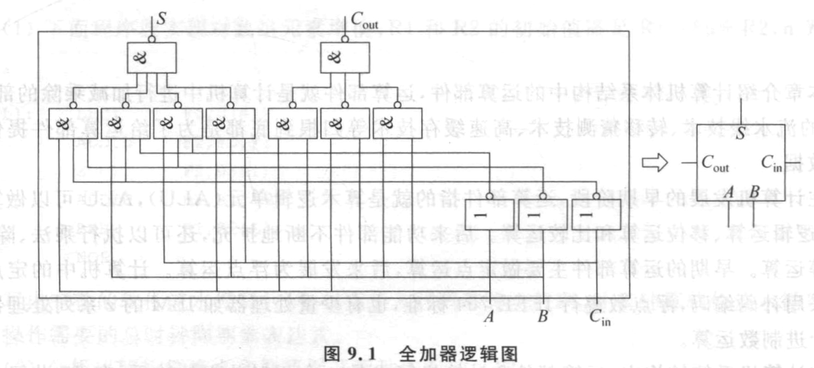

**① 16 位串行进位加法器（Ripple-Carry Adder，教材图 9.2）**：

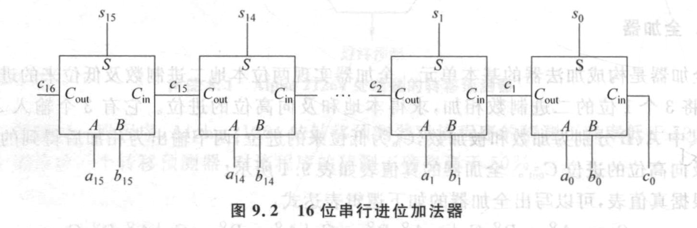

- 每 1 位全加器传递进位需要 $2T$。
- **生成最高位进位 $c_{16}$ 的延迟**：从 $c_0$ 串行传递经过 16 级全加器，延迟为 $16 \times 2T = \mathbf{32T}$。
- **生成最高位和 $s_{15}$ 的延迟**：前 15 级全加器串行产生进位 $c_{15}$ 需要 $15 \times 2T = 30T$，随后第 15 位全加器由 $c_{15}$ 产生和 $s_{15}$ 需要 $3T$，故总延迟为 $30T + 3T = \mathbf{33T}$（整体加法器关键路径延迟为 **$33T$**）。

**② 16 位先行进位加法器（Carry-Lookahead Adder，参照教材图 9.6 的两级 4 位分组全先行进位结构）**：

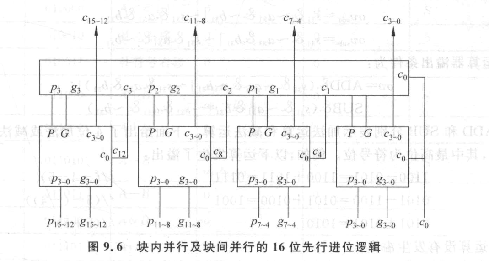

由于每个门的扇入不超过 4，采用 4 位一组、组内并行、组间也并行的两层 CLA 结构（图 9.6）：
1. **第 1 步（生成各位的 $p_i = a_i + b_i$ 和 $g_i = a_i b_i$）**：用与非/或非门 + 非门两级实现需要 **$2T$**（若直接用 1 级与门和或门则为 $1T$）；
2. **第 2 步（下层 4 个 4 位 CLA 模块并行生成 4 个块间进位因子 $P_{0\dots 3}, G_{0\dots 3}$）**：由图 9.5，需要 2 级门延迟 = **$2T$**；
3. **第 3 步（上层 1 个 4 位 CLA 模块由 $P_{0\dots 3}, G_{0\dots 3}$ 和 $c_0$ 生成块间进位 $c_4, c_8, c_{12}, c_{16}$）**：需要 2 级门延迟 = **$2T$**；
4. **第 4 步（下层 4 个 4 位 CLA 模块收到 $c_4, c_8, c_{12}$ 后并行生成所有组内进位 $c_1 \sim c_{15}$）**：需要 2 级门延迟 = **$2T$**（至此，从 $p_i, g_i$ 到产生全部进位 $c_{1\sim 15}$ 恰为教材第 171 页正文所说的 **6 级门延迟 $6T$**！）；
5. **第 5 步（各位全加器根据已算出的 $c_i$ 并行计算和 $s_i = a_i \oplus b_i \oplus c_i$）**：需要 **$3T$**。
- **总延迟汇总**：
  - **两级门口径（常见标准口径）**（产生 $p_i, g_i$ 计 $2T$ + 进位链 $6T$ + 求和 $3T$）：$2T + 2T + 2T + 2T + 3T = \mathbf{11T}$。
  - *(注：若产生 $p_i, g_i$ 计 $1T$，且在 $6T$ 进位生成期间 $\bar{a}_i, \bar{b}_i$ 已提前准备好、由 $c_i$ 产生 $\bar{c}_i$ 到输出 $s_i$ 计 $3T$，则为 $1T + 6T + 3T = \mathbf{10T}$；考试中建议写明 `$2T(p,g) + 6T(\text{两级CLA进位}) + 3T(\text{全加器求和}) = 11T$`)*

**③ 先行进位加法器比串行进位加法器快的根本原因**：
- 在串行进位加法器中，第 $i$ 位的进位输出 $c_{i+1}$ 必须等待第 $i-1$ 位的进位 $c_i$ 计算出来后才能开始计算，进位延迟随位数 $N$ 呈**线性增长 $O(N)$**。
- 而先行进位加法器通过提前定义仅依赖于输入操作数的**进位生成因子 $g_i = a_i b_i$** 和**进位传递因子 $p_i = a_i + b_i$**（以及块级 $G, P$），将进位递推式 $c_{i+1} = g_i + p_i c_i$ 直接展开并构建层次化树状进位网络，使得高位的进位 $c_i$ 可以由各级 $G, P$ 和初始进位 $c_0$ **并行直接生成**，无需逐位等待低位进位传播，从而使进位延迟随位数 $N$ 呈**对数增长 $O(\log N)$**。

---

### 习题 9.3
**题目**：假设每个“非门”“与非门”“或非门”的扇入不超过 4 个且每个门的延迟为 $T$，请给出使用如下不同算法的把 4 个 16 位数相加的延迟。
- **①** 使用多个先行进位加法器；
- **②** 使用加法树及先行进位加法器。
**解答与解析**：
设四个 16 位数分别为 $A, B, C, D$，单个 16 位先行进位加法器（由习题 9.2 ②）的延迟为 **$11T$**，单级全加器（3:2 压缩器 / CSA 华莱士树的一层）将 3 个数压缩为 2 个数（产生和向量 $S$ 与进位向量 $C$）的延迟为 **$3T$**。

**① 使用多个先行进位加法器**：
- 采用两级二叉树结构：
  - **第一级**：用 2 个 16 位先行进位加法器并行计算 $S_1 = A + B$ 和 $S_2 = C + D$，耗时 **$11T$**；
  - **第二级**：再用 1 个 16 位先行进位加法器计算最终结果 $S = S_1 + S_2$，耗时 **$11T$**。
- **总延迟**：$11T + 11T = \mathbf{22T}$。

**② 使用加法树（华莱士树 / CSA 树）及先行进位加法器**：
- 先用 **2 级保留进位全加器树（Wallace Tree / Carry-Save Adder Tree）** 将 4 个 16 位数归约压缩为 2 个数，最后仅用 **1 个先行进位加法器**把这 2 个数相加：
  - **第 1 级全加器**：将 $A, B, C$ 三个 16 位数按位并行送入 16 个全加器，压缩成和向量 $S^{(1)}$ 与进位向量 $C^{(1)}$（共 2 个数），延迟为 1 级全加器延迟 = **$3T$**；
  - **第 2 级全加器**：将 $S^{(1)}, 2C^{(1)}$ 与第 4 个输入数 $D$ 送入第二层全加器，压缩成最终的和向量 $S^{(2)}$ 与进位向量 $C^{(2)}$（共 2 个数），延迟为 1 级全加器延迟 = **$3T$**；
  - **最后一级先行进位加法器**：用 1 个 16 位先行进位加法器将 $S^{(2)}$ 与 $2C^{(2)}$ 相加得到最终结果，延迟为 **$11T$**。
- **总延迟**：$3T + 3T + 11T = 6T + 11T = \mathbf{17T}$。

---

### 习题 9.4
**题目**：证明 $[X]_{\text{补}} + [Y]_{\text{补}} = [X + Y]_{\text{补}}$。
**解答与解析**：
**证明**：
设 $X$ 和 $Y$ 为字长 $n+1$ 位（含 1 位符号位和 $n$ 位数值位，若为纯整数则模为 $2^{n+1}$，若为定点小数则模为 $2$）的带符号定点数，且 $X, Y, X+Y$ 均在 $n+1$ 位补码可表示范围内（不发生溢出）。
1. 根据补码的同余（取模）定义，在模 $M = 2^{n+1}$ 意义下，任意数 $Z$ 的补码满足：
   $$[Z]_{\text{补}} \equiv 2^{n+1} + Z \pmod{2^{n+1}}$$
   因此有：
   $$[X]_{\text{补}} = 2^{n+1} + X \pmod{2^{n+1}}$$
   $$[Y]_{\text{补}} = 2^{n+1} + Y \pmod{2^{n+1}}$$
   $$[X + Y]_{\text{补}} = 2^{n+1} + (X + Y) \pmod{2^{n+1}}$$
2. 将 $[X]_{\text{补}}$ 与 $[Y]_{\text{补}}$ 相加：
   $$[X]_{\text{补}} + [Y]_{\text{补}} = (2^{n+1} + X) + (2^{n+1} + Y) = 2^{n+1} + \left( 2^{n+1} + X + Y \right)$$
3. 在 $n+1$ 位二进制模 $2^{n+1}$ 运算中，超出第 $n+1$ 位的进位 $2^{n+1}$ 被自然舍弃（即 $\bmod\ 2^{n+1}$），故：
   $$[X]_{\text{补}} + [Y]_{\text{补}} \equiv 2^{n+1} + (X + Y) \equiv [X + Y]_{\text{补}} \pmod{2^{n+1}}$$
   即 $[X]_{\text{补}} + [Y]_{\text{补}} = [X + Y]_{\text{补}}$。证毕。

---

### 习题 9.5
**题目**：用 Verilog 写一个 16 位的先行进位加法器。
**解答与解析**：
严格按照教材图 9.5 & 图 9.6 构建的 16 位两级先行进位加法器 Verilog 代码如下：

```verilog
// 4位先行进位逻辑模块 (对应教材图 9.5)
module cla4 (
    input  [3:0] p,
    input  [3:0] g,
    input        cin,
    output       P,      // 块间进位传递因子
    output       G,      // 块间进位生成因子
    output [3:1] cout    // 产生 c1, c2, c3
);
    assign P = &p; // p[3] & p[2] & p[1] & p[0]
    assign G = g[3] | (p[3] & g[2]) | (p[3] & p[2] & g[1]) | (p[3] & p[2] & p[1] & g[0]);

    assign cout[1] = g[0] | (p[0] & cin);
    assign cout[2] = g[1] | (p[1] & g[0]) | (p[1] & p[0] & cin);
    assign cout[3] = g[2] | (p[2] & g[1]) | (p[2] & p[1] & g[0]) | (p[2] & p[1] & p[0] & cin);
endmodule

// 16位两级先行进位加法器顶层模块 (对应教材图 9.6)
module add16 (
    input  [15:0] a,
    input  [15:0] b,
    input         cin,
    output [15:0] out,
    output        cout
);
    wire [15:0] p = a | b;   // 各位进位传递因子
    wire [15:0] g = a & b;   // 各位进位生成因子
    wire [ 3:0] P, G;        // 4个4位块的块间传递与生成因子
    wire [15:0] c;           // 各位进位输入 c[15:0]
    wire        P_top, G_top;

    assign c[0] = cin;

    // 第一层：4 个 4 位 CLA 模块
    cla4 u_cla_0_3   (.p(p[ 3: 0]), .g(g[ 3: 0]), .cin(c[ 0]), .P(P[0]), .G(G[0]), .cout(c[ 3: 1]));
    cla4 u_cla_4_7   (.p(p[ 7: 4]), .g(g[ 7: 4]), .cin(c[ 4]), .P(P[1]), .G(G[1]), .cout(c[ 7: 5]));
    cla4 u_cla_8_11  (.p(p[11: 8]), .g(g[11: 8]), .cin(c[ 8]), .P(P[2]), .G(G[2]), .cout(c[11: 9]));
    cla4 u_cla_12_15 (.p(p[15:12]), .g(g[15:12]), .cin(c[12]), .P(P[3]), .G(G[3]), .cout(c[15:13]));

    // 第二层：组间 4 位 CLA 模块，产生 c[4], c[8], c[12] 以及整体 P_top, G_top
    cla4 u_cla_inter (.p(P),        .g(G),        .cin(c[ 0]), .P(P_top), .G(G_top), .cout({c[12], c[8], c[4]}));

    // 最终进位输出 c16 与 16 位和输出
    assign cout = G_top | (P_top & c[0]);
    assign out  = a ^ b ^ c;

endmodule
```

---

### 习题 9.6
**题目**：IEEE 754 标准定义了 4 种格式的浮点数据类型：单精度、扩展单精度、双精度以及扩展双精度。请完成如附表 9.1 的内容（待填参数包括：尾数位宽 $P$、指数最大值 $E_{\max}$、指数最小值 $E_{\min}$、指数偏移量 $\text{Bias}$、指数位数、浮点格式宽度）。
**解答与解析**：
对照教材第 36 页表 3.2（《IEEE 754 浮点格式参数》，见下图）及 IEEE 754 标准规范，完整填写附表 9.1 如下：

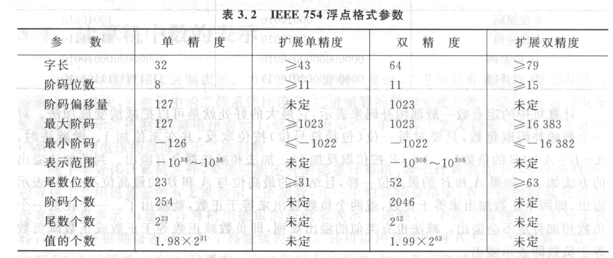

| 参数 | 单精度 (Single) | 扩展单精度 (Single Extended) | 双精度 (Double) | 扩展双精度 (Double Extended) |
| :--- | :---: | :---: | :---: | :---: |
| **尾数位宽 $P$** | $23$（含隐藏位 $24$） | $\ge 31$（含隐藏位 $\ge 32$） | $52$（含隐藏位 $53$） | $\ge 63$（X86 80位格式显式为 $64$） |
| **指数最大值 $E_{\max}$** | $+127$ | $\ge +1023$ | $+1023$ | $\ge +16383$ |
| **指数最小值 $E_{\min}$** | $-126$ | $\le -1022$（即 $1 - E_{\max}$） | $-1022$ | $\le -16382$（即 $1 - E_{\max}$） |
| **指数偏移量 $\text{Bias}$** | $127$ | $E_{\max}$（$\ge 1023$） | $1023$ | $E_{\max}$（$16383$） |
| **指数位数** | $8$ | $\ge 11$ | $11$ | $\ge 15$ |
| **浮点格式宽度（字长）** | $32$ | $\ge 43$ | $64$ | $\ge 79$（典型实现为 $80$ 位） |

---

### 习题 9.7
**题目**：图 9.5 是包括块间进位生成因子和进位传递因子的 4 位进位逻辑模块，用该逻辑模块组建 64 位先行进位加法器的进位逻辑，并证明其正确性。

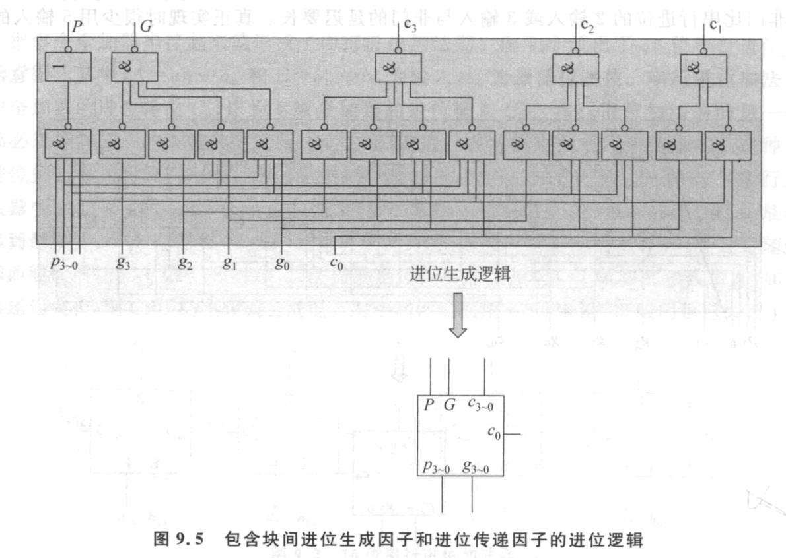
**解答与解析**：
#### 1. 64 位三级先行进位逻辑结构图（共需 $16 + 4 + 1 = 21$ 个图 9.5 所示的 4 位 CLA 模块）
因为每个图 9.5 模块（`CLA4`）可将 4 位合并为 1 组，故 $64 = 4^3$，采用 **3 层四叉树层次级联结构**（参照教材第 171 页图 9.6 扩展到 3 层）：
- **第一层（底层，共 16 个 `CLA4` 模块 $M_{1,0} \sim M_{1,15}$）**：
  - 第 $k$ 个模块（$k = 0, 1, \dots, 15$）接收 4 位操作数的进位传递与生成因子 $p_{4k+3 : 4k}, g_{4k+3 : 4k}$ 以及块进位输入 $c_{4k}$；
  - 向上输出 4 位块的进位传递因子 $P^{(1)}_k$ 和生成因子 $G^{(1)}_k$，并输出块内每一位的进位 $c_{4k+1}, c_{4k+2}, c_{4k+3}$。
- **第二层（中间层，共 4 个 `CLA4` 模块 $M_{2,0} \sim M_{2,3}$）**：
  - 第 $m$ 个模块（$m = 0, 1, 2, 3$）接收第一层 4 个相邻模块输出的 $P^{(1)}_{4m+3 : 4m}, G^{(1)}_{4m+3 : 4m}$ 以及 16 位大块的进位输入 $c_{16m}$；
  - 向上输出 16 位大块的进位传递因子 $P^{(2)}_m$ 和生成因子 $G^{(2)}_m$，并向下输出给第一层的块间进位 $c_{16m+4}, c_{16m+8}, c_{16m+12}$。
- **第三层（顶层，共 1 个 `CLA4` 模块 $M_{3,0}$）**：
  - 接收第二层 4 个模块输出的 $P^{(2)}_{3:0}, G^{(2)}_{3:0}$ 以及最低位进位输入 $c_0$；
  - 向下输出 16 位大块之间的进位 $c_{16}, c_{32}, c_{48}$（以及 64 位总传递/生成因子 $P^{(3)}_0, G^{(3)}_0$，从而 $c_{64} = G^{(3)}_0 + P^{(3)}_0 c_0$）。

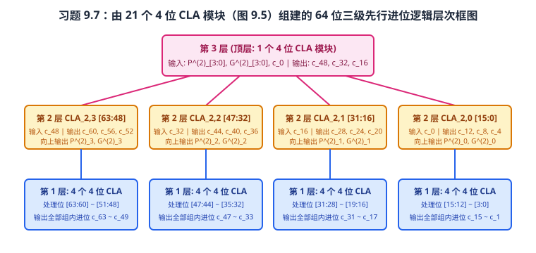

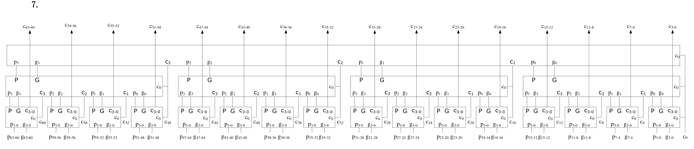

#### 2. 正确性证明（数学归纳证明）
**证明**：
1. **单比特进位递推基本定理**：
   对于任意第 $i$ 位（$i = 0, 1, \dots, 63$），定义 $g_i = a_i b_i$，$p_i = a_i + b_i$，则进位满足一阶布尔线性递推关系：
   $$c_{i+1} = g_i + p_i c_i \quad \cdots\cdots (1)$$
2. **第一层（4 位块）的等价性证明**：
   对任意第 $k$ 个 4 位块（包含位 $4k, 4k+1, 4k+2, 4k+3$），连续展开式 (1) 四次：
   - $c_{4k+1} = g_{4k} + p_{4k} c_{4k}$
   - $c_{4k+2} = g_{4k+1} + p_{4k+1} g_{4k} + p_{4k+1} p_{4k} c_{4k}$
   - $c_{4k+3} = g_{4k+2} + p_{4k+2} g_{4k+1} + p_{4k+2} p_{4k+1} g_{4k} + p_{4k+2} p_{4k+1} p_{4k} c_{4k}$
   - $c_{4k+4} = \underbrace{\left( g_{4k+3} + p_{4k+3} g_{4k+2} + p_{4k+3} p_{4k+2} g_{4k+1} + p_{4k+3} p_{4k+2} p_{4k+1} g_{4k} \right)}_{G^{(1)}_k} + \underbrace{\left( p_{4k+3} p_{4k+2} p_{4k+1} p_{4k} \right)}_{P^{(1)}_k} c_{4k}$
   即第一层模块输出的 $G^{(1)}_k, P^{(1)}_k$ 严格满足与式 (1) **形式完全同构**的块级递推关系：
   $$c_{4(k+1)} = G^{(1)}_k + P^{(1)}_k c_{4k} \quad (k = 0, 1, \dots, 15) \quad \cdots\cdots (2)$$
3. **第二层（16 位大块）与第三层（64 位全块）的递推同构证明**：
   - 将第 $m$ 个 16 位大块（包含 $k = 4m, 4m+1, 4m+2, 4m+3$ 共四个 4 位块）的 $G^{(1)}_{4m+3:4m}, P^{(1)}_{4m+3:4m}$ 和进位 $c_{16m}$ 输入第二层图 9.5 模块 $M_{2,m}$。
   - 由于式 (2) 与式 (1) 具有完全相同的代数形式，模块 $M_{2,m}$ 输出的 3 个进位恰为：
     $$c_{16m+4} = G^{(1)}_{4m} + P^{(1)}_{4m} c_{16m}, \quad c_{16m+8} = c_{4(4m+2)}, \quad c_{16m+12} = c_{4(4m+3)}$$
     且其输出的 16 位块级因子 $G^{(2)}_m, P^{(2)}_m$ 严格满足：
     $$c_{16(m+1)} = G^{(2)}_m + P^{(2)}_m c_{16m} \quad (m = 0, 1, 2, 3) \quad \cdots\cdots (3)$$
   - 同理，第三层模块 $M_{3,0}$ 接收 $G^{(2)}_{3:0}, P^{(2)}_{3:0}$ 和 $c_0$，由于式 (3) 仍与式 (1) 同构，$M_{3,0}$ 生成的 3 个进位输出必然精确等于 $c_{16}, c_{32}, c_{48}$。
   - 再将 $c_{16}, c_{32}, c_{48}$ 送回第二层得到全部 $c_{4k}\ (k=1\dots 15)$，送回第一层即精确得到全部 64 位进位 $c_1 \sim c_{63}$。证毕。

---

### 习题 9.8
**题目**：采用 Booth 编码和 Wallace 树的乘法器经常需要累加 $[-X]_{\text{补}}$ 和 $[-2X]_{\text{补}}$。而 $[-X]_{\text{补}}$ 和 $[-2X]_{\text{补}}$ 涉及取反加 1 的操作。请问如何设计乘法器以避免单独用加法器去加这些 1？
**解答与解析**：
参照教材第 179~183 页（9.3.4 节《32 位补码乘法器的实现》图 9.17、图 9.21 与图 9.22，见下图）：

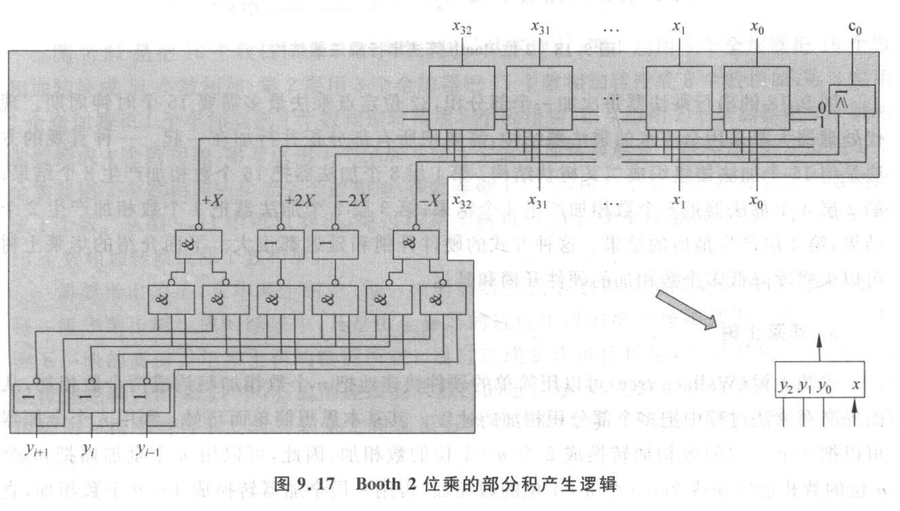

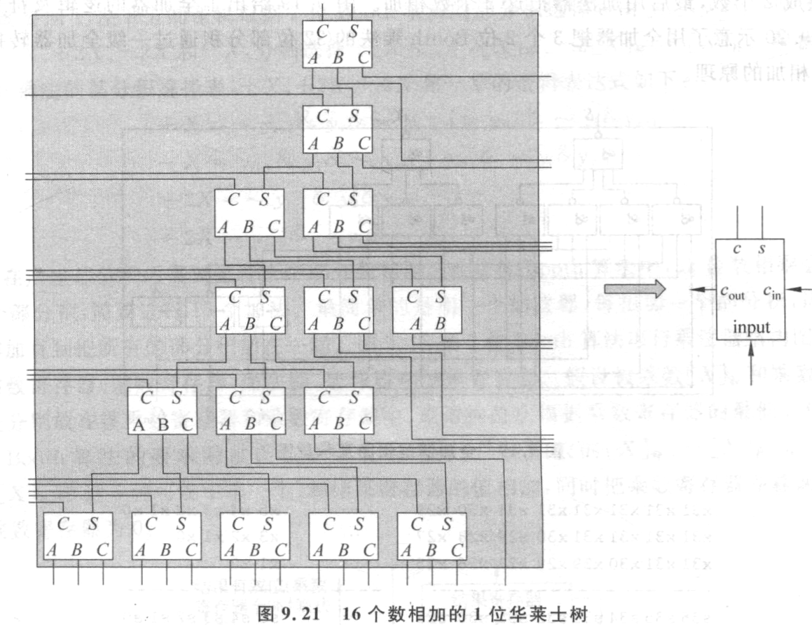

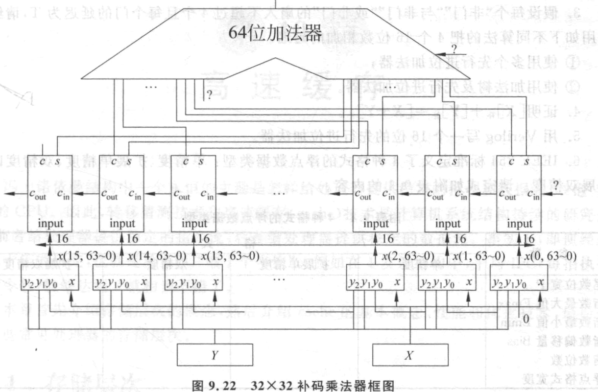

1. **问题的产生**：
   - 在 $32 \times 32$ 位的 2 位 Booth 乘法器中，共有 $32 / 2 = 16$ 个部分积。当某一个 Booth 部分积的操作为 $-[X]_{\text{补}}$ 或 $-2[X]_{\text{补}}$ 时，为了避免在部分积生成电路中串联长加法器，硬件只对 $[X]_{\text{补}}$ 或 $2[X]_{\text{补}}$ 进行**按位取反**，同时产生一个 1 比特的 **“末位加 1”信号 $c_0$**（当选择 $-X$ 或 $-2X$ 时 $c_0 = 1$，否则 $c_0 = 0$，见教材图 9.17 右上角）。
   - 16 个部分积总共会产生 **16 个“末位加 1”信号**，分别对应各自部分积的最低有效位权重位置。
2. **利用华莱士树（Wallace Tree）与最终加法器的空闲进位输入端吸收这 16 个“1”**：
   - 观察将 16 个数相加的 1 位华莱士树结构（教材图 9.21）：每一位的 16 输入华莱士树内部使用了 **14 个全加器**，这 14 个全加器向更高一位输出 **14 个进位输出（`cout`）**，同时也要从更低一位接收 **14 个进位输入（`cin`）**。
   - 然而，在**最低位（第 0 位，或对应部分积经符号扩展对齐后的第 0 列华莱士树）**，由于没有比第 0 位更低的位向它进位，这 **14 个进位输入端（`cin`）原本是悬空空闲的（默认接 0）**！
   - 此外，64 位华莱士树压缩输出的最后两个 64 位数 $S$（和向量）与 $C$（进位向量）在送入最后的 **64 位先行进位加法器** 时：
     - 因为进位向量 $C$ 是华莱士树最后一级全加器的进位输出，需要**左移 1 位**后再与和向量 $S$ 相加，故**进位向量 $C$ 的最低位（第 0 位）空出了 1 个输入位置**；
     - 同时，最后的 **64 位先行进位加法器本身还有 1 个最低位进位输入端 `cin`**。
   - **合计空闲位置数**：
     $$\underbrace{14}_{\text{第 0 位华莱士树的 14 个 cin}} + \underbrace{1}_{\text{左移后进位向量 C 空出的最低位}} + \underbrace{1}_{\text{最终 64 位加法器的 cin}} = \mathbf{16\text{ 个空闲最低位输入端}}$$
   - **结论**：将 16 个部分积产生的 16 个“末位加 1”信号直接连接到这 **16 个现成的最低位空闲输入端**上，即可在不增加任何额外加法器、不增加任何关键路径延迟的情况下，把全部 16 个“取反加 1”的 `1` 一次性累加进去！

---

## 第10章 高速缓存

### 习题 10.1
**题目**：一个处理器的页大小为 $4\text{ KB}$，一级数据 cache 大小为 $64\text{ KB}$，cache 块大小为 $32\text{ B}$，指出在直接相联、二路组相联，以及 4 路组相联的情况下需要页着色（page coloring）的地址位数。
**解答与解析**：
- **页着色（Page Coloring）原理**：
  - 操作系统页大小为 $4\text{ KB} = 2^{12}\text{ B}$，故虚实地址变换中保持不变的**页内偏移（Page Offset）为地址的第 `[11:0]` 位**（低 12 位）；第 `[12]` 位及以上为虚拟页号（VPN）/ 物理页号（PFN）。
  - Cache 块大小为 $32\text{ B} = 2^5\text{ B}$，故块内偏移为第 `[4:0]` 位（低 5 位）。
  - 在采用**虚址索引、实址标签（VIPT）**的一级数据 Cache 中，如果 **Cache 的组索引（Index）最高位超出了页内偏移最高位（第 11 位）**，超出的那部分虚拟地址位与物理地址位可能不一致，从而引发 **Cache 别名/同义词问题（Cache Synonym / Aliasing Problem）**。操作系统通过**页着色**限制虚拟页号与物理页号在这部分重叠位上必须相等，需要页着色的位数即为 $\text{Index}$ 超出 $12\text{ bits}$ 的位数：
    $$\text{页着色位数} = \log_2\left(\frac{\text{Cache 总容量}}{\text{相联度（路数）} \times \text{页大小}}\right)$$

1. **直接相联（1 路）**：
   - 组数 $= 64\text{ KB} / 32\text{ B} = 2^{16} / 2^5 = 2^{11}$ 组，Cache 索引位为地址的 **`[15:5]`**（共 11 位）。
   - 超出页内地址 `[11:0]` 的部分为地址的 **`[15:12]`** 位，故需要页着色的地址位数为 **$4$ 位**。
2. **二路组相联（2 路）**：
   - 每路大小为 $64\text{ KB} / 2 = 32\text{ KB} = 2^{15}\text{ B}$，组数 $= 2^{10}$ 组，Cache 索引位为地址的 **`[14:5]`**（共 10 位）。
   - 超出页内地址 `[11:0]` 的部分为地址的 **`[14:12]`** 位，故需要页着色的地址位数为 **$3$ 位**。
3. **4 路组相联（4 路）**：
   - 每路大小为 $64\text{ KB} / 4 = 16\text{ KB} = 2^{14}\text{ B}$，组数 $= 2^9$ 组，Cache 索引位为地址的 **`[13:5]`**（共 9 位）。
   - 超出页内地址 `[11:0]` 的部分为地址的 **`[13:12]`** 位，故需要页着色的地址位数为 **$2$ 位**。

---

### 习题 10.2
**题目**：根据以下数据，计算采用不同相联度的二级 cache 时，一级 cache 不命中的损耗。采用直接相联时，L2 命中时间为 4 个时钟周期，采用 2 路组相联和 4 路组相联时，L2 的命中时间将分别增加 1 个时钟周期和 2 个时钟周期，直接相联、2 路组相联、4 路组相联的局部失效率分别为 $25\%$、$20\%$、$15\%$，L2 的不命中损耗（从 L2 失效到数据返回 L2）是 60 个时钟周期。
**解答与解析**：
一级 Cache 的不命中损耗（$\text{Miss Penalty}_{L1}$）等于二级 Cache 的平均访存时间（$\text{AMAT}_{L2}$）：
$$\text{Miss Penalty}_{L1} = \text{Hit Time}_{L2} + \text{Miss Rate}_{L2} \times \text{Miss Penalty}_{L2}$$
1. **L2 采用直接相联**（$\text{Hit Time}_{L2} = 4$ 拍，$\text{Miss Rate}_{L2} = 25\%$）：
   $$\text{Miss Penalty}_{L1} = 4 + 25\% \times 60 = 4 + 15 = \mathbf{19\text{ 个时钟周期}}$$
2. **L2 采用 2 路组相联**（$\text{Hit Time}_{L2} = 4 + 1 = 5$ 拍，$\text{Miss Rate}_{L2} = 20\%$）：
   $$\text{Miss Penalty}_{L1} = 5 + 20\% \times 60 = 5 + 12 = \mathbf{17\text{ 个时钟周期}}$$
3. **L2 采用 4 路组相联**（$\text{Hit Time}_{L2} = 4 + 2 = 6$ 拍，$\text{Miss Rate}_{L2} = 15\%$）：
   $$\text{Miss Penalty}_{L1} = 6 + 15\% \times 60 = 6 + 9 = \mathbf{15\text{ 个时钟周期}}$$

---

### 习题 10.3
**题目**：通过分开指令 cache 和数据 cache，能够消除因指令和数据冲突而引起的 cache 缺失。现有一个由大小都为 $32\text{ KB}$ 的指令 cache 和数据 cache 组成的系统和另一个大小为 $64\text{ KB}$ 的一体 cache 组成的系统相比较。假设在所有的存储器访问中数据访问占 $26\%$，取指令占 $74\%$。$32\text{ KB}$ 指令 cache、数据 cache 和 $64\text{ KB}$ 的一体 cache 每千条指令缺失率（MPKI）分别为 $1.5$、$38$ 和 $40$。cache 命中时需要 1 个时钟周期，缺失代价为 100 个时钟周期，在一体 cache 中，Load 和 Store 命中需要一个额外的时钟周期。
- **(1)** 计算并比较哪一个组织方式有更低的缺失率。
- **(2)** 求出每种组织方式下的平均存储器访问时间。
**解答与解析**：
首先明确题目中“每千条指令缺失率分别为 $1.5$、$38$ 和 $40$”是 **MPKI（Misses Per 1000 Instructions，每执行 1000 条指令发生的缺失次数）**：
- 因为取指令占总访存次数的 $74\%$，数据访问（Load/Store）占总访存次数的 $26\%$，所以每执行 $1000$ 条指令（对应 $1000$ 次取指访存），发生的数据访存次数为：
  $$N_{\text{data}} = 1000 \times \frac{26\%}{74\%} \approx 351.35\text{ 次}$$
  每 $1000$ 条指令对应的**总存储器访问次数**为：
  $$N_{\text{mem}} = 1000 + 351.35 = 1351.35\text{ 次}$$

**(1) 计算并比较两种组织方式的缺失率（Miss Rate = 缺失次数 / 访存次数）**：
- **分离式 Cache（$32\text{ KB}$ I-Cache + $32\text{ KB}$ D-Cache）**：
  - $32\text{ KB}$ 指令 Cache 缺失率：$\text{Miss Rate}_I = \frac{1.5}{1000} = 0.0015 = 0.15\%$；
  - $32\text{ KB}$ 数据 Cache 缺失率：$\text{Miss Rate}_D = \frac{38}{351.35} \approx 0.10815 = 10.82\%$；
  - **分离式 Cache 的综合总缺失率**：
    $$\text{Miss Rate}_{\text{Split}} = \frac{1.5 + 38}{1000 + 351.35} = \frac{39.5}{1351.35} \approx \mathbf{0.02923\ (2.92\%)}$$
- **一体式 Cache（$64\text{ KB}$ Unified Cache）**：
  - 每 1000 条指令共缺失 $40$ 次，故**一体式 Cache 的总缺失率**为：
    $$\text{Miss Rate}_{\text{Unified}} = \frac{40}{1000 + 351.35} = \frac{40}{1351.35} \approx \mathbf{0.02960\ (2.96\%)}$$
- **结论**：**指令 Cache 和数据 Cache 分离（各 $32\text{ KB}$）的组织方式具有更低的缺失率**（$2.92\% < 2.96\%$，每千条指令缺失次数 $39.5 < 40$）。

**(2) 求每种组织方式下的平均存储器访问时间（AMAT）**：
- **分离式 Cache 的 AMAT**：
  每次访存（无论是取指还是数据访问）命中时间均为 $1$ 拍，缺失代价为 $100$ 拍：
  $$\text{AMAT}_{\text{Split}} = 1 + \text{Miss Rate}_{\text{Split}} \times 100 = 1 + \frac{39.5}{1351.35} \times 100 = \frac{1351.35 + 3950}{1351.35} \approx \mathbf{3.92\text{ 个时钟周期}}$$
  *(注：计算 AMAT 时可区分标准定义口径与“仅计入额外结构冲突周期”口径)*：
  - **口径 A（标准 AMAT 定义：$\text{Hit Time} + \text{Miss Rate} \times \text{Miss Penalty}$）**：
    - 分离式 Cache：$\text{AMAT}_{\text{Split}} = 1 + 0.02923 \times 100 = \mathbf{3.92\text{ 拍}}$
    - 一体式 Cache（数据访存占 $26\%$ 且命中需 $1+1=2$ 拍）：$\text{AMAT}_{\text{Unified}} = (1 + 26\% \times 1) + 0.02960 \times 100 = 1.26 + 2.96 = \mathbf{4.22\text{ 拍}}$
  - **口径 B（不计数据 Cache 基础 1 拍命中周期，仅计一体式结构冲突额外 1 拍）**：
    - 分离式 Cache：$\frac{1000 + (1.5 + 38) \times 100}{1000 + 351} = \mathbf{3.66\text{ 拍}}$
    - 一体式 Cache：$\frac{1000 + 351 \times 1 + 40 \times 100}{1000 + 351} = \mathbf{3.96\text{ 拍}}$

---

### 习题 10.4
**题目**：假定在一个只有 64 个字的内存中，有一个内存地址访问序列为：`0, 1, 2, 3, 4, 15, 14, 13, 12, 11, 10, 9, 0, 1, 2, 3, 4, 56, 28, 32, 15, 14, 13, 12, 0, 1, 2, 3`。对于某个 cache 结构，内存访问可以分为 cache 命中、强制缺失、容量缺失、冲突缺失，假定下列的 cache 参数，上述的访问序列中每次内存访问分别属于哪一类？
- **(1)** 直接相连，cache 块大小为 16 个字节，容量大小为 4 个块。
- **(2)** 两路组相联，cache 块大小为 8 个字节，容量大小为 4 个组，采用 LRU 替换算法。
**解答与解析**：
- 按常规 32 位机器 **$1\text{ 个字 (Word)} = 4\text{ 字节 (Bytes)}$**，且题目所给访问序列的单位为**字地址（Word Address）**：
  - **(1) 直接相联**：块大小为 $16\text{ B} = 4\text{ 个字}$，故字地址 $W$ 所在的**块号 $B = \lfloor W / 4 \rfloor$**；容量为 $4$ 个块（总容量为 $4 \times 16\text{ B} = 64\text{ B} = 16\text{ 个字}$），映射到 **Cache 行号 $\text{Index} = B \bmod 4$**。
  - **(2) 2 路组相联（LRU）**：块大小为 $8\text{ B} = 2\text{ 个字}$，故字地址 $W$ 所在的**块号 $B' = \lfloor W / 2 \rfloor$**；容量为 $4$ 个组（每组 2 路，共 $8$ 个块，总容量同样为 $8 \times 8\text{ B} = 64\text{ B} = 16\text{ 个字}$），映射到 **Cache 组号 $\text{Set} = B' \bmod 4$**。
  - **容量缺失 vs. 冲突缺失的判定准则**：某次非首次访问（非强制缺失）若在相同总容量（$64\text{ B}$）的**全相联（Fully Associative, LRU）Cache** 中也会缺失，则属于**容量缺失（Capacity Miss）**；若在相同总容量的全相联 Cache 中本可命中、仅因相联度受限而在当前 Cache 中被替换出去，则属于**冲突缺失（Conflict Miss）**。

下表完整给出全部 28 次访问在两种结构下的块号、索引与命中/缺失分类：

| 序号 | 访问字地址 | **(1) 直接相联**（每块 4 字，共 4 块）<br>块号 $B=\lfloor W/4\rfloor$, 行号 $B\bmod 4$ | **(1) 访问结果与分类** | **(2) 2 路组相联**（每块 2 字，4 组×2 路）<br>块号 $B'=\lfloor W/2\rfloor$, 组号 $B'\bmod 4$ | **(2) 访问结果与分类** |
| :-: | :-: | :-: | :-: | :-: | :-: |
| 1 | `0` | $B=0 \to \text{行 } 0$ | **强制缺失** | $B'=0 \to \text{组 } 0$ | **强制缺失** |
| 2 | `1` | $B=0 \to \text{行 } 0$ | 命中 | $B'=0 \to \text{组 } 0$ | 命中 |
| 3 | `2` | $B=0 \to \text{行 } 0$ | 命中 | $B'=1 \to \text{组 } 1$ | **强制缺失** |
| 4 | `3` | $B=0 \to \text{行 } 0$ | 命中 | $B'=1 \to \text{组 } 1$ | 命中 |
| 5 | `4` | $B=1 \to \text{行 } 1$ | **强制缺失** | $B'=2 \to \text{组 } 2$ | **强制缺失** |
| 6 | `15` | $B=3 \to \text{行 } 3$ | **强制缺失** | $B'=7 \to \text{组 } 3$ | **强制缺失** |
| 7 | `14` | $B=3 \to \text{行 } 3$ | 命中 | $B'=7 \to \text{组 } 3$ | 命中 |
| 8 | `13` | $B=3 \to \text{行 } 3$ | 命中 | $B'=6 \to \text{组 } 2$ | **强制缺失** |
| 9 | `12` | $B=3 \to \text{行 } 3$ | 命中 | $B'=6 \to \text{组 } 2$ | 命中 |
| 10 | `11` | $B=2 \to \text{行 } 2$ | **强制缺失** | $B'=5 \to \text{组 } 1$ | **强制缺失** |
| 11 | `10` | $B=2 \to \text{行 } 2$ | 命中 | $B'=5 \to \text{组 } 1$ | 命中 |
| 12 | `9` | $B=2 \to \text{行 } 2$ | 命中 | $B'=4 \to \text{组 } 0$ | **强制缺失** |
| 13 | `0` | $B=0 \to \text{行 } 0$ | 命中 | $B'=0 \to \text{组 } 0$ | 命中 |
| 14 | `1` | $B=0 \to \text{行 } 0$ | 命中 | $B'=0 \to \text{组 } 0$ | 命中 |
| 15 | `2` | $B=0 \to \text{行 } 0$ | 命中 | $B'=1 \to \text{组 } 1$ | 命中 |
| 16 | `3` | $B=0 \to \text{行 } 0$ | 命中 | $B'=1 \to \text{组 } 1$ | 命中 |
| 17 | `4` | $B=1 \to \text{行 } 1$ | 命中 | $B'=2 \to \text{组 } 2$ | 命中 |
| 18 | `56` | $B=14 \to \text{行 } 2$（替出 $B=2$） | **强制缺失** | $B'=28 \to \text{组 } 0$（替出 $B'=4$） | **强制缺失** |
| 19 | `28` | $B=7 \to \text{行 } 3$（替出 $B=3$） | **强制缺失** | $B'=14 \to \text{组 } 2$（替出 $B'=6$） | **强制缺失** |
| 20 | `32` | $B=8 \to \text{行 } 0$（替出 $B=0$） | **强制缺失** | $B'=16 \to \text{组 } 0$（替出 $B'=0$） | **强制缺失** |
| 21 | `15` | $B=3 \to \text{行 } 3$（此前在序号19被替） | **容量缺失**（全相联4块也会替出 $B=3$） | $B'=7 \to \text{组 } 3$（组 3 未被替换） | 命中 |
| 22 | `14` | $B=3 \to \text{行 } 3$ | 命中 | $B'=7 \to \text{组 } 3$ | 命中 |
| 23 | `13` | $B=3 \to \text{行 } 3$ | 命中 | $B'=6 \to \text{组 } 2$（序号19被替，全相联8块未满8个近期块） | **冲突缺失** |
| 24 | `12` | $B=3 \to \text{行 } 3$ | 命中 | $B'=6 \to \text{组 } 2$ | 命中 |
| 25 | `0` | $B=0 \to \text{行 } 0$（序号20被替，距上回访问已过4个不同块） | **容量缺失**（或冲突缺失） | $B'=0 \to \text{组 } 0$（组0在序号18,20连续进2块替出 $B'=0$） | **冲突缺失** |
| 26 | `1` | $B=0 \to \text{行 } 0$ | 命中 | $B'=0 \to \text{组 } 0$ | 命中 |
| 27 | `2` | $B=0 \to \text{行 } 0$ | 命中 | $B'=1 \to \text{组 } 1$（组 1 中的 $B'=1$ 仍在） | 命中 |
| 28 | `3` | $B=0 \to \text{行 } 0$ | 命中 | $B'=1 \to \text{组 } 1$ | 命中 |

---

### 习题 10.5
**题目**：cache 存储层次中多层 cache 之间通常可以采用包含式（Inclusion）或者非包含式（Exclusion）关系，例如 AMD 公司的 Opteron 的 L1 和 L2 之间采用的非包含式关系，而 Intel 公司的 Core 架构的 L1 和 L2 之间采用包含式关系，请比较包含式 cache 和非包含式的 cache 的特点，包括从存储访问路径、硬件实现复杂性、数据和消息通信量、多核之间一致性的维护等各个角度进行分析。
**解答与解析**：
这里定义：**包含式（Inclusive）**是指一级 Cache（L1）中的所有数据块都必须在二级 Cache（L2）中存有副本（$L1 \subset L2$）；**互斥式/严格非包含式（Exclusive，如 AMD Opteron）**是指任何一个数据块最多只能存在于 L1 或 L2 之一，两者内容无交集（$L1 \cap L2 = \varnothing$）。

| 比较维度 | 包含式 Cache（Inclusive，如 Intel Core） | 非包含/互斥式 Cache（Exclusive，如 AMD Opteron） |
| :--- | :--- | :--- |
| **1. 有效存储容量** | L1 的数据在 L2 中重复存储，片上总有效 Cache 容量仅为 $\text{Size}(L2)$（浪费了 L1 大小的容量）。 | L1 与 L2 数据不重复，片上总有效 Cache 容量为 $\text{Size}(L1) + \text{Size}(L2)$，**容量利用率高**（尤其适合 L1 较大而 L2 不够大的设计）。 |
| **2. 存储访问路径<br>（L1 缺失与替换）** | - **L1 缺失时**：若 L2 命中，直接将块复制给 L1；若 L2 也缺失，从主存读取块**同时填入 L2 和 L1**。<br>- **L1 替换时**：若被替换块为干净块（Clean），直接丢弃即可；若为脏块（Dirty），写回 L2 必定命中（无需在 L2 分配新行）。 | - **L1 缺失时**：若 L2 命中，在将该块送给 L1 的同时**必须将 L2 中的该块置为无效（或与 L1 被替换出的块做交换 Swap）**；若 L2 也缺失，从主存读取的块**只填入 L1，不写入 L2**。<br>- **L1 替换时**：**无论被替换块是干净块还是脏块，都必须写回（Victim Writeback）到 L2 中**，并在 L2 中触发一次替换分配。 |
| **3. 数据与消息通信量** | - **L1 与 L2 之间数据通信量小**：干净块从 L1 替换时无需向 L2 传输数据（仅发通知或静默丢弃）。<br>- 当 L2 替换某行时，需要向 L1 发送**反向无效（Back-Invalidation）**消息以确保包含性。 | - **L1 与 L2 之间数据通信量很大**：每次 L1 缺失并在 L2 命中（或替换）时，即使被替换的 L1 块是干净块，也必须把整块数据从 L1 传回并写入 L2（通常需要极高带宽的 L1-L2 Victim Buffer 通路，且要求 L1 与 L2 块大小相同）。 |
| **4. 多核之间 Cache 一致性的维护** | **极其简洁高效（包含式的最大优势）**：<br>- 由于所有 L1 的内容都是共享 L2/L3 的子集，多核监听（Snooping）或目录（Directory）查询**只需在下级 L2/L3 的 Tag 上进行过滤**；<br>- 若某地址不在 L2/L3 中，则必定不在任何核的 L1 中，**无需干扰处理器核的 L1 Cache 正常访存流水线**！ | **复杂且开销大**：<br>- 因为 L2 中没有 L1 数据的副本，外部一致性监听请求或目录查询**必须同时查询 L1 和 L2 的 Tag**（或者在 L2 处额外维护一份 L1 的镜像标签 Duplicate L1 Tags），否则会阻塞或争用 L1 的访存端口。 |
| **5. 硬件实现复杂性** | L1 与 L2 的块大小可以不同（例如 L1 块小、L2 块大），数据通路简单；但需维护 L2 替换时的反向无效机制，且要求 L2 的相联度大于等于 L1。 | 要求 L1 与 L2 的 Cache 块大小必须相同以便块交换；需设计高速 L1 $\to$ L2 受害者写回通路（Victim Buffer）和双级一致性监听机制。 |

---

### 习题 10.6
**题目**：cache 主要是利用程序中的局部性原理，局部性主要包括时间局部性和空间局部性两类。描述一个真实的应用程序，其数据访问呈现出下列某一种模式，如果下列模式不可能存在，请阐述理由。
- **(1)** 几乎没有空间局部性和时间局部性。
- **(2)** 较好的空间局部性，几乎没有时间局部性。
- **(3)** 较好的时间局部性，很少的空间局部性。
- **(4)** 较好的空间和时间局部性。
**解答与解析**：
**(1) 几乎没有空间局部性和时间局部性**：
- **典型应用**：大规模数据库或海量哈希表（Hash Table）上的**单次随机键值查询**、大图（Graph）上的单遍随机游走（Random Walk without revisit），或伪随机数生成器对超大内存数组的单次随机跨步采样访问（步长远大于 Cache 行大小，且每个元素只读一次）。

**(2) 较好的空间局部性，几乎没有时间局部性**：
- **典型应用**：**流式媒体处理（音视频编解码、图像滤波流）**、大文件顺序拷贝（`memcpy` / `memset`）或超大向量的单遍顺序扫描求和。数据在内存中连续存放并按顺序依次访问（同一个 Cache 行内的相邻字节被连续使用，空间局部性极好），但每个数据块处理完一遍后就不再被重复访问（几乎没有时间局部性）。

**(3) 较好的时间局部性，很少的空间局部性**：
- **典型应用**：对动态分配在堆上、物理地址分散的**小型循环链表、平衡二叉树（如红黑树的高频查找节点）或图结构**进行反复遍历与更新，或者程序中对少量分散的全局标量/指针变量的高频读写。这些节点在短时间内被反复访问（时间局部性好），但节点之间通过指针跳转、在内存地址空间上不连续（空间局部性差）。

**(4) 较好的空间和时间局部性**：
- **典型应用**：**分块（Tiling/Blocking）优化后的密集矩阵乘法**、二维图像的多次迭代卷积运算、快速傅里叶变换（FFT）、科学计算中的网格迭代求解（Stencil 计算）以及压缩/解压缩和加解密算法。数据既按连续数组存储顺序访问（空间局部性好），又在多重嵌套循环中被反复重用（时间局部性好）。

---

### 习题 10.7
**题目**：试列举 3 种降低 cache 缺失代价的技术，说明降低原因；列举 3 种降低 cache 缺失率的技术，并说明降低原因。
**解答与解析**：
结合教材第 10.3 节，各项技术及其机理如下：

#### 一、降低 Cache 缺失代价（Miss Penalty）的技术（任选 3 种以上）
1. **多级 Cache（Multi-level Caches，如增加 L2/L3 Cache）**：
   - **降低原因**：在快速小容量的 L1 Cache 与慢速主存之间增加容量更大的 L2/L3 Cache；当 L1 缺失时，绝大多数请求可以在延迟仅为十几拍的 L2 Cache 中命中，从而避免每次 L1 缺失都去访问上百拍延迟的主存，显著降低了 L1 的平均缺失代价。
2. **关键字优先与尽早重启动（Critical Word First & Early Restart）**：
   - **降低原因**：一个 Cache 行通常包含多个字（如 32B/64B），而 CPU 当前阻塞等待的只是其中 1 个字。**关键字优先**让主存优先传输 CPU 请求的那个缺失字并立即送给 CPU 恢复执行，然后再在后台传输该 Cache 行的其余字；**尽早重启动**则在按顺序传输 Cache 行的过程中一旦收到 CPU 所需的字就立即唤醒 CPU，无需等待整行填满。
3. **读缺失优先于写（ Giving Priority to Read Misses over Writes）与写缓冲合并（Write Buffer Merging）**：
   - **降低原因**：CPU 流水线必须等待读缺失返回数据才能继续执行，而写操作写入 Write Buffer 后 CPU 即可继续。当发生读缺失时，让读请求绕过（Bypass）写缓冲中尚待写回主存的写请求优先访问主存（若地址冲突则直接从写缓冲转发），同时通过写合并减少写占用内存总线的时间，从而缩短读缺失等待时间。
4. **受害者缓存（Victim Cache）**：
   - **降低原因**：在 L1 Cache 与下一级存储之间设置一个小容量（如 4~8 项）的全相联 Victim Cache，专门存放刚从 L1 被替换出来的块；当发生冲突缺失时，只需 1~2 拍即可从 Victim Cache 找回该块，大幅降低冲突缺失的代价。
5. **非阻塞 Cache（Non-blocking / Lockup-free Cache，支持 Hit-under-Miss 和 Miss-under-Miss）**：
   - **降低原因**：通过缺失状态保持寄存器（MSHR），在 Cache 处理一次缺失等待主存返回期间不锁定 Cache，允许继续响应后续命中的访存请求甚至并发发起多次缺失，利用访存级并行（MLP）重叠和隐藏缺失延迟。

#### 二、降低 Cache 缺失率（Miss Rate）的技术（任选 3 种以上）
1. **增大 Cache 块大小（Larger Block Size）**：
   - **降低原因**：利用程序的**空间局部性**，一次缺失取回相邻的更多数据，从而显著减少**强制缺失（Compulsory Misses）**（但块过大若超过拐点会增加冲突缺失和缺失代价，通常选 32B~64B）。
2. **增大 Cache 总容量（Larger Cache Capacity）**：
   - **降低原因**：使 Cache 能够容纳程序更大的活跃工作集（Working Set），直接减少**容量缺失（Capacity Misses）**（同时也会减少冲突缺失）。
3. **提高 Cache 相联度（Higher Associativity，如从直接相联改为 4 路/8 路组相联）**：
   - **降低原因**：允许映射到同一组的多个主存块共存于组内的不同路中，显著减少由于多个热点块竞争同一位置而引起的**冲突缺失（Conflict Misses）**。
4. **硬件或软件预取（Hardware / Software Prefetching）**：
   - **降低原因**：根据访存地址步长规律（硬件流预取器）或编译器插入的 `Prefetch` 指令，在处理器真正用到数据之前提前将指令或数据块从主存加载到 Cache 中，同时消除强制缺失和容量缺失。
5. **编译器优化（Compiler Optimizations，如循环交换 Loop Interchange、循环分块 Blocking、数组合并 Array Merging）**：
   - **降低原因**：通过调整数据布局和循环访存顺序，使程序按内存连续顺序访问（改善空间局部性）并在数据被替换出 Cache 前最大限度地复用（改善时间局部性），从源头上降低容量缺失和冲突缺失。

---

### 习题 10.8
**题目**：回答以下关于 cache 的问题。
- **(1)** 块的放置：在 cache 中，根据不同的策略一个块能被放置在哪里？
- **(2)** 块的标志：如果一个块在 cache 中，如何找到它？
- **(3)** 块的替换：如果没有命中，哪个块该被替换，列举 3 种策略。
- **(4)** 写时策略：通常有哪 2 种基本策略来写 cache，写缺失时又有哪 2 种基本策略？
**解答与解析**：
**(1) 块的放置（Block Placement，3 种地址映射方式）**：
- **直接映射（Direct Mapped）**：每个主存块只能放置在 Cache 中唯一固定的一个行位置上，行号为 $(\text{主存块号}) \bmod (\text{Cache 总行数})$。
- **全相联映射（Fully Associative）**：每个主存块可以放置在 Cache 中的**任意一个行位置**上。
- **组相联映射（Set-Associative，$n$ 路组相联）**：Cache 分为若干个组（Set），每组包含 $n$ 个行（路）；每个主存块只能放置在唯一固定的一个组中，组号为 $(\text{主存块号}) \bmod (\text{Cache 总组数})$，但可以放置在该组内部的**任意一路（任意一个位置）**中。

**(2) 块的标志与查找（Block Identification）**：
- 访存地址被划分为三部分：**标签（Tag）**、**组索引（Index）**和**块内偏移（Block Offset）**；Cache 的每一行除了数据块外，还存有对应的 **Tag 域** 和 **有效位（Valid bit）**。
- **查找过程**：
  - 先用地址的 **Index 域** 选中对应的 Cache 行（直接映射）或 Cache 组（组相联；全相联则无 Index，选中全部行）；
  - 将所选组内所有路的 **Tag 域** 读出，由硬件比较器与访存地址的高位 **Tag** 进行**并行相等比较**，同时检查该行的**有效位 `Valid == 1`**；
  - 若某一路的 `Tag` 相等且 `Valid == 1`，则判定为 **Cache 命中（Hit）**，并根据块内偏移（Offset）取出对应的字/字节；若所有路均不匹配，则判定为 **Cache 缺失（Miss）**。

**(3) 块的替换（Block Replacement，3 种常用策略）**：
当发生 Cache 缺失且对应组已满时，需要从该组中选择一路进行替换（直接映射只有 1 路，无须选择直接替换）：
1. **最近最少使用算法（LRU，Least Recently Used）**：记录组内各块的访问时间顺序，选择**最长时间没有被访问过**的那一块进行替换（利用时间局部性，命中率最高，硬件实现常采用伪 LRU 如二叉树法）。
2. **先进先出算法（FIFO，First-In First-Out / 轮转法 Round-Robin）**：按数据块进入 Cache 的先后顺序，选择**最早进入该组**的那一块进行替换。
3. **随机替换算法（Random Replacement）**：通过伪随机数发生器在组内**随机选择**一块进行替换（硬件实现极其简单，在高相联度下命中率接近 LRU）。

**(4) 写时策略（Write Policy）**：
- **写命中时的 2 种基本策略**：
  1. **写直达 / 写穿透（Write-Through）**：写数据时，**同时写入当前 Cache 和下一级存储器（主存或 L2 Cache）**。优点是数据始终一致、替换干净简单；缺点是写操作频繁占用内存总线带宽，通常需配合写缓冲（Write Buffer）。
  2. **写回（Write-Back）**：写数据时，**只修改当前 Cache 中的块，并将该块的脏位（Dirty bit）置为 1**，暂不写入下一级存储器；只有当该脏块被从 Cache 中替换出去时，才一次性写回下一级存储器。优点是大幅节省主存带宽和功耗。
- **写缺失时的 2 种基本策略**：
  1. **写分配 / 按写分配（Write-Allocate / Fetch-on-Write）**：发生写缺失时，先把该地址对应的整块数据从下一级存储器读入（分配）到 Cache 中，然后再对 Cache 中的块执行写修改。**通常与“写回（Write-Back）”策略配合使用**。
  2. **写不分配 / 不按写分配（No-Write-Allocate / Write-Around）**：发生写缺失时，不在 Cache 中分配该行，而是直接绕过 Cache 将数据写往下一级存储器。**通常与“写直达（Write-Through）”策略配合使用**。

---

### 习题 10.9
**题目**：在一个单处理器系统中，可能存在同一个内存地址的数据存在多个备份引起的数据一致性问题。请分别说明写缓存（Write Buffer）和数据 cache 之间一致性的问题，以及数据 cache 和内存的数据之间一致性的问题，并给出常见的软硬件解决方法。
**解答与解析**：
根据教材第 10.4 节及课程 PPT，写缓存与数据 Cache、数据 Cache 与内存之间的一致性问题及解决方法如下：

#### 一、写缓存（Write Buffer / Store Buffer）与数据 Cache 之间的一致性问题及解决方法
1. **不一致产生的原因**：
   - 为了隐藏 Store 指令写 Cache 或写下级存储器的延迟，处理器通常把已执行/待提交的 Store 地址和数据暂存在**写缓存（Write Buffer / Store Buffer）**中，等待数据 Cache 空闲时再写入。
   - 如果在写缓存中的数据**尚未真正写入数据 Cache（或主存）之前**，后续的一条 **Load 指令**访问了**相同的内存地址**：
     - 若 Load 指令直接去读数据 Cache（或当读缺失优先于写缓存去读主存），就会读到数据 Cache（或主存）中的**旧数据（Stale Data）**，而最新数据其实还在写缓存里，从而造成数据不一致（违反了单处理器程序的 RAW 访存语义）。
2. **硬件解决方法**：
   - **方法 1（写缓存侦听与旁路转发 / Store-to-Load Forwarding）**：在每次执行 Load 读访问（或发生 Cache 读缺失）时，硬件**并行将 Load 的物理地址与写缓存（Write Buffer）中所有有效表项的地址进行比较（CAM 查找）**；如果发现地址匹配，直接从写缓存中把最新写入的数据**旁路转发（Forward）**给 Load 指令（若只部分字节重叠则合并或等待）。
   - **方法 2（冲突时清空写缓存 / Drain Write Buffer on Conflict）**：当检测到 Load（或读缺失）地址与写缓存中的某项地址相同（或者简单起见每当发生读缺失）时，暂停该读请求，**先将写缓存中的数据全部排空写入数据 Cache / 主存**后，再执行该读请求。

#### 二、数据 Cache 与内存（以及指令 Cache / DMA 外设）之间的数据一致性问题及解决方法
在单处理器系统中，数据 Cache 与主存（以及指令 Cache）之间的数据不一致主要出现在以下两类场景：
1. **场景 A：I/O 设备与主存之间的 DMA（直接存储器访问）传输**：
   - **输入（外设 $\xrightarrow{\text{DMA}}$ 主存）不一致**：DMA 将新数据直接写入主存，但数据 Cache 中仍缓存着该地址的旧数据，导致 CPU 随后从数据 Cache 中读到旧值。
   - **输出（主存 $\xrightarrow{\text{DMA}}$ 外设）不一致**：在采用**写回（Write-Back）**策略的 Cache 中，CPU 修改后的最新数据仍在数据 Cache 中（Dirty 块）尚未写回主存，导致 DMA 直接从主存读走了未更新的旧数据。
2. **场景 B：自修改代码（Self-Modifying Code）或操作系统加载程序引起的 D-Cache 与 I-Cache 不一致**：
   - CPU 通过 Store 指令把新生成的指令代码作为“数据”写入了**数据 Cache（D-Cache）**，但尚未写回主存，或者**指令 Cache（I-Cache）**中还缓存着该地址以前的旧指令，导致取指部件取到错误的旧指令。
3. **常见的软硬件解决方法**：
   - **软件（操作系统）解决方法**：
     1. **使用非缓存空间（Uncached Memory Address Space，如 MIPS 的 `kseg1` 段）**：将 DMA 缓冲区或 I/O 映射区域设置在绕过 Cache（Uncached）的地址段，每次读写直接访问物理内存。
     2. **由操作系统执行显式 Cache 维护指令（Cache Flush / Invalidate，如 MIPS 的 `CACHE` 指令）**：
        - 在启动 **DMA 输出（内存 $\to$ 外设）之前**，OS 执行 **Cache 写回（Writeback / Clean）**指令，将 D-Cache 中对应的脏块强制刷回主存；
        - 在启动 **DMA 输入（外设 $\to$ 内存）之前或完成之后**，OS 执行 **Cache 作废（Invalidate）**指令，将 D-Cache 中对应的行置为无效；
        - 在**自修改代码或加载新程序后**，先将 D-Cache 中对应代码段写回主存，再将 I-Cache 中对应地址行置为无效（Invalidate I-Cache）。
   - **硬件解决方法**：
     - **硬件 I/O 一致性总线监听（Hardware I/O Snooping）**：让 DMA 控制器通过系统一致性总线（或通过 L2/LLC 一致性控制器）进行访问，数据 Cache 自动侦听（Snoop）DMA 发出的读写物理地址：当 DMA 写某主存地址时，硬件自动将 D-Cache 中对应的行作废；当 DMA 读某主存地址且该行在 D-Cache 中为脏（Dirty）时，由 D-Cache 拦截并提供最新数据同时写回主存。

---

## 第11章 存储管理

### 习题 11.1
**题目**：在一台运行 Linux 操作系统（页大小为 $4\text{ KB}$）的 MIPS 计算机上执行如下 C 语言程序。在该程序执行过程中共发生了多少次例外？说明其过程。
```c
void cycle(double* a) {
    int i;
    double b[65536];
    for (i = 0; i < 3; i++) {
        memcpy(a, b, sizeof(b));
    }
}
```
**解答与解析**：
1. **数据规模与占用页面数分析**：
   - 每个 `double` 占 $8\text{ Bytes}$；数组 `b[65536]` 和目标数组 `a` 的大小均为：
     $$65536 \times 8\text{ B} = 524288\text{ B} = 512\text{ KB}$$
   - 操作系统页大小为 $4\text{ KB}$，假设数组 `a` 和 `b` 的起始地址均按页对齐（且忽略代码段和局部变量 `i` 的影响），则数组 `a` 和数组 `b` 各自跨越的虚拟页面数为：
     $$N_{\text{pages}} = \frac{512\text{ KB}}{4\text{ KB}} = \mathbf{128\text{ 个页}}$$
     两个数组合计涉及 **$128 + 128 = 256$ 个虚拟页**。
   - **MIPS TLB 结构特点**：在 MIPS 处理器中，**每个 TLB 表项映射一对相邻的偶数虚页和奇数虚页（即每项映射 $2 \times 4\text{ KB} = 8\text{ KB}$）**，因此映射数组 `a`（128 个页）需要 **$128 / 2 = 64$ 个 TLB 表项**，映射数组 `b`（128 个页）也需要 **$128 / 2 = 64$ 个 TLB 表项**，合计需要 **$128$ 个 TLB 表项**。

2. **MIPS 存储管理相关例外的种类**：
   - **TLB Refill 例外（TLB 重填例外）**：当访存的虚拟地址（VPN2）在 TLB 中**没有匹配项（TLB Miss）**时触发，由软件重填处理程序从内存页表中取出这一对奇偶页表项（PTE）填入 TLB。
   - **TLB Invalid 例外（TLB 无效例外，即缺页 Page Fault）**：当虚拟地址在 TLB 中**命中**，但对应页表项的**有效位 `V == 0`**（说明该页尚未分配物理内存或未建立有效映射）时触发，由操作系统分配物理页框并将页表项和 TLB 中的 `V` 位置为 `1`。
   - **TLB Modify 例外（TLB 修改例外）**：当 Store 指令写一个在 TLB 中命中且 `V == 1`，但**脏位/可写位 `D == 0`** 的页（如首次写或写时复制页）时触发，操作系统将该页标记为脏并将 `D` 位置为 `1`。

3. **不同 TLB 容量与初始页表状态假设下的例外次数及发生过程**：
   > 由于题干未指定处理器的 TLB 总项数以及数组 `a, b` 的物理页是否已在调用前分配，下面分**标准情况（TLB 容量足够 $\ge 128$ 项 vs. 常见 64 项 TLB）**完整说明：

   - **情形一（标准假设：TLB 有 $128$ 项、采用 LRU 替换，进入函数时 `a, b` 的页表项初始有效位均为 `V = 0`，写页时 OS 直接置 `D = 1`）**：
     - **在第 1 次循环（`i = 0`）中**：
       - 每当 `memcpy` 首次访问数组 `b` 或数组 `a` 的每一对相邻（偶、奇）页的第一个偶数页首地址时：
         1. 首先在 TLB 中未找到匹配项，触发 1 次 **TLB Refill 例外**（将偶页和奇页的 PTE 装入同一个 TLB 项，此时两个 PTE 的 `V` 均为 `0`）；
         2. 异常返回重新执行该访存指令，此时 TLB 命中但偶页 `V == 0`，触发 1 次 **TLB Invalid 例外**（OS 为偶页分配物理内存并置偶页 `V = 1`；对于写数组 `a`，若首次分配时未置 `D=1` 则还会触发 1 次 TLB Modify 例外，若 OS 在处理 Store 触发的 TLB Invalid 时直接置 `V=1, D=1` 则不额外触发 Modify 例外）；
         3. 当访问推进到紧邻的奇数页首地址时，由于该奇偶页对已在第 1 步装入 TLB，**不再触发 TLB Refill 例外**，但因奇页的 `V == 0`，会触发 1 次 **TLB Invalid 例外**（OS 为奇页分配物理页并置奇页 `V = 1`）。
       - 因此，在第 1 次循环中：
         - 数组 `a` 和 `b` 共触发 **TLB Refill 例外**：$128 / 2 + 128 / 2 = 64 + 64 = \mathbf{128\text{ 次}}$；
         - 数组 `a` 和 `b` 共触发 **TLB Invalid 例外**：$128 + 128 = \mathbf{256\text{ 次}}$。
     - **在第 2、3 次循环（`i = 1, 2`）中**：
       - 由于 TLB 共有 128 项，恰好能完整容纳 `a` 和 `b` 的全部 128 对奇偶页，且所有页的 `V = 1, D = 1`，故后两次循环 **全部在 TLB 中命中，发生 $0$ 次例外**！
     - **合计例外总次数**：**$128$ 次 TLB Refill 例外 + $256$ 次 TLB Invalid 例外 = 共 $384$ 次例外**。

   - **情形二（补充公式：若处理器只有 $N_{\text{TLB}} = 64$ 项 TLB，采用 LRU 替换）**：
     - 因为整个工作集需要 $128$ 个 TLB 项，大于 TLB 容量 $64$ 项，顺序扫描流式访问在 LRU 下会发生容量颠簸（每次循环的每个奇偶页对都会发生 TLB Miss）：
     - **TLB Refill 例外次数**：每次循环发生 $64 + 64 = 128$ 次，3 次循环共发生 $3 \times 128 = \mathbf{384\text{ 次}}$；
     - **TLB Invalid 例外次数**：仅在第 1 次循环首次缺页时发生 $128 + 128 = \mathbf{256\text{ 次}}$（后续循环页表项 `V` 已为 `1`，重填后直接命中有效）。

---

### 习题 11.2
**题目**：对于指令 cache 是否有必要考虑 cache 别名问题？
**解答与解析**：
- **结论**：**有必要考虑指令 Cache 的别名（同义词）问题**（尽管指令 Cache 在大多数时候只读，其别名问题的严重程度低于数据 Cache，但在以下两类关键场景下如果不处理会导致系统错误甚至崩溃）：
1. **存在自修改代码（Self-Modifying Code）、动态编译（JIT）或操作系统动态加载/卸载程序页面时**：
   - 当同一个物理内存页先后（或同时）通过不同的虚拟地址映射（例如内核用内核虚拟地址写入新加载的程序代码并刷新了该虚拟地址对应的 Cache，而用户进程用另一个不同颜色的用户虚拟地址去取指）时，如果一级指令 Cache（VIPT I-Cache）存在别名问题，旧虚拟地址对应的陈旧指令可能仍然残留在 I-Cache 的另一个索引组中，导致处理器**取到错误的旧指令**。
2. **在采用包含式（Inclusive）多级 Cache 的多核/单核处理器中维护包含属性时**：
   - 二级或末级 Cache（L2/LLC）通常采用**物理地址索引（PIPT）**，同一个物理块在 L2/LLC 中只占唯一的一项；
   - 如果一级指令 Cache（VIPT）存在别名问题，同一个物理指令块可能会以两个不同的虚拟地址被同时加载到一级指令 Cache 的**两个不同组（两个不同位置）**中。当 L2/LLC 替换该物理块并向 L1 发送反向无效（Back-Invalidation）请求时，用物理地址只能定位并作废 L1 中的一个位置，导致另一个别名副本残留在 L1 I-Cache 中，**破坏了多级 Cache 的包含性与一致性状态机，引发系统混乱甚至死机**。

---

### 习题 11.3
**题目**：假定在某一个 CPU 的 cache 中需要 64 位虚拟地址，8 位的进程标识，而其支持的物理内存最多有 $64\text{ GB}$。请问，使用虚拟地址索引比使用物理地址作为索引的 Tag 大多少？这个值是否随着 cache 块大小的变化而发生改变？
**解答与解析**：
> *(注：题目中的“使用虚拟地址索引比使用物理地址作为索引”是指 **VIVT（虚拟地址索引、虚拟地址标签）** 与 **PIPT（物理地址索引、物理地址标签）** 两种全虚/全实 Cache 的 Tag 位宽对比)*：
1. **计算每个 Cache 行的 Tag 位宽差值**：
   - 支持的最大物理内存为 $64\text{ GB} = 2^{36}\text{ Bytes}$，故**物理地址宽度为 $36$ 位**；
   - 虚拟地址宽度为 $64$ 位，且由于不同进程的虚拟地址空间相同，为了避免进程切换时清空 Cache，每个虚拟标签中还必须附加 **$8$ 位的进程标识（ASID / PID）**，故完整虚拟寻址标识总宽度为 $64 + 8 = 72$ 位。
   - 对于容量、相联度和块大小相同的 Cache，其块内偏移（Offset）和组索引（Index）占据的低位地址位数 $k = \text{Index} + \text{Offset}$ 是完全相同的：
     - 使用物理地址时的 Tag 位数：$\text{Tag}_{\text{phys}} = 36 - k$；
     - 使用虚拟地址时的 Tag 位数（含 8 位 ASID）：$\text{Tag}_{\text{virt}} = 8 + (64 - k) = 72 - k$。
   - 因此，每个 Cache 行的 Tag 增大的位数为：
     $$\Delta \text{Tag} = \text{Tag}_{\text{virt}} - \text{Tag}_{\text{phys}} = (8 + 64 - k) - (36 - k) = 8 + (64 - 36) = 8 + 28 = \mathbf{36\text{ 位 (bits)}}$$
2. **该差值是否随 Cache 块大小的变化而改变**：
   - **对于每一行的 Tag 位宽之差（$36\text{ bits}$）**：**不会随 Cache 块大小（或容量、相联度）的变化而改变**。因为改变块大小只会同时等量改变虚拟地址和物理地址中被用作 `Index + Offset` 的低位长度 $k$，在两者相减时 $k$ 被完全抵消，每行 Tag 始终相差 $36\text{ bits}$。
   - *(补充说明：如果是问整个 Cache 所有行的 Tag **总存储容量**之差，当 Cache 总容量固定而块大小增大时，Cache 的总行数 $N_{\text{lines}}$ 会成反比减少，此时所有行的 Tag 总比特数之差 $36 \times N_{\text{lines}}$ 会随行数减少而按比例改变)*。

---

### 习题 11.4
**题目**：在一个包含 TLB 的当代处理器中，
- **①** 请阐述 TLB、TLB 失效例外、页表和 Page fault 之间的关系；
- **②** 如果有这样一个机器设计，对于同样的虚拟地址，TLB 命中和 Page fault 同时发生，这样的设计合理吗？为什么？
- **③** 现代计算机页表普遍采用层次化的方式，请解释原因。
**解答与解析**：
**① TLB、TLB 失效例外、页表和 Page Fault（缺页）之间的关系**：
- **页表（Page Table）**：由操作系统维护在主存中的数据结构，记录进程的虚拟页号（VPN）到物理页帧号（PFN）的完整映射关系以及访问权限、有效位（Valid）等状态。
- **TLB（Translation Lookaside Buffer，快表/页表缓冲）**：是处理器 MMU 内部的**高速缓存（页表的 Cache）**，存放最近经常使用的那一小部分页表项（PTE）副本，用于在一拍内完成虚实地址转换。
- **TLB 失效例外（TLB Miss / Refill Exception）**：当 CPU 访问某个虚拟地址时，如果在 **TLB 中没有查找到对应的虚拟页号表项（TLB Miss）**，就会触发 TLB 失效（或由硬件状态机/软件异常处理程序介入），去主存的**页表**中查找该虚拟页对应的页表项并重填（Refill）到 TLB 中。
- **Page Fault（缺页异常 / TLB Invalid 例外）**：当在页表（或重填后的 TLB 表项）中查找到该虚拟页对应的页表项时，发现其**有效位为 0（意味着该虚拟页尚未分配物理内存，或已被换出到磁盘 Swap 区，或属于非法未映射地址）**，此时触发 **Page Fault（缺页中断/例外）**，必须由操作系统内核分配物理内存页框、从磁盘调入页面并更新页表与 TLB。

**② 对于同样的虚拟地址，“TLB 命中”和“Page Fault”同时发生的设计是否合理**：
> 本问取决于架构对“TLB 命中”和“Page Fault”的硬件实现机制，有两种均合理的经典视角（在 MIPS 架构中尤为典型）：
- **视角 A（按经典软件重填 TLB 架构如 MIPS 的真实硬件机制——合理！）**：
  - 在 **MIPS 处理器**中，每个 TLB 表项同时映射**连续的一对偶数页和奇数页**（共享同一个虚页号高位 `VPN2`，但各自有独立的物理页号和有效位 `V0, V1`），而且 MIPS 的 **TLB Refill（重填）例外处理程序为了极致的执行速度，只负责无条件将主存页表中的奇偶两个 PTE 填入 TLB，不在重填程序里检查 `V` 位是否为 0**！
  - 因此，当重填返回重新执行访存指令、或者访问同一奇偶页对中尚未分配物理内存的另一半页时，硬件在 TLB 中进行 CAM 查找会出现 **`VPN2` 匹配命中（TLB Hit），但检查该页的有效位发现 `V == 0`**，从而在 **TLB 命中的同时触发 `TLB Invalid` 例外（即 MIPS 中的 Page Fault）**！这种设计把极其频繁的 TLB Refill 路径做到最短（仅十来条指令），把罕见的缺页检查推迟给硬件在 TLB 命中后判断 `V` 位，是非常合理且经典的工程设计。
- **视角 B（按硬件自动查页表架构如 X86，且将“TLB 命中”定义为“命中有效物理页映射”——不合理！）**：
  - 如果规定只有有效驻留主存的页（`Present/Valid == 1`）才允许装入 TLB，那么发生 Page Fault 说明该虚拟页在主存中根本没有有效物理页，此时它绝不应该存在于作为页表有效子集的 TLB 中；若同时发生则违背了 TLB 与主存页表的一致性。

**③ 现代计算机页表普遍采用多级层次化（Hierarchical Page Table）方式的原因**：
- **核心原因：为了大幅节省页表本身占用的主存空间，并避免要求分配大块连续的物理内存**。
- **定量举例说明**：
  - 以 32 位虚拟地址空间（$4\text{ GB}$）、$4\text{ KB}$（$2^{12}\text{ B}$）页大小为例，一个进程共有 $2^{32} / 2^{12} = 2^{20} = 1\text{ M}$ 个虚拟页，若每个页表项占 $4\text{ B}$：
    - 若采用**单级线性页表**，每个进程即使只使用了几 $\text{KB}$ 的内存，操作系统也必须为它预先分配一张完整的 **$2^{20} \times 4\text{ B} = 4\text{ MB}$ 连续物理内存**的页表！（在 64 位系统中，单级页表更是高达 $2^{52} \times 8\text{ B} = 32\text{ PB}$，完全无法实现）。
    - 而采用**两级（或多级）层次化页表**（例如将 20 位虚页号拆分为 10 位一级页目录索引 + 10 位二级页表索引），因为大多数进程实际只使用虚拟地址空间中极小的一部分（如低端代码/数据段和高端栈段，中间大片地址空间未分配），操作系统只需分配 **1 页（$4\text{ KB}$）的一级页目录**，以及**实际用到的那几页（几个 $4\text{ KB}$）二级页表**，所有未使用的虚拟地址区间在页目录中直接标记为空，无需分配二级页表！这样不仅将每个进程的页表内存开销从数 $\text{MB}$ 降到了十几 $\text{KB}$，而且各级页表都恰好是 1 个 $4\text{ KB}$ 页面大小，可以离散存放在任意物理页框中，无需连续物理内存。

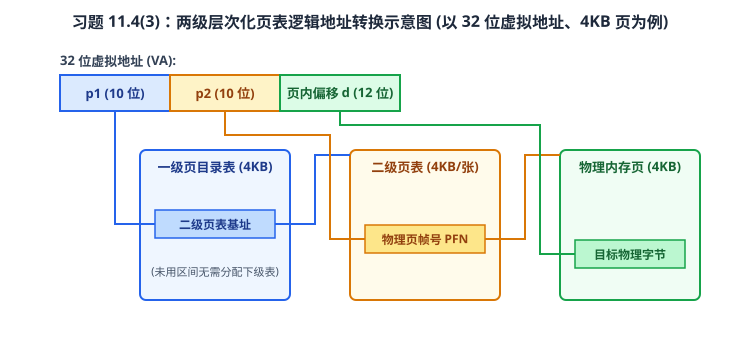

---

### 习题 11.5
**题目**：已知一台计算机的虚地址为 48 位，物理地址为 40 位，页大小为 $16\text{ KB}$，TLB 为 64 项全相联，TLB 的每项包括一个虚页号 `vpn`，一个物理页号 `pfn`，以及一个有效位 `valid`，请根据如下模块接口写出一个 TLB 的地址查找部分的 Verilog 代码。
```verilog
module tlb_cam(vpn_in, pfn_out, hit, ...);
```
其中，`vpn_in` 为输入的虚页号，`pfn_out` 为输出的物理页号，`hit` 为表示是否找到的输出信号；“...”表示与该 TLB 输入输出有关的其他信号。重复的代码可以用“...”来简化。
**解答与解析**：
1. **地址位宽计算**：
   - 页大小为 $16\text{ KB} = 2^{14}\text{ B}$，故页内偏移（Page Offset）为 **$14$ 位**。
   - 虚地址 48 位 $\implies$ **虚页号 `vpn_in` 位宽 $= 48 - 14 = 34$ 位**（`[33:0]`）。
   - 物理地址 40 位 $\implies$ **物理页号 `pfn_out` 位宽 $= 40 - 14 = 26$ 位**（`[25:0]`）。
   - 每个 TLB 表项共包含：$1\text{ bit valid} + 26\text{ bits pfn} + 34\text{ bits vpn} = \mathbf{61\text{ bits}}$（`[60:0]`）。

2. **TLB 地址查找部分 Verilog 代码**：
```verilog
module tlb_cam (
    input  [33:0] vpn_in,     // 48 - 14 = 34 位输入虚页号
    output [25:0] pfn_out,    // 40 - 14 = 26 位输出物理页号
    output        hit,        // TLB 命中信号
    output        valid_out   // 命中项的有效位输出 (也可将 valid 直接并入 hit 判断)
);

    // 64 项全相联 CAM/RAM 表项定义:
    // [60]    : valid (1 bit)
    // [59:34] : pfn   (26 bits)
    // [33:0]  : vpn   (34 bits)
    reg  [60:0] cam_content [63:0];
    wire [63:0] entry_hit;

    // 64 路并行 CAM 虚页号比较
    assign entry_hit[ 0] = (vpn_in == cam_content[ 0][33:0]);
    assign entry_hit[ 1] = (vpn_in == cam_content[ 1][33:0]);
    // ...
    assign entry_hit[63] = (vpn_in == cam_content[63][33:0]);

    // 是否找到匹配项 (Hit)
    assign hit = |entry_hit;

    // 读出命中项的 26 位物理页号 pfn_out
    assign pfn_out = ({26{entry_hit[ 0]}} & cam_content[ 0][59:34]) |
                     ({26{entry_hit[ 1]}} & cam_content[ 1][59:34]) |
                     // ...
                     ({26{entry_hit[63]}} & cam_content[63][59:34]);

    // 读出命中项的有效位 valid_out
    assign valid_out = (entry_hit[ 0] && cam_content[ 0][60]) ||
                       (entry_hit[ 1] && cam_content[ 1][60]) ||
                       // ...
                       (entry_hit[63] && cam_content[63][60]);

endmodule
```

---

## 第12章 多处理器系统

### 习题 12.1
**题目**：对于一个有 $p$ 个处理器的共享存储系统。
- **(1)** 请写出一段程序，用 `load`/`store` 指令、运算指令和转移指令实现一个自旋锁。
- **(2)** 请写出一段程序，用 `load`/`store` 指令、运算指令和转移指令实现一个公平的自旋锁。
- **(3)** 用 `load`/`store` 指令、运算指令和转移指令实现一个公平的自旋锁，最少需要访问多少个内存地址？
**解答与解析**：
> **【说明】**：第 12.1 题要求**仅使用普通的 `load`/`store` 指令、运算指令和转移指令**（不使用特殊硬件原子同步原语，软件实现互斥，如 Peterson 推广的 Filter Lock 过滤锁与 Lamport 面包店算法）；同时下面也一并给出基于 MIPS `LL`/`SC` 汇编的同步实现作为对照参考：

#### 方式 A：纯普通 `load`/`store` 指令软件实现（无需硬件原子指令，假设顺序一致性 SC）
**(1) $p$ 个处理器的自旋锁（Peterson 推广的 Filter Lock 过滤锁算法）**：
设置两个长度为 $p$ 的共享数组：`level[p]`（记录每个线程当前进入的等待层级 $0 \dots p-1$，初值全 0）和 `victim[p]`（记录每一层的礼让等待者，使用 $1 \dots p-1$）：
```c
int level[p]  = {0};
int victim[p] = {0};

void lock(int tid) {
    for (int L = 1; L < p; L++) {
        level[tid] = L;          // Store: 声明本线程试图进入第 L 层
        victim[L]  = tid;        // Store: 礼让，将自己设为第 L 层的牺牲者
        // Load & Branch: 若存在其他线程 k 的层级 >= L，且 victim[L] 仍为自己，则自旋等待
        for (int k = 0; k < p; k++) {
            if (k == tid) continue;
            while (level[k] >= L && victim[L] == tid) { /* spin */ }
        }
    }
}

void unlock(int tid) {
    level[tid] = 0;              // Store: 退出临界区，层级归零
}
```

**(2) $p$ 个处理器的公平自旋锁（Lamport 面包店算法，Lamport's Bakery Algorithm，先来先服务 FIFO）**：
每个试图加锁的线程像在面包店排队一样先领一个递增的号码牌 `number[tid]`，按 `(number[i], i)` 的字典序从小到大依次进入临界区，严格保证先到先服务（无饥饿、完全公平）：
```c
int  number[p]   = {0};
bool entering[p] = {false};

void lock(int tid) {
    entering[tid] = true;        // Store: 正在取号
    int max_num = 0;
    for (int i = 0; i < p; i++) {
        int n = number[i];       // Load
        if (n > max_num) max_num = n;
    }
    number[tid]   = max_num + 1; // Store: 领到比当前最大号大 1 的号牌
    entering[tid] = false;       // Store: 取号完毕

    for (int i = 0; i < p; i++) {
        if (i == tid) continue;
        while (entering[i]) { /* 等待正在取号的线程取完号 */ }
        // 若线程 i 持有有效号牌，且 (number[i], i) < (number[tid], tid)，则自旋等待线程 i 先执行
        while (number[i] != 0 &&
               (number[i] < number[tid] || (number[i] == number[tid] && i < tid))) {
            /* spin */
        }
    }
}

void unlock(int tid) {
    number[tid] = 0;             // Store: 释放号牌
}
```

**(3) 仅用普通 `load`/`store` 指令实现 $p$ 处理器公平自旋锁最少需要访问的内存地址数**：
- **答案**：最少需要访问 **$p$ 个独立的内存地址**（每个处理器核至少拥有 1 个只有它自己写、其他处理器读的共享内存地址）。
- **证明（反证法）**：
  - 假设只需要 $i\ (i < p)$ 个内存地址。由于普通 `store` 指令没有“读-改-写”原子性，当在某一时刻全部 $p$ 个处理器同时想要申请锁并向这 $i$ 个内存地址执行 `store` 写入自己的申请意图（或排队的序号）时，根据抽屉原理（鸽巢原理），因为 $i < p$，必然至少有两个处理器同时向同一个内存地址执行 `store` 写操作；
  - 后写入的处理器会直接**覆盖（Overwrite）**先写入处理器的申请信息，导致其他处理器根本不知道被覆盖的那个处理器正在申请锁，从而无法按照请求先后顺序提供公平服务（甚至破坏互斥性）。因此，仅用普通 `load`/`store` 指令最少需要 **$p$ 个**内存地址。

#### 方式 B：使用 MIPS `LL`/`SC` 汇编实现的自旋锁与排队锁（扩展对照）
1. **简单自旋锁（设 `$a0` 为锁变量地址，初值为 0）**：
```mips
Lock:
1:  LL    $t0, 0($a0)       ; 读取锁状态 (0=未锁, 1=已锁)
    BNEZ  $t0, 1b           ; 若已被锁则自旋等待
    ADDIU $t0, $t0, 1       ; 置 $t0 = 1
    SC    $t0, 0($a0)       ; 条件存回 1
    BEQZ  $t0, 1b           ; 若 SC 失败 ($t0==0) 则跳回重试
    NOP
Unlock:
    SYNC                    ; 内存屏障
    SW    $0,  0($a0)       ; 写 0 释放锁
```
2. **公平排队自旋锁（Ticket Lock：32 位字高 16 位为发号计数器 `ticket`，低 16 位为当前服务号 `serve`）**：
```mips
Lock:
1:  LL    $v0, 0($a0)       ; 同时取回高 16 位 ticket 和低 16 位 serve
    LUI   $t0, 0x0001       ; $t0 = 0x00010000 (给高 16 位 ticket 加 1)
    ADDU  $t0, $t0, $v0
    SC    $t0, 0($a0)       ; 原子写回递增后的 ticket
    BEQZ  $t0, 1b           ; 若 SC 失败则重试
    NOP
    SRL   $v0, $v0, 16      ; $v0 = 本线程领到的排队号 my_ticket
2:  LHU   $t0, 0($a0)       ; 读取低 16 位当前服务号 serve (小尾端下位于偏移 0)
    BNE   $t0, $v0, 2b      ; 若 serve != my_ticket，则继续自旋等待
    NOP
Unlock:
    SYNC
    LHU   $t0, 0($a0)       ; 取出当前 serve
    ADDIU $t0, $t0, 1       ; serve + 1
    SH    $t0, 0($a0)       ; 存回低 16 位，唤醒下一个排队号
```
3. **采用 `LL`/`SC` 排队锁时的内存地址数**：需要 **2 个内存地址**（或高低半字合并在 1 个字中：一个记录当前服务者 `serve`，另一个记录当前排队最晚号码 `ticket`），同时每个进程使用自己的寄存器或内存地址记录自己拿到的号码。

---

### 习题 12.2
**题目**：请查阅硬件同步原语相关的文献。
- **(1)** 请列出两种硬件同步原语，并给出它们在处理器上实现。
- **(2)** 分析各种同步原语的优劣。
- **(3)** 用各种同步原语实现一个公平的自旋锁。
- **(4)** 用各种同步原语实现公平的自旋锁，分别最少需要访问多少个内存地址？
**解答与解析**：
**(1) 两种常见的硬件同步原语及其处理器实现**：
1. **比较并交换（`CAS`，Compare-And-Swap，代表处理器：Intel/AMD X86 的 `CMPXCHG`、SPARC 的 `CASA`）**：
   - **语义**：`CAS(reg_expect, reg_new, MemAddr)` —— 原子地读取内存单元 `Mem[Addr]` 的值与期望值 `reg_expect` 比较；若相等，则将新值 `reg_new` 写入 `Mem[Addr]` 并返回成功（或在 `reg_new`/`reg_expect` 中返回旧值/成功标志）；若不相等则不修改内存。
   - **处理器实现**：通过一条复合的**读-改-写（Read-Modify-Write）**指令实现。执行时，处理器核首先向 Cache 一致性网络发出独占写请求获取该 Cache 行的 **M（独占修改）状态**，并在指令执行期间**锁定该 Cache 行（Cache Line Lock，拒绝或推迟其他核对该 Cache 行的外部一致性请求）**（若跨 Cache 行则锁定系统总线 Bus Lock），在本地完成读取、比较和条件写入后再释放行锁。
2. **链接加载 / 条件存储（`LL`/`SC`，Load-Linked / Store-Conditional，代表处理器：MIPS、Alpha、PowerPC、ARM、RISC-V）**：
   - **语义**：将原子“读-改-写”拆分为成对的两条指令：`LL rt, offset(rs)` 从内存读取一个字到 `rt`，同时在处理器核内记录该物理地址；随后的 `SC rt, offset(rs)` 检查自 `LL` 以来该地址是否被其他处理器写入或发生异常中断：若未被干扰，则把 `rt` 写入内存并将 `rt` 置为 `1`（成功）；否则放弃写内存并将 `rt` 置为 `0`（失败）。
   - **处理器实现**：每个处理器核仅需增加一个**链接地址寄存器 `LLAddr`** 和一个 **1 位链接状态标志 `LLbit`**。执行 `LL` 时置 `LLbit = 1` 并记录物理地址；在 `LL` 与 `SC` 之间，硬件通过现有的 **Cache 一致性监听或目录无效消息**监控 `LLAddr` 所在的 Cache 行：一旦收到其他核对该行的写无效消息（Invalidate）或本核发生异常返回（`ERET`），硬件自动将 `LLbit` 清零；执行 `SC` 时仅当 `LLbit == 1` 才发起正常的 Cache 写操作，无需锁定总线或 Cache 行。
   *(注：其他常见硬件同步原语还有 **测试并置位 `Test-and-Set`**、**取并加 `Fetch-and-Add`**、**原子交换 `Swap / XCHG`** 等)*。

**(2) 各种硬件同步原语的优劣对比**：

| 硬件同步原语 | 优点 | 缺点 |
| :--- | :--- | :--- |
| **`LL` / `SC`<br>（链接加载/条件存储）** | 1. **彻底免疫 ABA 问题**：因为它是检测“在 `LL` 和 `SC` 期间该地址是否发生过写操作”，即便值从 $A \to B \to A$，Cache 一致性无效消息也会清除 `LLbit`。<br>2. **硬件实现最符合 RISC 原则**：将读和写拆成两条单向访存指令，不需要单条指令既读又写，也无需锁定总线或 Cache 行。 | 1. **高争用下容易发生“活锁（Livelock）”或 `SC` 频繁失败**：任何对同一 Cache 行的伪共享写、中断或上下文切换都会导致 `SC` 失败重来。<br>2. 在 `LL` 与 `SC` 之间不能插入过多指令或访存指令。 |
| **`CAS`<br>（比较并交换）** | 1. **功能通用性极强（无阻塞同步基石）**：单条指令保证至少有一个竞争线程能成功前进（无活锁），是构建无锁（Lock-free）队列和数据结构的核心原语。 | 1. **存在 ABA 问题**：若内存值由 $A$ 被改为 $B$ 又改回 $A$，`CAS` 会误以为未发生过改变而成功（需附加版本号解决）。<br>2. **硬件实现复杂**：单条指令需同时完成内存读、比较、内存写并锁定 Cache 行，指令还需要 3 个操作数（地址、期望值、新值）。 |
| **`Test-and-Set` / `Swap`** | 1. 指令语义与硬件实现比较简单，非常适合直接实现简单的二值自旋锁。 | 1. **通用性差（共识数 Consensus Number 仅为 2）**：每次执行都会无条件发起写操作导致所有其他自旋核的 Cache 行失效（可用 Test-and-Test-and-Set 缓解），且很难直接高效构造复杂的无锁结构或公平排队锁。 |

**(3) 用 `CAS` 和 `LL`/`SC` 实现公平的自旋锁（Ticket Lock 排队自旋锁）**：
将一个 32 位共享锁变量 `lock_var`（地址存放在 `t0`）分为高 16 位 `ticket`（发号器，初值 0）和低 16 位 `serve`（当前服务号，初值 0）：
- **用 `CAS`（`cas r_expect, r_new, 0(r_addr)`，成功时 `r_new` 置 1，失败时 `r_new` 置 0）实现公平排队锁**：
```mips
Lock_CAS:
1:  LW    $t1, 0($t0)           ; 读取当前 {ticket, serve} 作为期望旧值
    LUI   $t2, 0x0001           ; 准备给高 16 位 ticket 加 1
    ADDU  $t2, $t1, $t2         ; $t2 = {ticket + 1, serve} (新值)
    CAS   $t1, $t2, 0($t0)      ; 若 0($t0) == $t1，则写入 $t2 并置 $t2 = 1，否则置 $t2 = 0
    BEQZ  $t2, 1b               ; 若 CAS 失败则重试取号
    NOP
    SRL   $v0, $t1, 16          ; 取出自己拿到的排队号 my_ticket = 旧 ticket
2:  LHU   $t3, 0($t0)           ; 读取低 16 位当前服务号 serve
    BNE   $t3, $v0, 2b          ; 若 serve != my_ticket，则自旋等待
    NOP

Unlock_CAS:
    SYNC
    LHU   $t3, 0($t0)           ; 读取当前 serve
    ADDIU $t3, $t3, 1           ; serve + 1
    SH    $t3, 0($t0)           ; 写回低 16 位，唤醒下一位
```
- **用 `LL`/`SC` 实现公平排队锁**：
```mips
Lock_LLSC:
1:  LL    $t1, 0($t0)           ; 链接加载当前 {ticket, serve}
    LUI   $t2, 0x0001
    ADDU  $t2, $t1, $t2         ; 高 16 位 ticket 加 1
    SC    $t2, 0($t0)           ; 条件存储新 {ticket + 1, serve}
    BEQZ  $t2, 1b               ; 若 SC 失败则重试
    NOP
    SRL   $v0, $t1, 16          ; 取出自己拿到的排队号 my_ticket = 旧 ticket
2:  LHU   $t3, 0($t0)           ; 读取低 16 位当前服务号 serve
    BNE   $t3, $v0, 2b          ; 若 serve != my_ticket，则自旋等待
    NOP

Unlock_LLSC:
    SYNC
    LHU   $t3, 0($t0)
    ADDIU $t3, $t3, 1
    SH    $t3, 0($t0)
```

**(4) 用各种同步原语实现公平自旋锁最少需要访问的内存地址数**：
1. **如果只用互斥二值自旋锁组合，或考虑 `LL`/`SC` 在硬件不保证前向进度（无硬件远端请求推迟机制，竞争写同一地址会导致 `SC` 无限失败）的严格理论公平性**：
   - **`CAS`（或 `Fetch-and-Add`）**：最少只需 **$1$ 个（若 `ticket` 和 `serve` 拼在一个字内）或 $2$ 个内存地址**（一个地址记录排队发号 `ticket`，一个地址记录当前服务者 `serve`；因为硬件保证并发 `CAS` 仲裁时必有 1 个处理器成功，写请求不会被静默覆盖）。
   - **`LL`/`SC`**：
     - 在**工程实现（Ticket Lock）**中，同样只需 **$1$ 个（高低半字合并）或 $2$ 个内存地址**（`ticket` 和 `serve`）；
     - 但在**严格无饥饿理论证明**中，由于多个核对同一地址并发执行 `LL`/`SC` 时可能因互相使对方的 `LLbit` 失效而导致某个核的 `SC` 总是失败，若要从理论上绝对保证公平不饥饿，则需要 **$p$ 个（即 $n$ 个）内存地址**让每个进程各自在独立地址上登记请求意愿。

---

### 习题 12.3
**题目**：加速比的定义是：使用增强措施时完成整个任务的性能 / 不使用增强措施时完成整个任务的性能。
- **(1)** 请给出一个例子，使用多线程能获得超线性加速比（即采用多个线程比单个线程运行时间减少的倍数超过了线程数）。
- **(2)** 上述例子是否违背了 Amdahl 定律。
**解答与解析**：
**(1) 多线程获得超线性加速比（Superlinear Speedup，即 $p$ 个处理器核上的加速比 $S > p$）的典型例子**：
1. **多核聚合 Cache 容量效应（Cache Effect，最常见原因）**：
   - 例如，某大型排序或矩阵迭代科学计算程序的工作集大小为 $4\text{ MB}$。
   - 在 **1 个处理器核**（假设单核私有 L2 Cache 为 $512\text{ KB}$）上单线程运行时，由于 $4\text{ MB} > 512\text{ KB}$ 的 Cache 容量，程序发生剧烈的 Cache 容量缺失，大量时间消耗在访问慢速主存（DRAM）上；
   - 当划分为 **8 个线程在 8 个处理器核**上并行运行时，8 个核的聚合 L2 Cache 总容量达到了 $8 \times 512\text{ KB} = 4\text{ MB}$，每个核分摊的 $512\text{ KB}$ 子工作集**完全装入了各自的私有 Cache 中**！这样不仅计算量被 8 个核分摊，而且消除了绝大多数访问主存的延迟（平均访存速度还额外提升了几倍），最终总运行时间缩短为单核的 $1/12$ 甚至 $1/16$（加速比 $S = 12 \sim 16 > 8$）。
2. **并行分支限界与启发式剪枝搜索算法（Parallel Branch-and-Bound / Depth-First Search）**：
   - 在树搜索或NP难组合优化问题中，单线程顺序搜索可能先走入了一个庞大的非最优子树；而多线程并行探索不同子树时，某个线程很快找到了一个极优解并共享给所有线程作为全局剪枝界（Bound），使得其他线程立即剪掉了原本需要耗费大量时间搜索的无效分支，导致**多线程实际执行的总工作量远少于单线程的工作量**，从而获得超线性加速比。

**(2) 是否违背了 Amdahl 定律**：
- **结论**：**并不违背 Amdahl 定律**。
- **原因**：Amdahl 定律写成 $S = \frac{1}{(1 - f) + f / k}$ 时，通常默认并行部分的加速因子 $k$ 最多等于处理器核数 $p$（隐含假设是：**单次基本操作的平均耗时不变**且**总计算工作量不变**）。而在上述超线性加速比的例子中：
  - 由于聚合 Cache 容量增大消除了主存访问缺失，或者并行剪枝减少了总搜索节点数，使得并行部分的实际加速因子 **$k > p$**（每个核不仅分摊了 $1/p$ 的任务，而且执行每条指令的 CPI 也因 Cache 命中率跃升而显著降低）；
  - 将真实的 $k > p$ 代入 Amdahl 定律公式 $S = \frac{1}{(1 - f) + f / k}$，自然允许 $S > p$，因此与 Amdahl 定律完全自洽、毫不矛盾。

---

### 习题 12.4
**题目**：在共享存储多处理器系统中假共享会带来不可忽视的性能损失，为了尽量减少假共享的发生，程序员在写程序时应注意些什么？
**解答与解析**：
- **假共享（False Sharing）的成因**：两个或多个不同处理器核上的线程频繁修改**逻辑上彼此独立、但物理地址恰好位于同一个 Cache 行（如同一个 64 字节块）内**的不同变量；由于硬件 Cache 一致性协议是以**整个 Cache 行**为最小维护单位的，一个核写自己的变量会导致其他核的整个 Cache 行频繁失效（Ping-pong 乒乓效应），带来严重的一致性通信开销。
- **程序员在编写并行程序时减少假共享的关键措施**：
  1. **数据结构对齐与填充（Cache-Line Alignment & Padding）**：
     - 对不同线程高频独立写入的全局变量、锁变量或线程状态结构体，使用编译对齐属性（如 `__attribute__((aligned(64)))`）或在结构体中插入填充字节（Padding），确保不同线程写的变量**分配在不同的 Cache 行上**。
  2. **使用线程私有局部变量累加，减少共享内存写频率（Use Thread-Local Variables）**：
     - 例如当多个线程更新全局数组 `sum[tid]` 时，不要在循环内部每次迭代都直接写共享数组 `sum[tid] += ...`，而是先在线程私有的**栈局部变量（会被编译器分配在寄存器中）** `local_sum` 中完成全部累加，仅在循环结束时执行 1 次 `sum[tid] = local_sum`。
  3. **按线程分块划分数组访存区间（Chunking / Contiguous Block Partitioning）**：
     - 多线程并行写同一个数组时，避免按“交错步长 1（`tid, tid+p, tid+2p...`）”分配给不同线程，而应按**连续大块（且块边界按 Cache 行大小对齐）**划分给各个线程，使同一 Cache 行内的所有元素只由同一个线程读写。
  4. **将结构体中的“只读字段”与“各线程高频改写字段”分离**：
     - 避免将所有线程都需要频繁读取的只读配置数据与某个线程频繁改写的计数器放在同一个小结构体（同一 Cache 行）中。

---

### 习题 12.5
**题目**：在基于目录的 cache 一致性系统中，目录记载了 P1 处理器已经有数据块 A 的备份。
- **(1)** 哪些情况下目录会又收到了一个 P1 对 A 块访问的请求。
- **(2)** 如何正确处理上述情况？
**解答与解析**：
**(1) 目录已记载 P1 拥有数据块 A 的备份，却又收到 P1 对 A 块访问请求的两种典型情况**：
1. **情况一（权限升级请求）：P1 原本只拥有 A 块的只读共享副本（`S` 状态），现在 P1 要对 A 块执行写操作**：
   - P1 会向宿主目录（Home Directory）发送**写升级/请求独占权（Write Miss / Upgrade Request）**消息，此时目录虽记载 P1 在共享者集合中，但仍会收到 P1 对 A 块的写请求。
2. **情况二（片上网络消息乱序 / 替换与重访竞争 Race Condition，本题核心考点）**：
   - P1 此前已经将 A 块从自己的私有 Cache 中**替换了出去（Eviction / Replacement）**，并向目录发送了**替换通知/写回消息（Replacement / Writeback Message）**；
   - 紧接着 P1 又需要访问 A 块，此时在 P1 本地 Cache 中发生缺失，于是 P1 立即又向目录发送了一个新的**读/写缺失请求（Miss Request）**；
   - 如果片上互连网络（NoC）不保证同一源到同一目的点对点消息的严格顺序（或者替换消息与缺失请求走了不同的虚拟通道/物理路径），导致**后发出的 `Miss` 访问请求越过了先发出的 `Replacement` 替换消息，先一步到达了目录节点**！此时在目录看来，P1 明明还持有 A 块的备份，却又发来了一个针对 A 块的缺失请求。

**(2) 正确处理上述替换与重访消息竞争的方法**：
1. **方法一（由网络层与虚拟通道保证点到点顺序）**：
   - 在互连网络设计中，保证从同一个源节点发往同一个目的节点的请求消息按严格先进先出（FIFO）顺序传输，使后发出的 `Miss` 请求绝对不会超越先发出的 `Replacement` 消息。
2. **方法二（由目录控制器识别竞争并暂缓/重试处理）**：
   - **暂缓等待（Stall / Buffer at Directory）**：当目录收到 P1 的 `Miss` 请求但发现目录状态仍记录 P1 持有该块（如 P1 处于 `M` 状态却发来 `Read Miss`）时，目录控制器识别出 P1 的替换写回消息尚在网络传输途中，于是将该 `Miss` 请求**暂挂（Buffer/Sleep）在目录等待队列中**，等到 P1 先前发出的替换/写回消息到达目录并更新完目录状态和数据后，再响应 P1 的 `Miss` 请求。
   - **或者发送负确认重试（NACK / Retry）**：目录向 P1 返回一个 `NACK`（拒绝并要求稍后重试）消息，让 P1 等待替换事务彻底完成后再重新发送 `Miss` 请求（同时为防止死锁，赋予写回/响应消息比普通请求消息更高的网络虚拟通道优先级）。

---

### 习题 12.6
**题目**：假设在一个双 CPU 多处理器系统中，两个 CPU 用单总线连接，并且采用监听一致性协议（MSI），cache 的初始状态均为无效，然后两个 CPU 对内存中同一数据块进行如下操作：CPU A 读、CPU A 写、CPU B 写、CPU A 读，写出每次访问后两个 CPU 各自的 cache 的状态变化。
**解答与解析**：
在基于总线监听的 **MSI 一致性协议** 中，每个 Cache 行的三种状态为：**`I`（Invalid，无效）**、**`S`（Shared，共享干净）**、**`M`（Modified，独占修改/脏）**。每次访问后的状态变化及总线事务如下表所示：

| 步骤 | 访存事件 | 总线事务与一致性动作说明 | **CPU A 的 Cache 状态** | **CPU B 的 Cache 状态** |
| :-: | :--- | :--- | :-: | :-: |
| 0 | **初始状态** | 两个 CPU 的 Cache 均未缓存该数据块 | **`I`** | **`I`** |
| 1 | **CPU A 读** | CPU A 发生读缺失，在总线上发出读请求（`BusRd`），主存提供数据块，CPU A 进入共享态 `S` | **`S`** | **`I`** |
| 2 | **CPU A 写** | CPU A 欲写 `S` 态块，在总线上发出作废/写升级请求（`BusUpgr` / `BusRdX`），进入独占修改态 `M` | **`M`** | **`I`** |
| 3 | **CPU B 写** | CPU B 发生写缺失，在总线上发出读独占请求（`BusRdX`）；处于 `M` 态的 CPU A 监听到后，将最新脏数据写回主存/提供给 CPU B，并将自身状态作废为 `I`；CPU B 获得块并写入，进入 `M` 态 | **`I`** | **`M`** |
| 4 | **CPU A 读** | CPU A 发生读缺失，在总线上发出读请求（`BusRd`）；处于 `M` 态的 CPU B 监听到后，将最新修改的数据提供给总线上（同时写回主存）并将自身状态降级为 `S`；CPU A 读入数据也进入 `S` 态 | **`S`** | **`S`** |

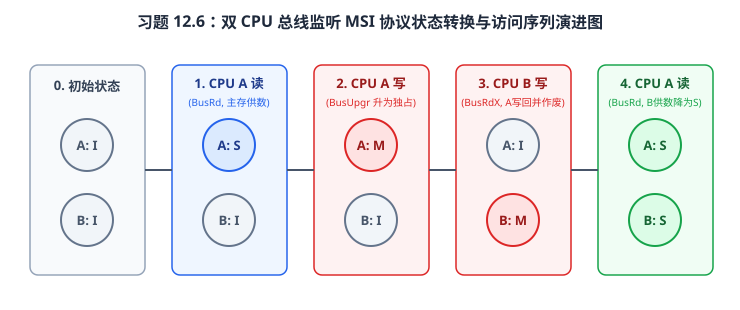

---

### 习题 12.7
**题目**：在下面程序段中，`A, B, C, D` 为进程 `P1, P2, P3` 的共享变量，且初始值均为 0。该程序的正确运行结果是 `D = 2000`。
```c
// P1                // P2                       // P3
A = 2000;            while (B != 1) { ; }        while (C != 1) { ; }
B = 1;               C = 1;                      D = A;
```
- **(1)** 在一个用可伸缩网络连接、采用基于目录的 cache 一致性协议的分布式共享存储系统中运行上述程序得到结果是 `D = 0`，请解释产生上述结果的原因。
- **(2)** 在实现顺序一致性的分布式共享存储系统中，对上述程序施加什么限制可以保证执行结果的正确性。
- **(3)** 在实现弱一致性的分布式存储系统中，采用 `barrier` 进行同步，请问上述程序如何插入 `barrier` 操作才能保证执行的正确性？
**解答与解析**：
**(1) 在分布式目录协议系统中产生 `D = 0` 的原因**：
- 在可伸缩互连网络连接的分布式共享存储（DSM）系统中，不同共享变量 `A, B, C` 分布在不同的宿主节点或通过不同路径传输消息。
- 当进程 `P1` 依次执行 `A = 2000` 和 `B = 1` 时，若系统**未等待 `A = 2000` 对所有远程处理器核（特别是 `P3`）的写无效（Invalidation）确认消息全部返回**，就继续执行了 `B = 1`：
  - `P1` 对 `B = 1` 的修改很快被 `P2` 看到；
  - `P2` 跳出 `while (B != 1)` 循环并立即执行 `C = 1`；
  - `P2` 对 `C = 1` 的修改又很快到达 `P3`，使 `P3` 跳出 `while (C != 1)` 循环并立即执行 `D = A`；
  - 而此时，由于网络延迟或乱序，**`P1` 最初执行的 `A = 2000` 所触发的针对 `P3` 本地 Cache 中变量 `A` 的写无效消息（或新值更新）仍被阻塞在网络中，尚未到达 `P3`**！因此 `P3` 从自己的 Cache 中读出了 `A` 的初始旧值 `0`，导致最终结果为 `D = 0`（违反了写原子性 Write Atomicity / 因果一致性）。

**(2) 在已经实现顺序一致性（Sequential Consistency, SC）的系统中需要施加的限制**：
- **答案**：**无需对程序本身施加任何额外的同步限制**！
- **原因**：因为**顺序一致性（SC）硬件模型本身就严格保证**：① 每个处理器核内部的访存操作完全按程序顺序（Program Order）执行（即 `P1` 中 `A = 2000` 必定先于 `B = 1` 全局生效，`P2` 中读 `B == 1` 必定先于 `C = 1`，`P3` 中读 `C == 1` 必定先于 `D = A`）；② 写操作具有**全局写原子性（Write Atomicity）**（一个写操作只有对系统中所有处理器核都可见/所有旧副本均已作废确认后，才允许发射下一条访存操作）。因此通过传递性：
  $$(A = 2000) \prec (B = 1) \prec (\text{P2 读到 } B = 1) \prec (C = 1) \prec (\text{P3 读到 } C = 1) \prec (D = A)$$
  在顺序一致性系统下，`P3` 执行 `D = A` 时必定能读到 `A = 2000`，程序无需修改即天然正确。

**(3) 在弱一致性（Weak Consistency）系统中通过插入 `barrier`（栅障）保证正确性的方案**：
- 在弱一致性模型中，普通的数据读写操作可以被硬件任意乱序执行和延迟传播，只有到达显式的同步操作（如 `barrier` 栅障或 `fence` 内存屏障）时，硬件才确保在进入 `barrier` 之前发起的所有访存写操作都已全局完成并对所有处理器核可见。
- **方案一（保留原 `while` 循环，用两道全局 `barrier` 同步三个进程间的数据传递）**：
  - 第 1 道栅障 **`barrier1`**：放在 `P1` 完成 `A = 2000; B = 1;` **之后**，以及 `P2`、`P3` 开始执行**之前**（确保 `A = 2000` 和 `B = 1` 对 `P2, P3` 已经全局可见）；
  - 第 2 道栅障 **`barrier2`**：放在 `P1` 的 `barrier1` **之后**、`P2` 完成 `C = 1;` **之后**，以及 `P3` 开始执行 `while (C != 1)` 和 `D = A` **之前**（确保 `C = 1` 和 `A = 2000` 对 `P3` 已经全局可见）：
```c
// P1                // P2                       // P3
A = 2000;            barrier1;                   barrier1;
B = 1;               while (B != 1) { ; }        barrier2;
barrier1;            C = 1;                      while (C != 1) { ; }
barrier2;            barrier2;                   D = A;
```
- *(注：如果是在同一进程内部插入**局部内存屏障 `mem_barrier` / `fence`** 而不使用跨进程集合栅障，则只需在 `P1` 的 `A = 2000` 与 `B = 1` 之间、在 `P2` 的 `while (B != 1)` 与 `C = 1` 之间、以及在 `P3` 的 `while (C != 1)` 与 `D = A` 之间各插入一条 `fence` 指令即可)*。

---

### 习题 12.8
**题目**：有以下两个并行执行的进程，在顺序一致性和弱一致性下，它各有几种正确的执行顺序，给出执行次序和最后的正确结果（假设 `a` 和 `b` 的初始值为 0）。
```c
// P1                // P2
a = 1;               b = 1;
print b;             print a;
```
**解答与解析**：
记 `P1` 的两条语句为 $S_{1a}: \text{`a = 1`}$ 和 $S_{1b}: \text{`print b`}$；记 `P2` 的两条语句为 $S_{2a}: \text{`b = 1`}$ 和 $S_{2b}: \text{`print a`}$。

#### 1. 在顺序一致性（Sequential Consistency, SC）下
根据 Lamport 的顺序一致性定义，所有进程的操作必须表现为某一个全局统一的串行交织顺序，且**每个进程内部的操作必须严格保持其程序顺序**（即必须满足 $S_{1a} \prec S_{1b}$ 且 $S_{2a} \prec S_{2b}$）。
两个各含 2 条语句的序列保持内部顺序的交织方式共有 $\binom{4}{2} = 6$ 种拓扑执行次序，对应 **3 种可能的打印输出结果**（绝对**不可能**出现 `a = 0, b = 0`）：
1. **结果一：打印出 `a = 1, b = 1`**（两个写操作都先于或至少在对方打印前完成，共 4 种具体指令交织次序）：
   - 次序 ①：`a = 1` $\to$ `b = 1` $\to$ `print b` $\to$ `print a`
   - 次序 ②：`a = 1` $\to$ `b = 1` $\to$ `print a` $\to$ `print b`
   - 次序 ③：`b = 1` $\to$ `a = 1` $\to$ `print b` $\to$ `print a`
   - 次序 ④：`b = 1` $\to$ `a = 1` $\to$ `print a` $\to$ `print b`
2. **结果二：打印出 `a = 1, b = 0`**（`P1` 先完整执行完，再执行 `P2`）：
   - 次序 ⑤：`a = 1` $\to$ `print b`（读到 0）$\to$ `b = 1` $\to$ `print a`（读到 1）
3. **结果三：打印出 `a = 0, b = 1`**（`P2` 先完整执行完，再执行 `P1`）：
   - 次序 ⑥：`b = 1` $\to$ `print a`（读到 0）$\to$ `a = 1` $\to$ `print b`（读到 1）

*(按两个进程中 `a` 和 `b` 的读写先后关系归纳，即为 **3 种等价结果执行序**：① `a=1` 先于 `print a` 且 `b=1` 先于 `print b` $\implies a=1, b=1$；② `a=1` 先于 `print a` 且 `print b` 先于 `b=1` $\implies a=1, b=0$；③ `print a` 先于 `a=1` 且 `b=1` 先于 `print b` $\implies a=0, b=1$)*。

#### 2. 在弱一致性（Weak Consistency）下
由于程序中没有任何同步操作（无 `fence` / `barrier`），弱一致性允许处理器核内部对**不同地址的写与读操作进行重排序（Write-to-Read Reordering）**，或者将写操作暂存在本地写缓冲（Store Buffer）中而让后面的读操作绕过写操作先行执行。
因此，除了顺序一致性允许的上述 **3 种结果（6 种顺序）** 外，还允许出现**第 4 种执行结果**：
4. **结果四：打印出 `a = 0, b = 0`**：
   - **执行次序**：`print a` 先于 `a = 1` 生效（读到 `a = 0`），**同时** `print b` 先于 `b = 1` 生效（读到 `b = 0`），例如交织次序为：`print b` $\to$ `print a` $\to$ `a = 1` $\to$ `b = 1`。
- **汇总**：按最终输出状态划分，顺序一致性下有 **3 种**正确结果（`{a=1, b=1}`, `{a=1, b=0}`, `{a=0, b=1}`），弱一致性下有 **4 种**正确结果（多了 `{a=0, b=0}`）。
